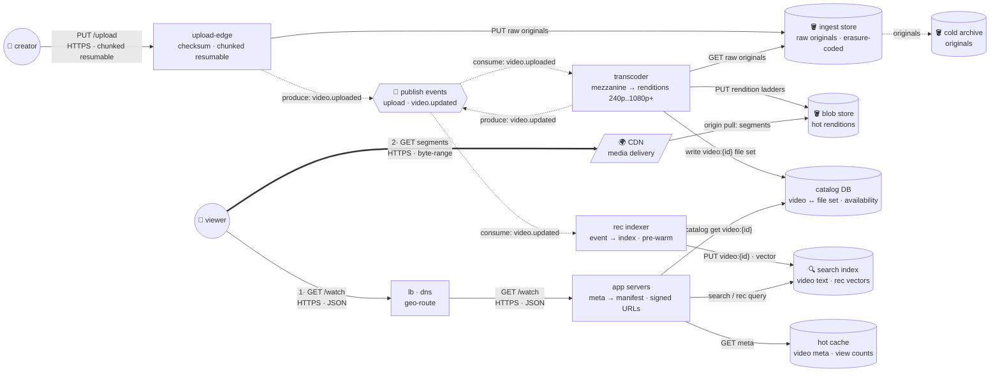

# 03 — High-level architecture

Two mostly independent planes: the **content plane** (the bytes) and the **control plane**
(metadata, API, discovery). The content plane is 99.99% of the traffic and almost never
touches your application servers.

## Diagram

View-count telemetry (the write side of the like/view counters, and the full event
pipeline behind them) is out of this bytes-flow diagram's question; it is designed in
deep dive 5 (View counts & metadata at billions-scale) below.

Q: How do upload bytes and watch bytes flow — what touches the app servers, and what only crosses the CDN?

## Components

| Component | Job | Notes |
|---|---|---|
| Upload edge | accept + checksum + chunked resumable upload | terminates the TCP/HTTP close to user for speed |
| Ingest store | durable raw object storage | original file kept (re-encode later); 3× replic. or erasure-coded |
| Transcoding pipeline | raw → renditions | async DAG: split video into chunks (e.g., 2–10 s), transcode chunks in parallel, mux; see deep dives |
| Catalog DB | source of truth: video ↔ file set ↔ availability | strongly consistent; small rows, low QPS |
| Metadata services | video pages, channels, comments, like/view counters | eventually consistent counters (batch/aggregate) |
| Search / Recommendation | text search, "up next" | ML-heavy; can be fully degraded without failing watch |
| CDN | delivers ~all video bytes | the actual workhorse; origin shield to absorb back-to-back misses |
| Blob storage tiers | hot (SSD/HDD, first N days/hours by popularity) → cold/durable | lifecycle driven by the skew in popularity |

## Key data flows

**Publish**: upload → event "v=123 uploaded" → transcoding DAG finishes per-rendition →
catalog update "v=123 playable at set R" → fan out to search/rec index + invalidate/pre-warm.
Everything between upload and catalog update may fail/retry — idempotency keyed by
(video_id, rendition, segment_idx).

**Watch**: viewer hits app → app server calls catalog+metadata (cache-first) → returns
playback manifest with signed CDN URLs + rendition ladder → player downloads 4–10 s media
segments adaptively. The app server never streams video bytes.

## Where the money is

- ~1.4 EB/day through CDN (from estimates) → encoding bitrate policy and CDN hit ratio
  are the two levers that actually change P&L.
- Storage: keep originals (needed for future re-encodes) in cold storage, hot renditions
  sized by popularity curve.
