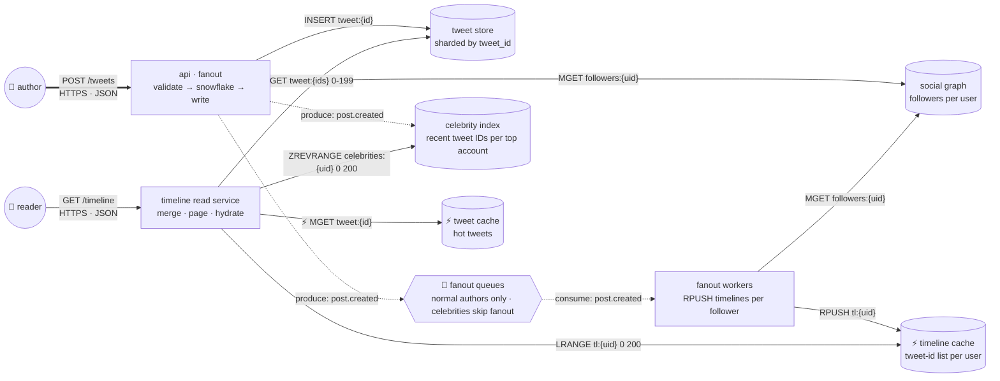

# 03 — High-level architecture

## Diagram

Q: How does one tweet reach every follower's timeline — and what a celebrity post changes on both the write and read paths?

## Components

| Component | Job | Key data |
|---|---|---|
| API / Fanout service | accepts post, writes tweet store, decides fanout strategy | tweet content, author, timestamp |
| Tweet store | durable tweets, sharded by tweet_id | text, author, counts, media refs |
| Tweet cache | hot tweets (recent + viral) | ~10–20% of fleet serving ~95% of hydration |
| Social graph service + store | who follows whom, in fanout-friendly form | follower lists per user (shardable by followed_id) |
| Timeline cache | per-user materialized list of tweet IDs | Redis consistent-hash sharded by user_id |
| High-fanout queue + workers | normal-author fanout, pipelined batches | author → followers, insert timeline entries in batches |
| Celebrity "recent tweets" index | fallback/merge source for on-read | ~top-N most-followed accounts → their recent tweet IDs |
| Timeline read service | merge + page timelines, handle read-your-own-writes | |
| Search / trend pipeline | ingest tweets into search index, trends aggregation | separate DAG, can lag |
| Media CDN | image/video bytes | bytes bypass app servers entirely (see [YouTube](../01.youtube/03-architecture.md)) |

## Key data flows

**Post (normal user)**: validate → write tweet store (authoritative, ID assigned here by
Snowflake) → synchronously return to author (read-your-own-writes: author's own timeline
render merges the real store, not the cache) → async fanout workers insert into ~300
follower timelines.

**Post (celebrity)**: same write, but fanout is skipped entirely — nothing is enqueued to
the fanout queues, so no follower timeline is written at post time. Timeline reads for
anyone who follows that celebrity
MERGE: timeline-cache entries ⊕ recent-tweets-from-celebrity-index, dedup by tweet ID.
(Real Twitter 2012 went further: no celebrity fanout queue at all — celebrity tweets were
served purely on-read from the Earlybird search index; see
[04-deep-dives](04-deep-dives.md) §1.)

**Read timeline**: read timeline cache (one Redis multi-get) → if author follows any
high-fanout accounts, merge their recent tweets on-read → hydrate tweet bodies from tweet
cache/store in batch → render. One user's timeline = a few cache round trips total, not N.

## Where the money is

- Timeline reads are the product: their p99 latency and their hit ratio define the design.
- The 180B/day fanout-insert rate (from estimates) is why Redis timeline caches exist at all
  — they're the only way to make read path O(1) instead of O(following_count).
