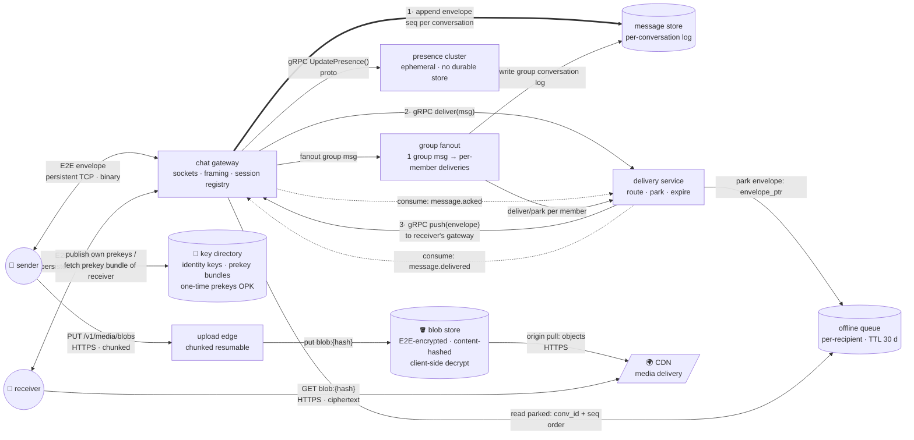

# 03 — High-level architecture

## Diagram

Q: What happens to one 1:1 message online vs offline, how a group message fans out — and why media takes a separate path?

## Components

| Component | Job | Key data |
|---|---|---|
| Chat gateway | terminate persistent sockets, TLS, protocol framing; ~1M conns/server | stateless-ish; knows the set of connected users |
| Message store | durable append-only per-conversation log | envelope (sender, ts, content-ciphertext, ID), never plaintext |
| Delivery service | routes message → recipient's online gateways, or parks for offline | per-recipient queue |
| Offline queue | per-recipient ordered buffer with TTL (say 30 days) | envelope pointers |
| Presence cluster | ephemeral online/offline/typing/last-seen, in-memory, best-effort | transient |
| Media blob store + CDN | stores encrypted blobs by hash, serves them | bytes bypass chat path |
| Identity / key directory | users' public keys, device lists (per Signal protocol) | public data, updated at registration / device-linking |
| Group fanout service | expands one group message → per-member deliveries | fanout logic, per-group |
| Spam/rate limiting | per-account limits, graph-based heuristics | see deep dives |

## Key data flows

**1:1, receiver online**: sender→gateway: write message store (assigns seq number within
conversation), then delivery service pushes to the receiver's gateway (lookup via in-memory
"who is connected to which gateway now" registry) → receiver ACKs → "delivered" state
propagated to sender (and read receipts when receiver opens). End-to-end: server is *route
+ mailbox*, not inspector.

**1:1, receiver offline**: write to store/parked queue; when receiver's gateway reconnects,
parked messages are delivered in `conversation_id + seq` order before any new ones.

**Group message**: fanout service writes the group conversation log once, then fanout
pushes/parks per member. For big groups (up to 1024 members — far smaller than a Twitter
celebrity's 100M followers), fanout is manageable synchronously; this is a bounded
fanout, unlike Twitter's (see [Twitter deep dives](../02.twitter/04-deep-dives.md)).

**Multi-device**: message is written once, delivered to each of the account's active
devices via per-device encryption (the sender's client encrypts per device's public key,
or a per-device message key wrapper).

## Where the money is

- **The connection fleet**: 100M concurrent sockets + a storm of reconnects. The design
  work is keeping that stable. The message store is a real but secondary system: ~1.5 TB/day
  (~45 TB at 30-day TTL) of envelope-scale records, ~175K writes/s from
  [estimates](02-scale-estimates.md) — about four orders of magnitude below the media path
  (~10 PB/day delivered) in bytes, but not a "few small DBs" either.
- **Delivery latency**: dominated by 2 hops (sender gateway → delivery service → receiver
  gateway), so minimize hops on hot path — the rest of the system is offline/error paths.
