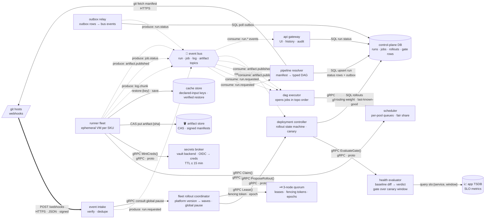

# 03 — Architecture

## High-level diagram

Q: How does a commit become a tested artifact and then a gated production rollout — and what does the event bus fan out?

## Components

1. **Event intake.** Webhook receivers, cron tickers, and a dispatch API. Verifies
   signatures, deduplicates webhook retries (idempotent ingestion keys: `(origin, event
   id, delivery id)`), and publishes `run.requested`. Stateless and horizontally
   scalable — intake must never be the thing that stops deploys.
2. **Pipeline resolver.** Checks out the manifest for the event's ref, interpolates matrix
   expansions and reusable-job includes, validates the DAG (cycles, unknown deps), and
   persists a typed, versioned DAG definition for the run. Deterministic: same event →
   same DAG, so replays are exact.
3. **Control-plane DB.** Sharded SQL, sharded by org (write volume case in 02). Rows are the *authoritative*
   state of runs, jobs, rollouts, gate evaluations. Writes happen transactionally with an
   **outbox row** consumed by a relay into the event bus — status and its event are
   published atomically, so consumers see a faithful stream without making the bus
   authoritative.
4. **Event bus.** Partitioned log, partition key = run id (keeps a run's event stream
   ordered). Used for fanout to UI, log indexing, audit, and downstream triggers. At-least-
   once delivery; every consumer dedups (run id, transition counter) — exactly the wire
   discipline in [WhatsApp's messaging design](../03.whatsapp/04-deep-dives.md).
5. **DAG executor.** One interpreter per running pipeline. Holds a run's DAG in memory,
   opens jobs in topological order, honors per-job `needs`, matrix fan-out, and `if:`
   conditions. Persists each transition; on executor crash another instance resumes from
   DB state (jobs are idempotent-by-design: cache-restore, verify-then-work).
6. **Scheduler.** Owns queues. Queues are **per-runner-pool partitions** (e.g. `linux-x64-
   small`, `gpu`, `windows`), each an ordered, durable list of claim-requests. Claims are
   leases (`lease token, TTL 60 s, heartbeat`) so a dead runner's job becomes re-claimable.
   Fairness across tenants is enforced at dequeue time (04, dive 1).
7. **Runner fleet.** Ephemeral VMs in per-SKU pools plus warm container slots. Agent does:
   claim → acquire fencing token → mint short-lived creds from broker → work → stream logs
   → publish artifact → report transition → die. Nothing persists on the VM between jobs.
8. **Artifact store.** Content-addressed (SHA-256 chunked) storage with an immutable
   signed manifest tying `(repo, pipeline, artifact name)` → content hash. GC by
   refcount-from-live-retention-policies, never by mtime scan (dive 2).
9. **Secrets broker.** Holds long-lived vendor credentials in a hardened vault; exposes
   only *minting*: job presents its platform-issued identity (OIDC token naming run, job,
   repo, ref) and receives narrowly-scoped credentials with TTL ≤ 15 min. Runners can
   never read stored secrets, only lease derived ones.
10. **Deployment controller.** A per-rollout state machine: `pending → canary:1% → gate →
    … → promote` or `→ rollback`. Single writer per rollout (leader per rollout id, with
    fencing tokens) — it is the only component that mutates environment routing weight.
11. **Health evaluator.** Stateless workers; for a gate, computes the metric delta
    (candidate vs baseline slices of the same TSDB query) and returns `promote | hold |
    rollback` with the evidence attached. Verdicts are advisory to the controller;
    *the controller decides* (this ownership split is the backbone of dive 4).
12. **Fleet rollout coordinator.** The platform deploys itself with the same mechanism it
    sells: waves over the platform fleet, each wave gated on platform health metrics, plus
    a global pause state that intake can consult (dive 5).

## Data flows

**Commit → tested artifact** (the CI path):

1. Push event → intake publishes `run.requested(repo, sha, reason)` → resolver builds DAG
   and creates run rows (status rows + outbox events).
2. DAG executor walks the graph; for each ready job it enqueues a claim-request on the
   right pool queue.
3. Runner claims, mints creds, restores cache (verify-before-use), works, streams log
   chunks to the bus, pushes artifacts to the CAS, reports success/failure with the fence
   token (stale tokens rejected — the job was re-claimed, this result is discarded).
4. On `artifact.published`, downstream jobs and the deployment controller are notified via
   the bus.

**Artifact → production** (the CD path):

1. Artifact address `(repo, sha, manifest-hash)` is proposed to `staging`: controller runs
   the declared strategy, gate on `staging` health, succeeds → artifact is **blessed**
   (recorded as the last-known-good address for the repo).
2. Proposal to `us-prod`: canary steps, each gate evaluated by the health evaluator over a
   10-min window; verdicts recorded as first-class gate rows.
3. Success → controller promotes to 100% and writes the new last-known-good record.
   Failure → controller flips routing back to the last-known-good address **address-based,
   not rebuild-based** — rollback cannot fail because "the old build no longer exists".
4. Every transition → outbox → bus → UI/audit.

**Platform self-deploy** (dive 5): fleet rollout coordinator proposes a platform version to
dogfood → waves → regional cohorts, each wave self-gated; the coordinator itself is
coordinated by a small 3-node quorum service (the usual group-membership pattern: leases,
fencing tokens, epoch numbers).

## Design decisions worth naming

- **DB-rows-are-authority, bus-is-fanout.** Option A (event-sourced everything, status is a
  projection) wins auditability and replay, loses operational debug-ability and makes
  "why is my run stuck" a stream archaeology problem. Option B (rows authoritative, events
  as notifications via outbox) wins simple queries and transactions, loses free replay. We
  pick B because the dominant operational tasks are latency and correctness questions about
  *current* state, which a query must answer directly.
- **Leases + fencing tokens for all work claims** (scheduler, rollout leadership): assumes
  at-least-once claim delivery and makes duplicates harmless.
- **Artifacts immutable, promotion by address**: removes an entire class of "we deployed
  something different than we tested" failures by making it impossible rather than
  enforced.
