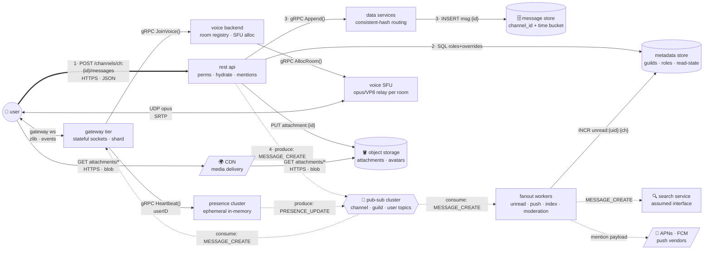

# 03 — Architecture

## High-level diagram

Q: How does one message reach every socket subscribed to a channel topic — and how do voice and presence bypass that path?

## Components

| Component | State it owns | Scalability axis |
|---|---|---|
| Gateway tier | per-session: socket, auth, shard assignment, zlib context, last seen | horizontal; sticky by user hash; sessions are stateful by design |
| REST/RPC API | none (stateless) | horizontal |
| Event bus / pub-sub | topic routing, per-channel topic membership on each gateway | horizontal; topics sharded by guild/channel id |
| Fanout/notification workers | none (stateless workers consuming topics) | horizontal; batch per-core |
| Data services layer | none (routing/coalescing shim) | horizontal; consistent-hash by channel_id |
| Message store | messages, partitioned by (channel_id, time bucket) | sharded; partition-per-channel |
| Metadata store | guild/channel/member/role/permission rows, read-state | sharded by guild_id / user_id |
| Presence cluster | ephemeral online/idle state per user across guilds | purely in-memory, sharded by user_id, self-healing |
| Object storage + CDN | attachment blobs | trivially horizontal |
| Voice SFUs | per-room media state, participant list | horizontal by room split; each room is one SFU instance |
| Voice backend | room registry, SFU allocation, signaling state | small; coordination only |

## Key data flows

### 1. Send a message (text channel)

1. Client → **API fleet** (REST or gateway socket message op) with channel_id + body.
2. API checks **permission** (role + channel overrides, hit-cached from metadata store).
3. API calls **data-services → message store** with a **snowflake-style
   timestamp-sortable ID** (same ID machinery as
   [Twitter §3](../02.twitter/04-deep-dives.md): timestamp | worker | sequence, which sort
   chronologically without a sort column and are needed again for pagination).
4. On durable write, the API **publishes `MESSAGE_CREATE`** to the channel's topic on the
   pub/sub cluster.
5. **Each gateway holding sockets subscribed to that topic** receives the event and fans
   out per-core (batched per-remote-node; see deep dive §2).
6. Fanout workers run async side-paths: unread-count increment, mention resolution → push
   notification (APNs/FCM), search indexing, moderation hook.

### 2. Join a guild

1. Fetch guild/channel/member/role snapshot (metadata store), compute the client's
   permission snapshot, deliver as **READY** payload over the gateway socket.
2. Subscribe the session to the guild's channel topics *that the client actually renders* —
   a key optimization: a 100k-member guild may have 50 channels; a client normally has 1
   channel open + a handful visible in its sidebar. Delivery subscriptions follow rendered
   visibility, not guild membership.
3. Pull **recent history** per visible channel (bounded window, e.g. 50 messages) and the
   client's **read-state rows** for the unread indicator.
4. Subscribe the session's **presence interest** for other members (usually lazy/limited
   to who the client will actually display).

### 3. Voice join

1. Client → **voice backend** with guild/channel; backend allocates/points to an **SFU**
   for that room (sticky per room).
2. Backend does NAT/ice/srtp signaling over the same gateway socket, then media switches to
   a **dedicated UDP path** to the SFU (voice media intentionally bypasses the chat TCP
   path — see requirements).
3. SFU relays opus frames to other participants; only RTCP feedback and participant-state
   changes travel back over the event bus (e.g. `VOICE_STATE_UPDATE`).

### 4. Presence

- A client heartbeats over its gateway session → presence cluster updates user status.
- Presence changes publish to **every guild the user is in** (bounded by guild sizes; the
  huge-guild fanout for presence is handled by the same "membership ≠ delivery" rules and
  per-core batching as message fanout — see deep dives §1, §2).
- Never persisted; on gateway loss, presence self-heals on the next heartbeat or on
  reconnect. Same trade-off as [WhatsApp §6](../03.whatsapp/04-deep-dives.md) §6.

## What's deliberately NOT in this diagram

- No database-replica reads shown — the data-services layer hides them (deep dive §5).
- No per-message "delivery ACK" from client to server — chat is at-most-once *display* but
  durable server-side (messages are not "delivered to your device", they are "written to
  the channel, and your device fetches/receives them"); this is a meaningful simplification
  vs WhatsApp's per-conversation ACK protocol.
- No cross-guild / cross-shard transactions — guild and channel mutations are
  single-partition by design; the few operations that span (e.g. guild rename →
  denormalized channel rows) eventually-consistent.
- No global rate limiter box — rate limiting lives at the edge (API fleet + gateway) and is
  enforced per-user, per-channel.
