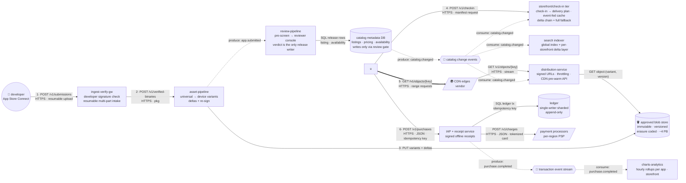

# 03 — Architecture

## High-level diagram

Q: How does a developer upload become a released app, and how do ~1B clients check in, download, and pay?



The review pipeline is the spine that connects developer writes to public reads:

```
 [Submission] -> [Automated pre-screen] -> [Review queue] -> [Reviewer console]
                    (crash-run, static)      (per-category       |
                                              routing,          v
                                              SLA timers)   APPROVE / REJECT
                                                                |        |
                              metadata-fix loop <- REJECTION    |        +-> (developer
                              or new binary resubmission        v             response loop)
                                              [Signing & Distribution Release]
```

## Components

1. **Ingest & Verify Gateway** — terminates developer uploads (resumable, checksummed,
   multi-part). Verifies the developer signature of the *submitted* binary. Nothing
   enters the asset pipeline unsigned.
2. **Asset Pipeline** — deterministic jobs: thin a universal package into
   device/OS variants; generate delta patches against retained predecessor versions;
   re-sign with the distribution certificate and embed provisioning profiles. Output:
   immutable objects (variant, version) + delta objects (from-version, to-version,
   variant) + a signed manifest of what was produced.
3. **Approved Binary Blob Store** — the only place client-facing bytes come from.
   Immutable, versioned, erasure coded. Deleting a version means clients lose it —
   tombstone-and-hydrate instead (see deep dive 1's failure modes).
4. **Delta/Manifest Service** — given (device model, OS, installed version), returns
   the cheapest valid delivery plan: delta chain, patch-applied size check, and a full
   fallback URL in the same response. The client never negotiates retries with the
   service — one request, one plan, then CDN.
5. **Distribution Service + CDN edges** — signed URLs, range requests, per-client
   throttling, pre-warm API for phased rollouts.
6. **Catalog Metadata DB** — listing rows, per-storefront price/availability, ratings
   aggregate. Writes only pass the review gate; reads eventually consistent across
   regions (deep dive 5).
7. **Search Cluster** — in-memory index over approved catalog only; indexer consumes
   catalog change events (deep dive 2).
8. **Review pipeline** — the state machine of deep dive 3, with a reviewer console,
   automated pre-screens, category-based routing, and SLA timers. Verdict is the only
   writer that flips a version from `pending` to `released`.
9. **IAP Service + Receipt Service + Payment processors** — exactly-once purchase core
   (deep dive 4), signed receipts handed to devices, per-region payment processing.
10. **Charts/Analytics** — consumes the transaction+delivery event stream, hourly
    rollups per (app, storefront, genre); serves read-only chart rows.

## Data flows

**Publish (write path).** Developer upload → verify → asset pipeline (variants, deltas,
sign) → blob store + delta store → catalog row `pending`. Review verdict → signing
confirmation → catalog row `released` → catalog change event → search indexer, CDN
pre-warm, storefront caches. One gate, one flip: *release* is a single catalog-field
transition, and everything downstream subscribes to that event. This makes the
release atomic from the outside: an app is visible everywhere only after its gate
flips, and never partially.

**Delivery (read path).** Device update check-in → storefront/check-in tier compares
(device, installed) against catalog releases → manifest response (variant URL, delta
chain, fallback) → CDN fetch → client patches + verifies signature over the *patched
result* (a delta patch that yields a bad signature is discarded and the full variant is
pulled — the signature is the correctness oracle for deltas).

**Purchase (money path).** Device → IAP service with idempotency key → account ledger
transaction → payment processor → receipt signing → receipt to device (cached,
offline-validatable) → event stream → analytics/payout feeds.

**Charts path.** Events → stream → aggregators → hourly store-chart tables → storefront
API reads precomputed rows (no per-request chart computation).

## Key architectural stances

- **Single release gate.** Catalog publication, signing, and distribution availability
  all hang off one `release` event. No side door.
- **Immutable artifacts, mutable pointers.** Binaries/variants/deltas are immutable
  content-addressed objects; catalog rows point at them. Updates create rows, never
  mutate blobs — this is what makes CDN caching safe (same as the blob-store pattern,
  see `../07.blob-store/04-deep-dives.md`).
- **Two traffic tiers, two stacks.** Tiny high-QPS calls (check-ins, search, IAP) vs
  huge low-QPS byte flows (CDN). They share the catalog but nothing else — request
  services can fall over without delivery stopping, and vice versa.
- **Consistency where money or trust is involved; eventual everywhere else.** Ledger
  and release gate: strongly consistent. Catalog reads, charts, deltas: eventually
  consistent, with signed artifacts as the safety net.
