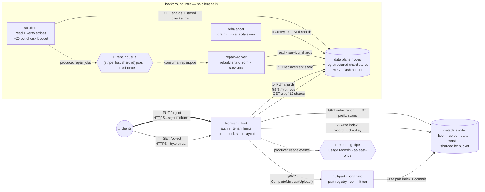

# 03 — High-level architecture

## Diagram

Q: Where does a client PUT/GET flow through the control and data planes, and what runs in the background?

## Components

| Component | Job | Key property |
|---|---|---|
| Front-end fleet | terminate HTTPS, sign-verify, parse, limit, route | stateless; bytes never pass through for big objects — it negotiates, data plane streams |
| Metadata/index store | key → stripe/part/version mapping, bucket config, ACLs | strongly consistent, sharded by bucket (bucket = shard unit), ordered by key |
| Data plane nodes | hold erasure-coded shards; log-structured on-disk format | dumb + parallel; no cross-node coordination on the hot path |
| Stripe placement | which 12 hosts/racks hold a stripe's shards | chooses failure domains; different policies per storage class |
| Scrubber | background verification of all physical bytes | only way 11 nines works; consumes ~10–20% disk I/O budget |
| Repair workers | rebuild shards from parity | must finish faster than the next failure (deep dive 5) |
| Multipart coordinator | part registry; commit/abort | transaction on top of metadata store |
| Rebalancer | moves shards to fix skew/decommission | throttled; never competes with repair |
| Metering/billing pipe | usage records from front-end | async, at-least-once, deduped downstream |

## Key data flows

**PUT (object)**: front-end authenticates → picks stripe layout from placement policy →
streams bytes to data-plane nodes (shards computed on data-side for big objects to keep
front-end CPU light) → shards ack on durable media → metadata record committed →
front-end returns success. Order matters: data first, then index. A crash between means an
orphaned stripe, not a visible-but-missing object (garbage-collected later) — one-sided
failure, by design.

**GET**: front-end authenticates → loads index record → coordinates a parallel read of
≥k shards, recombines → streams to client. Hot keys get served from a small flash cache
tier in front of HDDs plus CDN edge offload (../01.youtube/04-deep-dives.md).

**DELETE**: metadata tombstone; physical stripe reclamation is asynchronous (delete
markers first, physical cleanup later) — a delete storm must not become a shard-rewrite
storm (see ../02.twitter/04-deep-dives.md for the same tombstone-vs-fanout-delete call in
timeline deletion).

**Multipart**: each part is an independent PUT into the data plane + an index entry under
an upload record; `Complete` is a metadata transaction (mark upload complete, assemble an
object entry pointing at part stripes). No data is copied at Complete — bytes were already
durable and placed.

**LIST**: prefix-bounded scans against the bucket's index shards; correctness under
concurrent writes is the small-delta list problem — deep dive 2 is devoted to it.

## Where the money is

- **Bytes, not requests**: ~14 Tbps egress and 180 PB/day shard writes dominate. The
  front-end/metadata tier is comparatively tiny (1 PB of index, ~1M writes/s) — which is
  exactly why the control/data split is the load-bearing decision: it lets each plane
  scale with its own metric.
- **Background I/O budget**: scrubbing + repair + rebalance must share ~20% of disk I/O
  without degrading foreground latency — scheduling that budget is a first-class subsystem,
  not an ops afterthought.
