# 03 — Architecture

```
                    ┌──────────────────────────────────────────────────┐
  Clients (web/app) │  Edge / Gateway tier                             │
──────(SSE/WS)────▶ │  - auth, TLS, connection bookkeeping (~100M)     │
                    │  - streams tokens back to clients                │
                    └───────┬──────────────────────────────────────────┘
                            │ HTTP/gRPC per turn
                    ┌───────▼──────────────┐
                    │ Conversation service │◀─────── Conversation store
                    │ - load & append      │         (KV/object store:
                    │   turns, serialize   │          durable text, cheap)
                    │   context window     │
                    └───────┬──────────────┘
                            │ prepared request (tokens + prefix id)
                    ┌───────▼───────────────────────────────┐
                    │ Admission & rate limiting              │
                    │ - per-tier token quotas, queue policy  │
                    │ - priority: paid > free; shed free     │
                    └───────┬───────────────────────────────┘
                            │ admitted
                    ┌───────▼──────────────┐      ┌──────────────────┐
                    │ Inline moderation    │      │ Model registry & │
                    │ (fast classifier,    │      │ canary router    │
                    │  reject early)       │      │ (v: weights map) │
                    └───────┬──────────────┘      └────────┬─────────┘
                            │                              │ version pin
                    ┌───────▼──────────────────────────────▼───────┐
                    │ Inference scheduler (the core)                │
                    │ - affinity routing by conversation prefix     │
                    │ - placement, batching, preemption             │
                    └──────┬───────────────────────┬───────────────┘
                           │                       │
              ┌────────────▼─────────┐   ┌─────────▼─────────────┐
              │ Prefill pool         │   │ Decode pool           │
              │ (compute-bound)      │   │ (memory-bound, paged  │
              │ prompt → KV          │   │  KV cache, continuous │
              └────────────┬─────────┘   │  batching)            │
                           │  KV transfer│                       │
                           └─────────────┴──── Prompt/prefix cache
                                             (hot KV/prefix replicas)
                           │ token stream
                    ┌──────▼──────────────────────────────┐
                    │ Stream assembly & persistence       │
                    │ - tokens → client via gateway       │
                    │ - on completion: write turn to      │
                    │   conversation store                │
                    └──────┬──────────────────────────────┘
                           │ completed turns (async)
                    ┌──────▼──────────────────────┐
                    │ Async moderation & policy   │
                    │ - output review, abuse      │
                    │   patterns, quotas/billing  │
                    └─────────────────────────────┘
```

Q: What happens to one user turn, from the persistent connection to the token stream back?

```mermaid
flowchart LR
  c((🧑 clients<br/>web · app)) <-->|"1· user turn · SSE token stream<br/>SSE/WS · JSON"| gw[Edge gateway tier<br/>auth · TLS · conn bookkeeping]
  gw -->|"2· gRPC AppendTurn()<br/>turn text · conv id"| cs[Conversation service<br/>stored turns → context window · prefix id]
  cs -->|"KV get+put turns"| ds[(Conversation store<br/>durable turns)]
  cs -->|"3· gRPC SubmitTurn()<br/>tokens · prefix id"| rl[Admission + rate limits<br/>token quotas · shed free tier]
  rl -->|"gRPC ScreenPrompt()<br/>prompt tokens · tier"| mod[Inline moderation<br/>fast classifier gate]
  mod -->|"4· gRPC EnqueuePrompt()<br/>prompt"| sch[Inference scheduler<br/>affinity routing · batching · preemption]
  sch -->|"gRPC GetVersionMap()"| reg[Model registry + canary router<br/>version → routing pct]
  sch -->|"gRPC Prefill()<br/>prompt · prefix id"| pf["Prefill pool<br/>compute-bound: prompt → KV"]
  sch -->|"gRPC Decode()<br/>request · prefix id"| dc[Decode pool<br/>memory-bound · continuous batching]
  pf -->|"gRPC KV-transfer()<br/>cache miss · full prefill"| dc
  pc[("Prompt/prefix cache<br/>hot KV of shared prefixes · affinity-held on GPUs")]
  pf <-->|"KV in/out · prefix id"| pc
  dc <-->|"KV page residency"| pc
  dc -->|"gRPC StreamTokens()<br/>token deltas · proto"| sa[Stream assembly + persistence<br/>tokens → gateway · write final turn]
  sa -->|"token deltas<br/>gRPC stream · proto"| gw
  sa -.->|"KV put turn · conv id"| ds
  sa -.->|"completed turns (async)"| am[Async moderation<br/>abuse patterns · billing]
```



## Components

- **Edge/gateway tier**: terminates ~100M persistent client connections (SSE or WebSocket).
  Per-turn request goes *through* the connection; tokens flow back on it. Stateless beyond
  connection bookkeeping; a gateway can restart and clients reconnect (same reconnect-storm
  discipline as WhatsApp).
- **Conversation service**: serializes the bounded context window from stored turns into the
  request payload, assigns a **prefix id** (content hash of the prefix token range) so the
  scheduler can route by cache affinity. Owns read-your-writes for history.
- **Admission control**: token-based quotas per tier, queue position by tier, load shedding
  (deep dive 4). Runs *before* any GPU work — a rejected prompt must cost ~zero GPU-seconds.
- **Inline moderation**: a small, fast classifier on the user input before generation
  (milliseconds, CPU-class) — a hard gate for policy; full review is async.
- **Model registry + canary router**: maps (model name, version) → served checkpoints and
  their routing percentages; the only place rollout state lives (deep dive 5).
- **Inference scheduler**: the core. Places each admitted request on a prefill worker,
  transfers KV to a decode worker (or keeps both co-located), admits new requests into
  running decode batches continuously, preempts free-tier work under pressure, and keeps
  global token throughput maximized while honoring TTFT and token-rate targets.
- **Prefill pool / decode pool**: separated because the two phases bottleneck differently
  (compute vs memory bandwidth). Separation is a choice, not a law — deep dive 1.
- **Prompt/prefix cache**: hot KV prefixes for shared prefixes (system prompts, RAG chunks,
  long conversation histories). Affinity routing turns "cache hit" into "route to the same
  GPUs".
- **Stream assembly & persistence**: forwards tokens to the gateway immediately; on
  completion (or user stop) writes the final turn. Nothing user-visible waits on the write.

## Data flows

1. **Happy path**: client sends turn on its connection → conversation service builds the
   context → admission admits → inline moderation passes → scheduler picks a version
   (canary-aware) and prefill worker (prefix affinity) → KV handed to decode pool → tokens
   stream through gateway as generated → completion writes the turn to the store.
2. **Cache-continuation path**: second turn of a conversation whose KV prefix is still resident
   → scheduler routes to the same workers → prefill covers only new tokens → TTFT drops
   sharply and prefill GPU-seconds are saved.
3. **Overload path**: queue full / quotas exceeded → free-tier requests get a busy response
   *before* GPU work; paid requests preempt queued free work (never mid-stream paid work).
4. **Rollout path**: registry shifts 1% → 5% → 25% of scheduled requests to candidate
   version; shadow traffic evaluates without serving; regression triggers automatic
   percentage rollback.
5. **Policy path**: streaming already delivered; async moderation flags outputs and
   accounts post-hoc — the response to a flagged stream is upstream (tuning, suspension),
   not recall.
