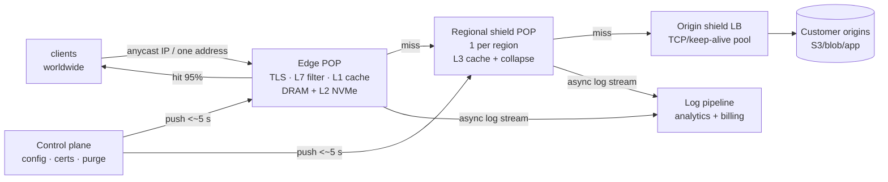

# 03 — Architecture

## High-level data path



Same path in words, edge-first:

```
client ──anycast──▶ [POP edge tier]                    TLS term, HTTP/2·3, WAF/rate limits
                     ├─ L1 cache (DRAM) ── hit → respond
                     ├─ L2 cache (NVMe, shared disk) ── hit → respond
                     └─ miss (coalesced) ──▶ regional shield POP ──▶ origin
```

## Components

**Edge POP (the product).** A cluster of homogeneous cache servers behind anycast
advertising, each running the full request pipeline: kernel-level packet filtering
(XDP/eBPF-style drop paths) → TLS termination → L7 request parse → customer rules engine →
cache lookup (L1 in-process DRAM, L2 shared NVMe pool) → origin manager. The POP acts as
one logical cache: a per-request consistent-hash lookup maps the cache key to one cache
server owning that object, so a POP behaves like a single distributed cache rather than a
farm of independent caches (independent per-server caches would cut hit rate by N×).

**Regional shield POPs.** A small number (1–3) of larger POPs per region designated as
second-tier caches. Edge POPs are statically + map-assigned to a shield such that each
edge's shield is close (single-digit ms) but each region's origins behind it see only
shield traffic. Shields also run request coalescing under lock, so n simultaneous edge
misses for one object become 1 origin fetch (deep dive 5).

**Origin-facing tier.** Connection poolers terminating customer-origin TLS, keep-alive
reuse, and health checks. Origins see CDN IPs only — the CDN contract is "origin egress
rules only allow the shield network".

**Control plane (config, certs, purge).** A globally distributed config service: customer
config versioned, signed, and pushed to every POP; every POP serves from a local
versioned snapshot (config is read-only hot data). Purge commands fan out on the same
channel — see deep dive 4. Certificate issuance (ACME-style) and custom-cert upload flow
through here; POPs receive keys via the config channel after validation.

**Log/billing pipeline.** POPs append binary log records to local buffers, ship compressed
to regional ingest, and aggregate into per-customer analytics + billing. Exactly-once
billing is enforced by per-POP sequence numbers, not per-request dedup.

**Map/steering service.** Maintains the anycast/health picture: which prefixes are
announced from where, POP capacity states, and (for the minority of clients where anycast
lands badly) DNS-based steering records. See deep dive 1.

## Data flows

1. **Cacheable GET**: client → POP (anycast) → TLS → rules → L1/L2 hit → response (+ `Age`
   header, cache-status log line). No origin touch: the common path, ~2–10 ms of added
   latency. ~95%+ of requests.
2. **Miss**: POP → assigned shield → shield hit (serves stale-if-error, backfills edge) or
   shield miss → coalesced origin fetch → response written at shield + edge + client.
3. **Dynamic (non-cacheable)**: POP → shield → origin over keep-alive connection pool;
   response passes through untouched (no caching); the CDN adds: TLS offload, connection
   reuse, backbone transit, per-request filtering/rate limits.
4. **Write/POST**: never cached (unless customer opts in to edge caching of responses to
   writes); proxied synchronously — the client response must come from the origin.
5. **Invalidation**: customer/API → control plane → global push → POPs mark purged keys
   stale/absent within seconds; next request revalidates or refetches (deep dive 4).
6. **Telemetry**: everything above logs asynchronously; billing derives from per-POP logs
   with exactly-once via per-POP sequence numbers + daily reconciliation.

## Failure modes (cross-cutting, detailed in deep dives)

- A POP fails/gets partitioned → anycast withdraws the prefix there, clients re-route to
  the next-population POP (BGP convergence, ~seconds–minutes — deep dive 1).
- A shield region fails → edges fall back to direct-to-origin for that region (hit-rate
  loss, not outage).
- Origin slow/failing → serve stale within grace policy; origin errors are cached briefly
  (negative caching) to avoid retry storms.
- Control plane down → POPs serve with last-good config (read-only data; the request path
  must never require a control-plane roundtrip).
- Log pipeline backpressure → POP drops analytics logs before billing logs (billing records
  are the only must-not-lose class; they get a local durable queue).
