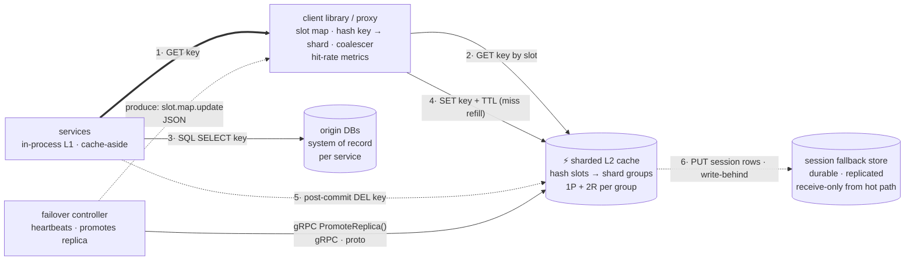
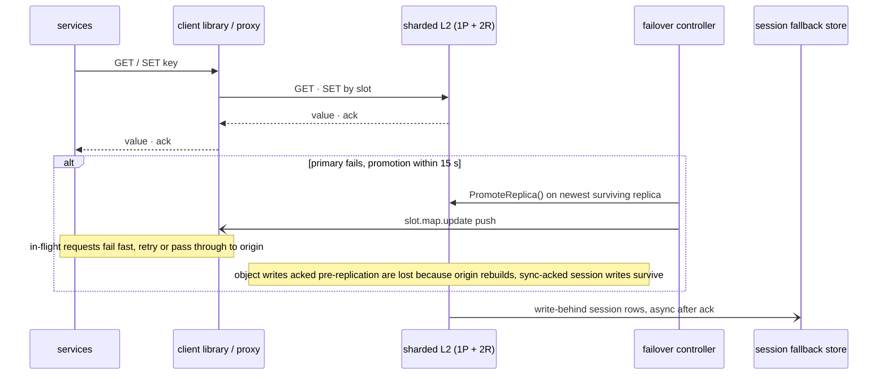

# 10.distributed-cache — 03 Architecture

## High-level diagram (one region)

## High-level diagram (one region)

Q: How do reads and the two write classes (origin-backed objects vs sessions) flow through L1 and the shared sharded L2?

## Failover sequence

Q: What happens to in-flight requests and already-acked writes when a primary fails inside the ≤ 15 s promotion window?

## Components

1. **Client library / proxy** — owns three things so every service doesn't rebuild them:
   (a) the **slot map**: hash(key) → 16,384 slots → shard, refreshed when the topology
   changes; (b) **request coalescing** for identical concurrent GETs; (c) metrics
   (hit rate, latency, per-key hotness) exported per service. Either link in-process or run
   as sidecar proxies; the API is identical either way.
2. **Shards** — the tier is partitioned by hash slot, not by key ranges or by service. A
   shard group is 1 primary + 2 replicas in different racks/zones. All keys of a hash-tagged
   group co-locate, enabling multi-key atomic ops within one shard only.
3. **Replication** — per class: object writes ack at the primary only and replicate
   asynchronously; session writes sync to one replica before the primary acks. The failover
   quorum selects the newest surviving replica — it does not by itself preserve writes the
   primary acked before replicating them, so async ack-at-primary *can* lose acked object
   writes (acceptable: origin rebuilds), while acked session writes survive failover because
   they sync before the ack — see deep dive 2 for what each mode buys.
4. **Failover/fleet controller** — a small cluster manager: heartbeats slots' primaries,
   promotes a replica on failure (target ≤ 15 s, requirement N2), publishes slot-map
   updates to clients, and drives migration when shards are added or removed.
5. **Invalidation path** — post-commit `DEL`/version-bump calls from services. Best-effort
   and asynchronous with respect to the DB write; correctness comes from cache-aside
   discipline plus TTL bounds, not from the invalidation itself being atomic (deep dive 3).
6. **Durable session fallback** — a small replicated store that receives session writes
   asynchronously (or synchronously, if an outage forcing global re-login is unacceptable);
   the read path never consults it in steady state.

## Two data classes, two policies

| Aspect | Object class | Session class |
|---|---|---|
| Origin of truth | origin DB (rebuildable) | none in hot path (fallback only) |
| Stale reads | tolerated up to TTL | not tolerated to be *lost* while TTL is live |
| Write mode | cache-aside after DB commit | write-behind to tier, async persisted |
| Eviction | LRU/LFU aggressively under pressure | never evict live sessions; evict expired only |
| Replication | async; losing a shard's cache = reheat | ack from primary + quorum failover |

Splitting classes is what keeps each one cheap. Object-class reads ride a single async
replication chain and accept misses; session-class writes pay for quorum durability but are
only ~10% of write volume.

## Data flows

1. **Read (object class), hit** — svc → L1 (hit ~40%) → else L2 GET by slot → value. One
   network round trip, p99 ≤ 1.5 ms (N1).
2. **Read, miss** — coalescer registers the in-flight GET; one caller reads from origin DB,
   SETs the value with TTL, all waiters get the value. Origin load is then ~misses, not
   ~misses × concurrent-duplicates.
3. **Write (object class)** — svc commits to origin DB, *then* DELs the cache key (or
   bumps a version key), not the reverse. The race this ordering still contains is
   analyzed in deep dive 3.
4. **Session create/update** — svc SETs session with 14-day sliding TTL; the shard's
   primary acks and replicates; expired sessions are reaped by the eviction path, and the
   fallback store receives the write asynchronously.
5. **Reshard** — controller assigns vacant slots to a new shard; source primaries stream
   keys in the slot (async copy + mark-migrated, clients re-route on map refresh), new
   primary becomes owner. Clients that read stale maps during the window get a redirect or
   MOVED-style response rather than a silent loss.
6. **Failover** — primary dies; controller promotes a replica; clients see the new map
   within seconds; in-flight requests during the ≤ 15 s window fail fast (no hang), clients
   retry or pass through to origin — that burst is priced into N4.

## What is deliberately *not* in the diagram

- No service-specific cache tiers, no cross-tier consistency protocol between L1 and L2 —
  L1 entries carry short TTLs (seconds) and are the app's problem to invalidate on write.
- No global lock manager, no distributed transactions, no cache-wide "consistency oracle":
  the tier's consistency story is per-class TTL + invalidation discipline + replication
  mode, not a protocol.
- No disk tier: spilling values to disk changes the failure profile it exists to avoid
  (memory is the point).
