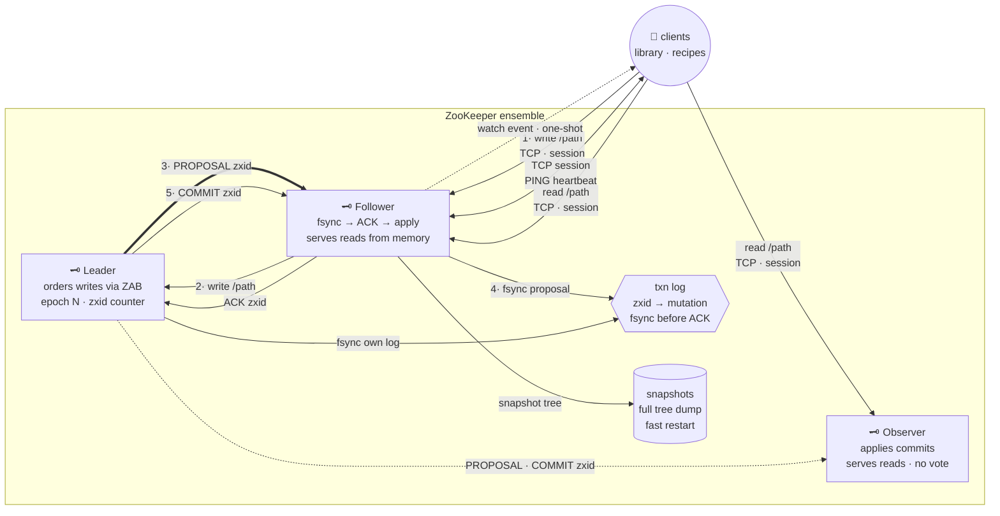

# 03 — High-level architecture

## Diagram

Q: How does a write reach a ZAB quorum, and how do reads, sessions and one-shot watches behave on the servers?



## Components

| Component | Job | Key data |
|---|---|---|
| Leader | orders all writes (ZAB), runs recovery/sync on election, broadcasts proposals | current epoch, zxid counter, pending proposal queue |
| Followers (vote) | fsync proposals to txn log, ACK, apply on COMMIT; **serve reads from memory** | committed prefix of the log, in-memory tree, session table |
| Observers (no vote) | apply committed txns, serve reads; never join quorum math | committed prefix (lags voting servers slightly) |
| Txn log | durable record of every proposal, fsync'd before ACK | zxid → znode mutation |
| Snapshots | periodic full-tree dump for fast restart | full znode tree + session table |
| Session table | per-client: last ping time, timeout, ephemerals owned | ephemeral nodes are *rows here*, not standalone data |
| Watch list (per server, per znode) | which sessions must be notified on which event kind | one-shot; consumed on fire |
| Client library | connection mgmt, heartbeat, re-arm watches, recipes (election/lock) | the "smart half" of the system by design (01-requirements) |

## Data flows

**Write path (the only path that matters for correctness).** Client sends the write to
*any* server; if it is not the leader, the request is forwarded. The leader wraps it in a
PROPOSAL with a fresh zxid, followers fsync to the txn log and ACK. On a quorum of ACKs the
leader sends COMMIT; followers apply to the in-memory tree and the reply reaches the client
(stamped with the zxid, satisfying the client's own-write visibility). Non-quorum servers
apply nothing — they permanently hold a *prefix* of the true order, never a divergent one.

**Recovery (leader election).** When the leader dies or loses quorum, followers with the
highest committed zxid run an election; the winner increments the epoch (the high 32 bits of
zxid), then syncs followers via DIFF/SNAP (bring them up to date) and TRUNC (drop
previously-accepted-but-never-committed proposals). Invariants this must preserve: no
committed txn is lost, and nothing from a pre-election epoch is ever committed afterward
(deep dive 1).

**Read path.** Any server answers any read straight from its in-memory tree, no disk, no
leader round trip. This is why reads are cheap (02-estimates) — and why they can be a few
transactions behind the leader (deep dive 2). `sync(path)` exists as the escape hatch:
process on the serving server until it has caught up to the leader's current commit point,
then run the read.

**Session lifecycle.** Client connects to one server; session established; ephemeral nodes
are owned by the session, not the TCP connection. Heartbeats are piggy-backed or sent as PING.
On server failure the client reconnects to another member and the session resumes *if it has
not expired* (timeout negotiated at connect within server bounds). Expiry triggers ephemeral
reaps — a burst of delete transactions (02-estimates).

**Watch delivery.** A watch is registered server-side and fires **once**, on the server the
client's connection is on, with the event delivered *before* newer data can be observed on
that connection. Fire-and-forget — no subscription, no replay; the client immediately
re-reads and re-arms (deep dive 4).

## ZAB in one picture

```
broadcast (steady state):
  client ─► leader: write request
  leader ─► all followers: PROPOSAL(zxid = epoch:N, counter:C)
  followers: fsync txn log → ACK
  leader: quorum ACKs → COMMIT(zxid) → all apply; reply to client

recovery (leader died / lost contact):
  1. elect: follower with highest zxid's epoch proposes, epoch++, counter resets
  2. sync: DIFF (up-to-date followers get the tail) / SNAP (followers
     snapshot-and-replace) / TRUNC (drop proposals never committed)
  3. new broadcasts begin only after sync
```

## Where the money is

- **The fsync, not the CPU.** Write throughput is a disk-latency story (02-estimates); the
  txn log needs its own fast disk. Every other case here scales *out*; ZooKeeper scales
  *down* to the single slowest quorum member's fsync — that is the entire performance model.
- **The re-applied in-memory tree.** Reads cost nothing; the tree is kept identical on all
  committed servers by construction. There is no cache-invalidation problem to solve
  because there is exactly one tree per server and one update order for it.
- **The client library.** Half the system lives outside the server (recipes, re-arm loops,
  fencing discipline). A correct ZooKeeper deployment is as much about what clients do
  between notifications as about the server itself — that is where deep dives 3, 4, 6 go.
