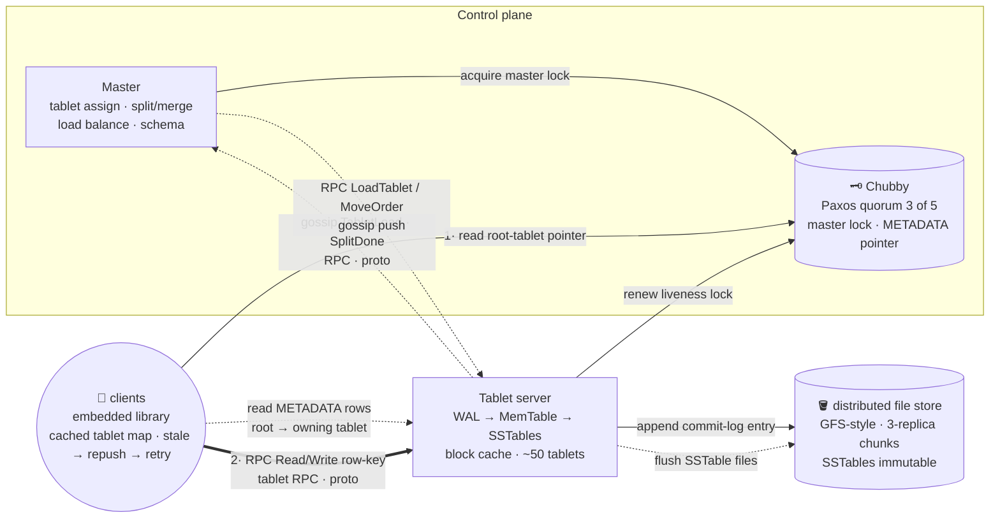

# 03 — High-level architecture

## Diagram

Q: How does the client data path reach a tablet server, and why do Chubby and the master stay off it?

## Components

| Component | Job | Key properties |
|---|---|---|
| Chubby | master election, root-tablet pointer, per-server liveness locks, schema/config | 5 replicas, Paxos quorum 3; NOT on the read/write data path |
| Master | tablet assignment, split/merge decisions, load balancing, schema ops, GC of orphaned files | stateless aside from Chubby state; death of master ≠ death of data plane |
| Tablet server | serves reads/writes for ~50 tablets: WAL, MemTable, block cache, SSTable serving, minor/major compactions | stops serving the moment it loses its Chubby lock (prevents split-brain serving) |
| Tablet | contiguous row-key range of one table, ~10–50 GB target | one tablet = one server at a time; rows are atomic unit |
| SSTable (in distributed store) | immutable sorted file of key→value strings, 64 KB blocks, per-file bloom filter, per-locality-group files | writes are new files, never in-place mutation |
| MemTable + WAL | write buffer (recent writes) + commit log before MemTable flush (~100 MB threshold, rough estimate) | WAL on replicated store = durability before ack |
| Block cache | per-server read cache (hot SSTable blocks) + scan cache | makes the 4:1 read:write ratio survivable |

## Key data flows

**Write**: client → (after discovery) tablet server → append commit log entry to
replicated store → insert into MemTable → ack. No coordinator, no read-modify-write of
any index beyond the client's cached tablet map. When the MemTable crosses its size
threshold it freezes, becomes an SSTable, and a fresh MemTable is allocated.

**Read**: client → tablet server (stale cache entry → repush → retry) → merge MemTable +
SSTables newest-first, one version per cell (or last N) — bloom filter per SSTable skips
files that can't hold the key, block cache skips files that were read for a neighbor key.

**Discovery / repush**: client cache miss or stale entry → read the root-tablet pointer
from Chubby → the serving root METADATA tablet → the owning METADATA tablet → find the
server → if the server is gone, walk up the range and ask the nearest server; tablet
servers answer "not mine, and your range is now at X".

**Tablet split/load move (background)**: master watches per-tablet size and per-server
load gossip → the owning tablet server picks a split point in the middle of the
size-bloated or hot tablet and records the split in METADATA (one new row), then notifies
the master; if the notification is lost the master rediscovers the split when it next
asks to load the old tablet (per the paper) → child tablet
loads its files lazily on its new server; a load-balancing move is the same machinery
(unload on A, load on B, update METADATA last).

**Batch scan**: MapReduce-style job → client library enumerates tablets from METADATA →
workers stream their tablets directly (no central fanout service needed — the tablet
map IS the partitioning plan; see [WhatsApp deep dive §3](../03.whatsapp/04-deep-dives.md)
for how a later system built a gRPC data-service layer on the same partition-aware idea).

## Where the money is

- The write path touches exactly two devices: replicated log + RAM. Everything else
  (compaction, GC, index) is background. This is why write latency doesn't depend on
  table size — the property every derived requirement in [02](02-scale-estimates.md) leans on.
- The read path is entirely local to one machine (or a stale-cache round trip). Chubby
  and master are off the hot path; their failure degrades *membership*, not *serving* —
  until something restarts (deep dive 4).
