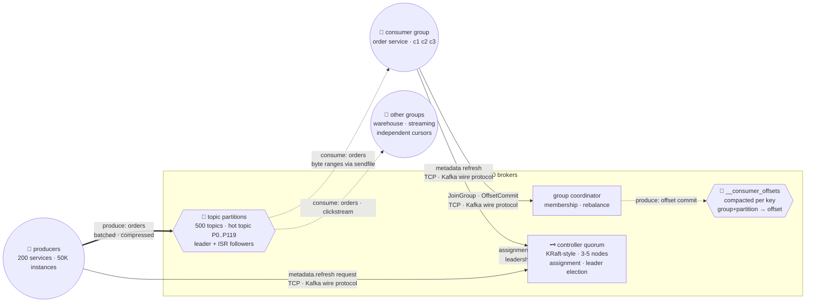

# 03 — High-level architecture

## Diagram

Q: How do produce batches append to partition logs, and how do independent consumer groups consume and commit offsets?

## Components

| Component | Job | Why it looks like this |
|---|---|---|
| Producer client | buffers records per partition, compresses batches, picks partition by key, tracks acks | batching amortizes network + broker cost (deep dive 2) |
| Topic | named stream of records; unit of config (partitions, RF, retention) | not a broker object — a naming + partitioning convention |
| Partition | ordered, immutable log on disk, offset-indexed segment files | the atomic unit; ordering, scaling, replication all key off this ONE thing (deep dives §1) |
| Broker | hosts partitions, serves produce/fetch, appends + reads via page cache | mostly a thin layer over disk + NIC; stateless app logic |
| Replica set + ISR | R=3 copies per partition; leader + followers; ISR membership tracked | durability knob and availability knob together (deep dives §3) |
| Controller/quorum | assigns partitions to brokers, elects leaders on failure | small, metadata-only quorum; it is the coordination point (pattern like ZK: a metadata service the rest depends on) |
| Group coordinator (per broker) | tracks group membership per group, triggers rebalances, stores committed offsets in __consumer_offsets | consumer-side state lives in the log, not in memory (deep dives §4) |
| __consumer_offsets | internal compacted topic holding (group, partition) → offset | reuse the log's own compaction primitive for the log's own cursor state — no separate DB (deep dives §5) |

## Key data flows

**Produce**: producer-side accumulator batches records per (topic, partition) for a few
ms (linger.ms) or until batch.size; sends compressed batch to the partition leader.
Leader appends to its log at next offset, followers replicate; when `acks=all` and
ISR size ≥ `min.insync.replicas`, leader advances its high-watermark and replies success.

**Consume**: consumer fetches from partition leader with start offset; leader serves
bytes (via page cache → sendfile, no per-record parsing). Consumer processes, then
commits the new offset for that partition. A consumer's position is data IN the log —
survives broker restarts, consumer restarts, everything.

**Partition leadership failover**: broker dies → controller observes it leave the
quorum → for every partition it led, elect a new leader from the current ISR, ship the
new assignment metadata. Clients (re)connect: producers refresh metadata on error and
retry; consumers see the fetch error, refresh metadata, resume from committed offset.

**Rebalance**: a group member's session times out or a new member joins → group
coordinator triggers rebalance → members re-render their partition assignment →
consumption of ANY partition in the group pauses for the rebalance duration. This is a
data-plane event that stops all consumption; keep it fast (deep dives §4).

**Retention sweep**: a background job on each broker deletes log segments (never
individual records) once too old/too big; compaction runs on topics configured for it,
keeping the latest record per key (deep dives §5).

## What is deliberately NOT here

- No "delivery queue" semantics (no ack-per-message-then-delete): the log keeps data
  until retention expires regardless of who consumed it. Consumers are independent
  cursors, not subscribers being tracked. This is the single largest semantic difference
  from a classic MQ and it's what makes throughput possible — see deep dives §6.
- No cross-topic transactions or ordering: different topics are independent streams.
- A mirror tier for geo-replication would sit OUTSIDE this diagram (separate
  source→target async copy); it's a boundary, not a component here.
- No broker-side business logic: Kafka brokers don't parse, route, or transform. All
  smartness lives in producers and consumers. Brokers being dumb is the load-bearing
  design choice — everything else (throughput, replays, retention) falls out of it.
