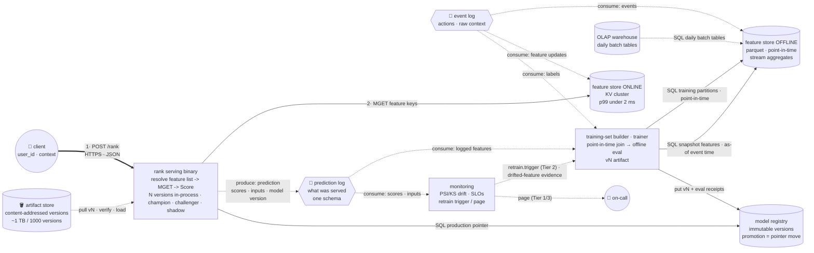

# 03 — High-level architecture

## Diagram

Q: How does the serving hot path fetch features and score in-process, and how do logs close the training, promotion and monitoring loop?

## Components

| Component | Job | Key data |
|---|---|---|
| Event ingestion | Kafka topics for actions + raw context; the single spine feeding features, training and monitoring | append-only events; the ~17 GB/s-class firehose (est.) in [02](02-scale-estimates.md) is the *prediction log's* stream, not this one |
| Feature store — online | KV cluster serving packed feature rows at p99 < 2 ms per fetch | user vectors, item feature blobs, `computed_at` stamps |
| Feature store — offline | historical, point-in-time-correct snapshots in parquet + streaming-derived aggregates | full history for training sets and backfills |
| Feature service | resolves a feature request → a set of KV fetches; per-request caching; the one place feature *access* happens | feature-set manifests (which features a model needs) |
| Training-set builder | point-in-time joins of labels × logged/snapshot features into training partitions | petabyte-class Spark jobs |
| Trainer | distributed training on shared GPU/CPU pool, emits vN artifact | weights + metrics + feature-set/code hashes |
| Model registry | immutable versions; promotion workflow (eval → shadow → partial → full); artifact store pointer | the single source of "what's shippable" |
| Model server | scores requests with N versions in-process; shadow route; hot artifact reload | champion/challenger/shadow routing config |
| Prediction log | what was actually served, one place, one schema | input to retrain + drift + debugging |
| Monitoring | PSI/KS per feature & score distribution, SLO panel, retrain triggers | aggregates over the prediction log |

## Key data flows

**Serving (hot path)**: request → feature service resolves the model's feature list → user
row multiget + candidate-table fetches (in parallel across tables — at p99 < 2 ms per fetch
they cannot run serially inside a 50 ms budget) → model server batch-scores all 500 candidates with
the current champion (and routes a slice to challenger/shadow) → scores returned →
prediction row emitted to Kafka. Total budget ~50 ms p99; the only network hops are the
feature fetches and (via Kafka, async) logging — the model itself runs in-process, no
separate "inference service" hop (trade-off in deep dive 4).

**Training (cold path)**: nightly labeled partitions exist (day-2 complete) → builder
joins labels against **logged served features first**, snapshot features only for fields the
logs lack → partitioned parquet → training reads, produces a version → offline eval on a
held-out window → registry `candidate`. The warehouse's daily batch tables feed the offline
store's batch side (deep dive 2), alongside the log-derived stream aggregates.

**Promotion (registry workflow)**: candidate → shadow (mirror live traffic, compare score
distributions + offline-eval receipts) → partial (e.g. 5% real traffic behind an experiment
flag) → production. Each transition writes evidence to the registry; the model server only
loads `production` pointers set through the workflow. Rollback = repoint the pointer to the
previous immutable version (deep dive 3, 4).

**Monitoring**: the same Kafka stream that feeds retraining feeds PSI/KS jobs computing
feature-by-feature distribution distances vs the training baseline snapshot, plus business
metrics; deviations either open a retrain trigger, or page. Which is which, and why auto
is bounded, is deep dive 5.

## What makes this architecture hold together

- **One spine, three readers**: the event stream feeds features, training *and* monitoring.
  There is exactly one canonical place each value is written (prediction log for "what was
  served", offline store for "what history holds"), so skew debugging has an authority.
- **Serving never depends on training being up** (only on the registry pointer and the
  feature store), and training never depends on serving being up (only on Kafka retaining
  the log) — the two halves are joined in the middle by immutable artifacts.
- The platform is deliberately *thin* in the hot path and *thick* at the seams: features in
  one KV hop, model in-process, everything else — versioning, eval, drift — happens off the
  request path, where latency does not have to be bought twice.
