# 03 — Architecture

## High-level diagram

Q: How does a ranking request fan out through retrieval, feature assembly, the heavy ranker and re-rank filters inside ~100 ms?

```mermaid
flowchart LR
    subgraph ret [Retrieval · ~10 ms]
        ann[two-tower ANN fleet<br/>sharded IVF / brute-force]
        gph[graph / co-watch source<br/>item→items lists]
        frsh[trending + fresh source<br/>minutes-to-hours-old items]
        mg[merge / dedupe<br/>cap ~2,000]
    end
    u((🧑 client<br/>user_id · context · surface))
    ap[API / edge<br/>p99 ~100 ms budget]
    fa[feature assembly<br/>user row + item multi-gets<br/>mixed freshness tier]
    up[(user profile store<br/>one row per user)]
    it[(item feature store<br/>precomputed stats · realtime counters<br/>cached embeddings)]
    rk["🧠 heavy ranker<br/>DNN multi-objective<br/>P(watch) · P(skip) · P(like)"]
    rr[re-rank + filters<br/>policy · diversify · explore<br/>→ 50 ordered items]
    el{{📨 event log<br/>impressions · feedback<br/>position · model version}}
    u ==>|"1· POST /rank<br/>HTTPS · JSON"| ap
    ap -->|"gRPC Retrieve()<br/>gRPC · proto"| ann
    ap -->|"gRPC Retrieve()<br/>gRPC · proto"| gph
    ap -->|"gRPC Retrieve()<br/>gRPC · proto"| frsh
    ann -->|"candidate ids"| mg
    gph -->|"candidate ids"| mg
    frsh -->|"candidate ids"| mg
    mg -->|"2· gRPC Candidates()<br/>~2,000 cands · proto"| fa
    fa -->|"GET profile:{uid}"| up
    fa -->|"MGET item batches · 128-256 keys"| it
    fa -->|"3· gRPC Score()<br/>packed vectors · proto"| rk
    rk -->|"gRPC Scores()<br/>predicted scores · proto"| rr
    rr -.->|"produce: impression<br/>position · model version"| el
    el -.->|"consume: watch/impression events<br/>streaming counters"| it
```



```
                                   TRAINING LOOP (async, hours cadence)
 events (impressions, watch, skip — ~6M/s avg, ~23M peak)  ──▶ event log (~45 TB/day, by user_id)
                                               │  label joiner (waits out label delay)
                                               ▼
        training examples ──▶ trainer (daily/hourly retrain) ──▶ offline eval
                                               │                    │ compare vs serving
                                               ▼                    ▼
                                         model registry ◀── shadow/canary evaluation
                                               │
                       rollout: ANN index rebuild + embedding tables + ranker weights
                       (blue/green: new shards warm up before serving switches)
```

## Components

- **Retrieval fleet**: sharded ANN over item embeddings (two-tower retrieval) + non-ML
  candidate sources (follow graph / co-visit item→item lists, trending, fresh items from a
  stream-backed index). Each source returns a few hundred candidates in ~10 ms; the merger
  unions, dedupes and caps at ~2,000. Retrieval is judged on **recall** (does it contain
  what the ranker would pick), never on score quality (deep dives 1–2).
- **Feature assembly**: two-tier. *User tier* — one precomputed profile row per user
  (embedding, aggregate history), fetched once per request. *Item tier* — precomputed daily
  statistics plus a realtime counter layer (last-5-min/1-hour views and watch rate) plus
  cached item embeddings; gathered as batched multi-gets (~128–256 keys per batch). Served
  by a shared feature store so training and serving read the same definitions (offline/
  online skew is a failure mode, deep dive 3).
- **Heavy ranker**: the DNN, scoring the full ~2K candidate set batched. Multi-objective:
  predicts P(watch), expected watch-fraction, P(skip), P(like/share); a blend function turns
  these into one score. Runs on scoring fleets; per-request cost is the main
  cost/latency knob. A small **pre-ranker** (tiny model over cached features) may cut 2K →
  500 if capacity requires (deep dive 1).
- **Re-rank + filters**: deterministic and product-owned. Policy verdicts, dedup vs items
  the user already saw, author/topic diversification (e.g., no more than N from one author
  per page), exploration slot allocation, injection of fresh/trending items, final ordering
  pass. Cheap, fast, and the only place where "business rules" may override the model.
- **Event log & label joiner**: impression events carry position, model version, feature
  snapshot reference; watch/skip events join back to impressions by (user, item, session).
  The delay between impression and label is handled explicitly (deep dive 4).
- **Model registry & rollout**: retrained weights + embedding tables + ANN index ship
  together as one version; shadow-serve against traffic before switch; blue/green shard
  warm-up so index rebuilds never pause serving.
- **Experimentation harness**: normal A/B plus **interleaving** trials on ranker candidates
  (deep dive 6).

## Data flows

1. **Request → page**: edge → retrieval (parallel sources) → merge (~2K) → features (user
   row + batched item vectors) → ranker scores → filters/diversify → ordered 50, every
   impression logged with position + model version.
2. **Impression → label → training**: impression event (logged at serve time) and later
   watch/skip events (logged at play time) are joined by the label joiner; joined examples
   become next training window. Minutes of lag in labels, not seconds — architecture
   assumes it (deep dive 4).
3. **Events → realtime features**: the same event stream feeds the counter store so "views
   in last hour" moves within seconds of reality (deep dive 3).
4. **Training → serving**: registry ships ranker weights and embeddings; index rebuilds
   stream behind serving shards; rollouts are shadowed, canaried, and reversible.

## Failure posture

- Retrieval down → skip ML retrieval, serve recency × popularity × follow-graph page
  (fall back to something like [Twitter's](../02.twitter/03-architecture.md) pre-ranking
  timeline shape). Ranker down → same fallback. Feature store partial outage → rank with
  default/damped features rather than fail the page. Anything ML may degrade; the page
  itself must not.
