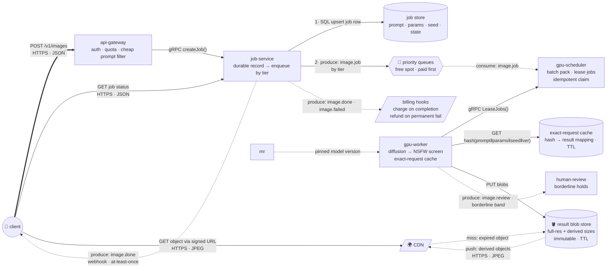

# 03 — High-level architecture

## Diagram

Q: How does a prompt become a delivered image — and where do moderation and the GPU path gate?

## Components

| Component | Job | Key data / choice |
|---|---|---|
| API Gateway | auth, validate prompt+params, quota check, cheap prompt moderation, reject early | must stay sub-300ms; no GPU calls |
| Job service + store | durable job record; the source of truth for state and billing | strongly consistent writes; written BEFORE queueing |
| Priority queues | buffer arrival-rate spikes against fixed GPU capacity; ordering paid > free | two tiers, deep dive 2 |
| GPU scheduler | claim/pack jobs into batches, lease to workers with idempotent job IDs, handle worker death | the lease protocol is the correctness core |
| GPU worker pools | reserved pool (paid) + spot pool (free); run diffusion + post-gen safety classifier | spot = 60–70% price off (public-cloud rates), preemption risk only |
| Model registry | pins model/sampler versions; enables exact-request cache keys and rollback | version = (weights, steps, seed policy) |
| Result blob store | full-res + derived sizes, immutable, TTL'd | object store, lifecycle rules (see [blob store](../07.blob-store/04-deep-dives.md)) |
| Safety pipeline | prompt filter (pre-spend) + image classifier (pre-delivery) + human review queue | two-sided, deep dive 4 |
| Status/notification | poll endpoints + webhooks; at-least-once events, client-side dedup | same pattern as [WhatsApp](../03.whatsapp/04-deep-dives.md) §1 |
| CDN + serving tier | image bytes to clients; origin shield | ~95%+ hit on creation-hot content (see [CDN](../09.cdn/04-deep-dives.md)) |
| Billing hooks | charge cost units on completion, refund/retry on permanent failure | tied to job state machine, not API call |

## Key data flows

**Submit**: gateway validates → prompt moderation verdict (fast classifier; reject or flag) →
quota check → write job row (state=queued, seed + model version assigned **here**, so an
identical later request is detectably identical) → enqueue by tier → return job ID. GPUs
untouched so far.

**Generate**: scheduler dequeues, packs N=4 (or fewer, plus other jobs' images) into a GPU
batch, lease-jobs out; worker checks exact-request cache (see deep dive 5) — on hit, skips
inference entirely; on miss, runs the sampler → post-generation NSFW classifier on every
image → pass: upload blobs (full + sized variants), mark job done; reject: mark rejected
with coarse reason; borderline: park in human review, state stays hidden-with-hold.

**Deliver**: client polls (cheap status read from a cache) or receives webhook
(at-least-once, client dedups by event ID); fetching images goes through signed CDN URLs
only — never the origin directly. A delivered URL must never point at an unmoderated image.

**Failure**: worker crashes mid-batch → lease expires → jobs return to queue head with
backoff and attempt counting; after K attempts and it's paid → auto-refund + failed state;
free → expired-state quietly.

## Where the money is

- GPU rent (~$600–750K/day at our estimates, 02) is ~everything. All design effort goes
  into GPU-seconds per delivered image: inference steps (dd3), utilization/scheduling (dd2),
  and not regenerating what already exists (dd5).
- The second cost is storage+egress of artifacts — solved with standard blob/CDN patterns
  plus aggressive TTLs.
