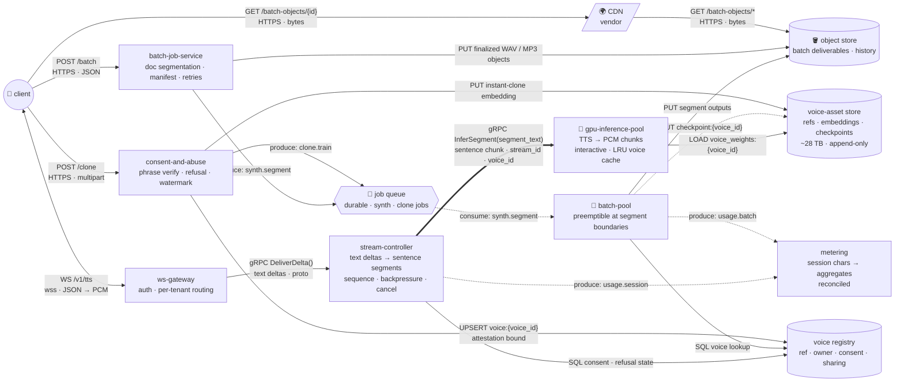

# 03 — High-level architecture

## Diagram

Q: How do interactive streaming and batch synthesis share one GPU fleet — and what does every synthesis check before it spends GPU-seconds?

## Components

| Component | Job | Key data |
|---|---|---|
| WS gateway / edge | terminate client websockets, auth, per-tenant routing | connection state only |
| Streaming synth controller | per-stream state machine: text deltas in, sentence-level segmentation, dispatch inference, chunk sequencing, cancellation | stream ID, sequence numbers, backpressure state |
| GPU inference pool | runs the TTS model conditioned on the requested voice; streams out PCM chunks | per-GPU voice cache (LRU), RTF telemetry |
| Batch job service | durable job queue, document segmentation, progress checkpoints, retries | job records, segment manifest |
| Voice registry | names → model reference + owner + sharing scope + consent state; authorization on every synthesis | voice metadata (small, hot) |
| Voice asset store | consented reference recordings, instant-clone embeddings, professional-clone checkpoint weights | ~28 TB, immutable, append-only |
| Consent & abuse service | verifies consent phrase recording, decides refusals, applies watermarks, similarity screening against protected voices | consent attestations (append-only) |
| Object store + CDN | batch deliverables, history replay, downloads | bytes bypass the synthesis path |
| Metering | per-session character credit aggregation → billing | reconciled aggregates, not per-chunk rows |

## Key data flows

**Interactive stream**: client opens WS → gateway authenticates (API key / user) →
stream controller allocates state, pins the requested voice. Outgoing text deltas are
buffered until a **sentence-ish boundary** (deep-dive 1), then sent to the interactive
pool. The pool normalizes the voice key: a cache hit runs inference immediately; a miss
pauses that stream, pulls the voice (embedding/weights) from the asset store, then
proceeds. Audio chunks come back with per-stream sequence numbers and real-time
timestamps; the controller relays them over the WS; the client plays from a small jitter
buffer (deep-dive 2). A cancellation drops the stream's outstanding inference work and
frees the GPU slot immediately.

**Batch job**: submit → durable job record → segmentation of the document into
sentence/paragraph synth units (manifest persisted) → segment jobs are enqueued to the
**batch pool** only → outputs written as WAV objects, manifest updated → when all segments
done: concatenate/align (dubbing: also translation + timing), finalize deliverable,
notify webhook, metered. Any worker restart resumes from the segment manifest — a job
never re-synths a finished segment.

**Voice registration (cloning)**: owner uploads consent recording + voice samples →
consent service verifies the spoken phrase and stores an append-only attestation →
instant clone: embedding built, registry entry created immediately; professional clone:
training job queued on the batch pool, checkpoint written to asset store, registry entry
flips to `ready` when landed. Registry lookup is on the interactive hot path, so these
writes are never in it (controller reads a replica).

**Authorization on every request**: voice_id must resolve to the caller or a shared scope
workspace, via the registry; public-library voices and own voices pass, everyone else's
private voices fail closed. This check is cheap and sits in front of every GPU-seconds
purchase.

## Where the money is

- **The interactive GPU pool** (~85%+ of fleet cost by our estimates in
  [02](02-scale-estimates.md)). Every % of RTF and cache hit rate is real money; the
  batch pool is a rounding error next to it.
- **First-audio-byte latency**: dominated by voice cache misses and segmentation chunk
  sizing, not the model itself — both are software choices (deep-dives 1 and 3).
- The storage/control-plane layers are small (~28 TB voice assets, ~72 TB batch outputs,
  QPS in the hundreds): this case is a *real-time scheduling* problem more than a big-data
  problem, the opposite of [YouTube](../01.youtube/03-architecture.md), where storage and
  ingest dominate and compute is the rounding error.
