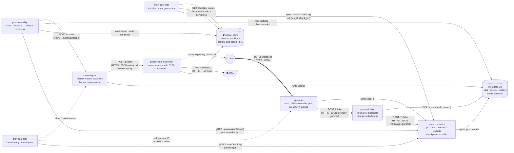

# 03 — Architecture

## High-level diagram

Q: How does one generation flow through the job DAG — prompt intake, chunked GPU work, screening, and publish — without a job ever escaping unscreened?

## Components

1. **API edge**: authentication, per-user submission limits priced in *GPU-minutes*, the
   queue/ETA surface. Stateless; everything durable lives behind it.
2. **Prompt intake**: cheap prompt-side safety classifiers (text), parameter validation,
   and a dedupe layer — a (prompt-hash, params) key hitting a screened artifact returns
   it instead of scheduling a new job.
3. **Job orchestrator**: the system's heart. Holds the job DAG (deep dive 2), priorities
   (drafts < final renders; internal eval jobs < user jobs; paid tiers > free tier),
   global + per-user GPU budgets, retry policy, and the checkpoints table. The queue is
   *the* cost-control instrument; there is no "generate anyway" path.
4. **GPU fleet, three pools**:
   - *Draft pool*: low-cost passes (low-res, few denoising steps) to kill bad prompts
     early and give the user a 15-second preview; burns ~1/10th of a full job.
   - *Main pool*: the chunked latent pipeline — chunk-jobs run on individual GPUs,
     coordinate through the orchestrator, checkpoint to the artifact store.
   - *Post pool*: CPU/GPU assembly, upscaling, H.264/AV1 encode of renditions — this side
     looks exactly like YouTube's transcode DAG (see
     [YouTube deep dives](../01.youtube/04-deep-dives.md#1-transcoding-as-a-parallel-dag)).
5. **Checkpoint & artifact store** (object storage): per-chunk latents, decoded
   keyframes, final artifacts, model-version manifests. Content-addressed; TTL for
   intermediates.
6. **Screening service**: classifiers run on the final artifact (and on mid-pipeline
   latents, deep dive 6); hard-fail → block+log; borderline → human review queue; clear →
   publish. Position matters: *before* publish, no exceptions.
7. **Metadata DB**: job records (id, user, prompt, model version, params), artifact
   records (location, verdict, watermark id, TTLs), credit balances. Strongly consistent
   for job/artifact state; aggregate for telemetry.
8. **CDN**: renditions and watermarked artifacts; library embeds. Ordinary CDN design —
   the interesting content lives upstream of here.

## Key data flows

**Generate (happy path)**, timeline for a 10s clip:

1. POST /generations → intake validates, dedupe-misses, hands the job to the
   orchestrator, which writes the job record, charges the user's credits, and returns a
   job id ~instantly.
2. Draft pass on the draft pool (~15–30s): either the user sees an early preview and can
   cancel/adjust (saves a full job when the prompt was dud — ~1/3 of jobs by assumption),
   or it's skipped for one-tap simple prompts.
3. Orchestrator decomposes: 10s → 2 x 5s chunks (chunk count/length = deep dive 2),
   writes the DAG, schedules chunk 1 on the main pool.
4. Chunk-jobs run; every chunk checkpoints latents + optional keyframes to the artifact
   store; chunk 2 conditions on chunk 1's boundary latents (or runs in parallel with a
   boundary-overlap merge, deep dive 2's trade-off).
5. Assembly worker stitches latents → decodes → upscales → encodes renditions.
6. Screening on the artifact (~seconds of classifier time; human queue only for
   borderline). Block/flag/publish decision recorded in the metadata DB.
7. Publish: watermark embedded, C2PA manifest written, renditions pushed to the CDN,
   user notified. The clip is served from cache from then on.

**Edit/remix**: user tweaks chunk 2's prompt on a previous job → orchestrator builds a
*new* DAG whose chunk 1 reuses the checkpointed latents from the old job (pinned model
version must match!) and only chunk 2 is generated. Cost: ~half a job; latency: ~half.
Deep dive 5 for where this fork breaks.

**Job failure/resume**: any GPU or worker death is invisible to correctness — the
orchestrator re-runs unfinished chunk-jobs (idempotent keyed execution, deep dive 3),
resuming from the last checkpointed step. Failed *jobs* are surfaced honestly to the user
with credits refunded, never silently retried to mask a model defect.

**Moderation flow**: prompt-side block (cost of ~zero) → draft-pass observation (cheap
early signal, deep dive 6) → final-artifact classifiers (mandatory gate) → human review
(borderline only, throttled to review capacity — the queue backpressure deliberately
slows *publication*, not generation, when reviewers are saturated).

## What this diagram is NOT

- Not a training architecture: no gradient steps happen here, no data-collection DAG.
- Not serving-critical: if the entire GPU pipeline is down, the library keeps playing from
  CDN for as long as it likes. The two planes share only the metadata DB and the artifact
  store, and the artifacts are immutable and pre-published — the generation plane going
  dark degrades submission, nothing else.
