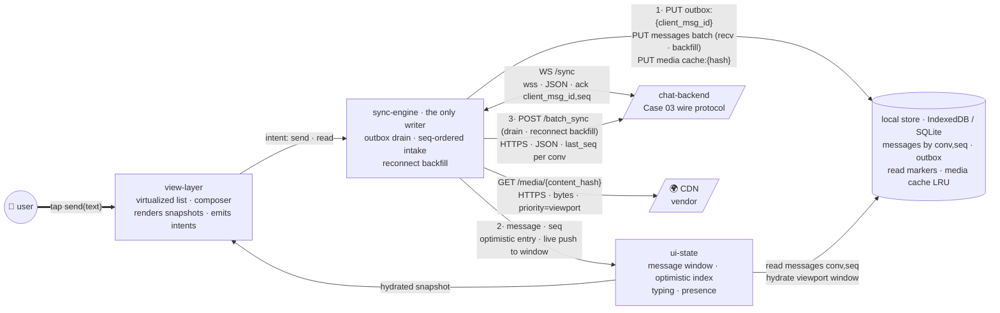

# 03 — Architecture: the client as four layers and one writer

The client's shape is dictated by one rule: **the server log is the source of truth, the
local store is the projection, the view is a function of the store.** Everything else is
in service of that.

Q: How does a send move through the client's four layers without losing a tap — and how do live events, backfill, and media reach the same store through one writer?

## Components

**View layer.** Virtualized list (04 dive 2), composer, sidebar. Holds no business state —
reads store snapshots, emits intents. The list component owns *view* state only: scroll
position, measurement cache interplay, overscan window.

**UI state (in-memory).** Per-conversation message window (a few hundred messages around
the viewport, hydrated from local store), the optimistic index, ephemeral state (typing,
presence). Optimistic messages live in the optimistic index until acked, then fold into
the seq-ordered log at their server-assigned seq (04 dive 1).

**Sync engine.** The **single writer**: the only component that moves messages across the
wire, in either direction, and the only component that mutates persisted state. One
WebSocket for live events; HTTPS for bulk backfill and media. It owns the outbox drain
loop and the reconnect/backfill protocol (04 dive 4).

**Local store.** Two distinct write patterns, two sub-stores:
- *messages* — content, keyed `(conversation_id, seq)`, written by batching (04 dive 3);
- *outbox* — durable queue keyed by `client_msg_id`, written **before** the optimistic
  render (a tap that doesn't survive a crash is a lost message).
Plus read markers, the height cache, and the media cache (04 dive 6), which is content-hash
keyed and evictable.

## Data flows

**Send path** (the one that must never lose a tap):
1. Composer emits `send(text)` → sync engine assigns `client_msg_id` (UUID), writes the
   message to the **outbox store** (durable, ~1–5 ms estimate).
2. Optimistic message enters the UI state index; view renders it at the tail in the same
   frame — state `sending`.
3. Background drain loop POSTs it; server ack returns `(client_msg_id, seq)` → message
   folds into the ordered log at `seq`, state `sent`; index entry dropped.
4. Transport error → state `failed`, retry with the *same* `client_msg_id` (idempotent
   retry — the server dedups by that key, mirroring [Case 03's wire protocol](../03.whatsapp/04-deep-dives.md)).

**Receive path**: WS frame → sync engine dedups by `client_msg_id` / orders by `seq` →
writes to store in one batched transaction → pushes into the in-memory window if
conversation is active → view re-renders. Budget: < 50 ms p95.

**Reconnect path**: socket down → exponential backoff reconnect → one batched
`sync(last_seq per conversation)` request → server streams missed events; client detects
seq gaps and range-fetches them (04 dive 4). Hot-channel truncation: server may close the
gap with a jump marker.

**Media path**: message carries (media metadata + ~30 B placeholder hash) → placeholder
paints instantly → fetch full asset by content hash from CDN with priority = viewport +
scroll direction → cache by hash → decode at display size off the main thread (04 dive 6).

## What the single-writer rule buys

Every hard client bug in this domain is two actors mutating the same state: two tabs
draining the outbox, view scrolling while backfill merges, ack arriving while the user
scrolls. Making the sync engine the only writer to the store and the wire means every
correctness argument reduces to "what did the engine do, in order" — testable without a UI.
The view can crash, remount, and re-hydrate without corrupting anything; the outbox
survives any of it.
