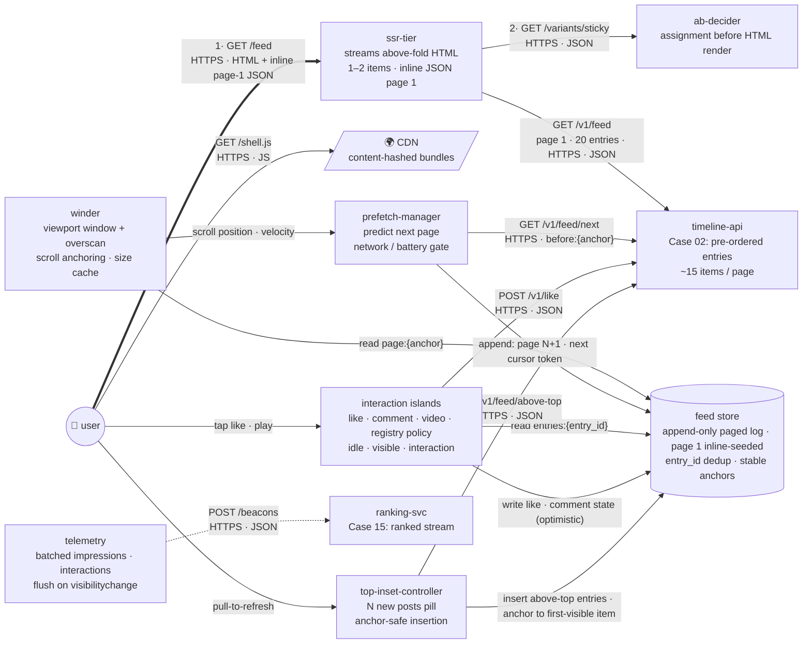

# 03 — Architecture: stream the paint, hydrate the interaction, window the scroll

The shape is dictated by three rules:

1. **Content first**: the feed stream paints without waiting for the interaction JS.
2. **The scroll window never grows with the session**: the view mounts a bounded window
   over a paged log.
3. **The ranker's list is a moving floor**: every pagination cursor and every insertion is
   defined against *stable anchors*, never offsets in a mutating list.

Q: How does one feed session paint, paginate, and insert new stories — without the scroll window growing or a cursor ever referencing a mutable offset?

## Components

**Edge/SSR tier.** Content-hashed immutable bundles on CDN; a *thin* SSR tier that
streams the first viewport: one or two rendered feed items plus an inline JSON payload
(page 1 + cursor token + variant flags). It is thin because freshness of ranked content
means SSR can't be a long-cache artifact — it is per-request, so the component budget is
"p99 < 300 ms" (estimate target), not "as fast as static".

**A/B decider (at the edge).** Assignment happens *before* the HTML is produced (dive 6):
the variant travels with the SSR payload, so paint and behavior agree from the first frame
and no cacheable-canvas of variants is needed on the CDN.

**Feed store.** The only authoritative client state: an append-only log of *pages*, each
page a list of entries with a stable anchor token (dive 4's rank-stable cursor), deduped
by `entry_id` (the ranker re-emits and reorders; the store keeps first-seen), trimmed
pages far behind the window. Interactions (likes) write back here optimistically.

**Winder (virtualized list).** Owns mounting/unmounting against the viewport, the
size cache, overscan, and scroll anchoring. Reads the store, never the wire. The direct
sibling of [Case 19's](../19.frontend-chat-app/03-architecture.md) message-window layer —
shared vocabulary, different anchor semantics (rank anchor vs seq).

**Prefetch manager** and **top-inset controller** are deliberately separate components
(dive 3 and dive 4), because they answer different questions: "when do we fetch next" and
"what happens when the ranked list changes above us" — conflating them is how scroll-jump
bugs get born.

**Island registry.** Declares per-component hydration policy (immediate | on-visible |
on-interaction | on-idle). This is where the interaction-latency budget lives or dies
(dive 5).

**Telemetry.** Batched impressions/interactions; flush on batch-size, interval, or
`visibilitychange`. Its output is the ranker's input (Case 15) — the loop closes here.

## Data flows

**Cold start** (drives dive 2): request → edge assigns variant → SSR streams HTML
(items 1–2 rendered inline) → first paint ~T + 1 RTT (target < 1.5 s p75) → inline
payload seeds the feed store (page 1) → shell JS (150 KB budget) parses/executes →
windower takes over rendering → islands hydrate progressively (interaction UI by
~3 s p75); below-the-fold content already flowed in via HTML stream or was prefetched.

**Scroll path**: winder detects the window nearing the last mounted item → asks the
prefetch manager, which checks (a) gate pass (network/battery), (b) prediction
(time-to-reach-end < fetch RTT) → fetch page N+1 with the *last page's anchor token*
(dive 4) → store appends page, dedups → winder mounts window extension in one batched
layout pass. Budget: response → painted < 300 ms (01).

**New-stories path** (dive 4's core): a top-ranked refresh (on pull-to-refresh or polled)
returns items ranking *above* the current top anchor → top-inset controller renders the
pill instead of inserting → on scroll-to-top (or tap), insert with viewport anchored to
the first previously-visible item; insertion *below* the viewport is always anchor-safe
and immediate.

**Interaction path**: tap like → optimistic store mutation + immediate paint →
background POST → reconcile (accept server counts; failure reverts with a retry affordance).
Same optimistic pattern as [Case 19's message state machine](../19.frontend-chat-app/04-deep-dives.md),
minus the ordering problem — interactions are per-entry, not a total order.

## The two contracts with the backend

From [Case 02](../02.twitter/04-deep-dives.md) the client inherits: (1) the *timeline is a
pre-ordered list of entries* — the client never ranks, only renders and paginates; (2)
pagination by **sortable stable IDs** ("entries before/after anchor X"), which survives a
mutating ranked list in a way offsets never do — that inheritance is what makes dive 4
solvable at all. From [Case 15](../15.ml-ranking-system/README.md) the client inherits its *measurement duty*: impressions
and exposures are the ranker's ground truth, so the beacon pipeline's correctness is
ranking-quality-critical.
