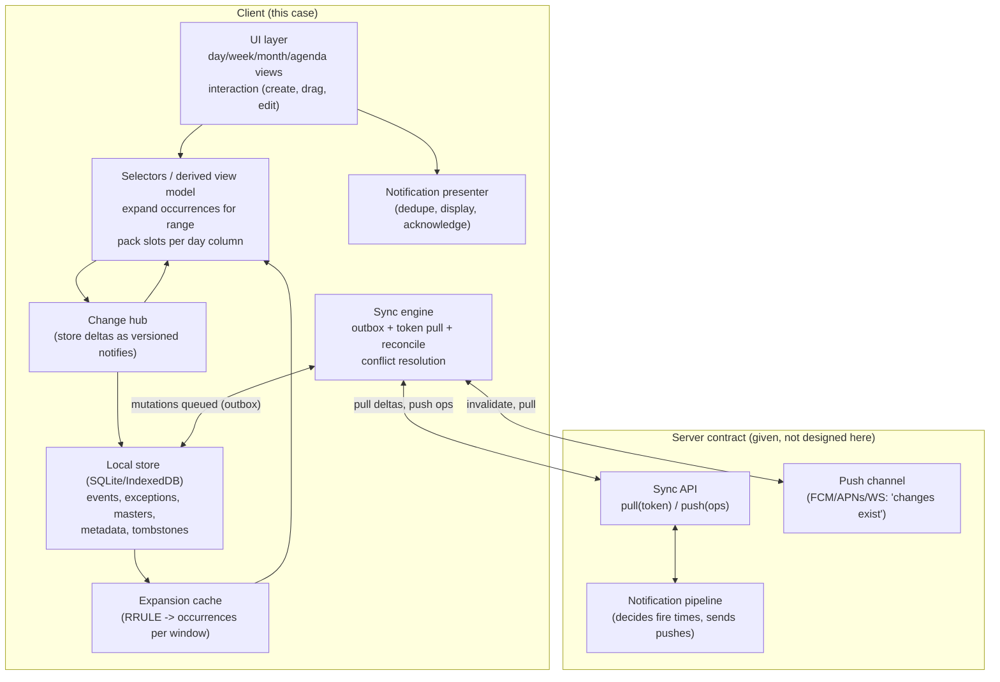

# 03 — Architecture

## Mermaid diagram

## Client components

- **Local store** — the only source of truth for rendering. Relational (SQLite on mobile,
  IndexedDB on web) because queries are range-based ("events overlapping [a, b]") and
  need indexes on interval endpoints; a document/key-value store would push interval
  queries to full scans. Holds: event rows (with tz + recurrence fields), exception rows
  (per-occurrence overrides), tombstones, per-calendar sync tokens, and the outbox
  (pending mutations, durable, append-only). Schema details land in dives 3 and 4.
- **Sync engine** — owns the *conversation with the server*, nothing else. Push loop:
  drain the outbox in client-op order, each op carrying a client op ID (idempotency key,
  same idea as Case 03's per-message dedup ID); the server stamps each accepted op with a
  server sequence/apply time and returns the post-apply state. Pull loop: pull(token)
  returns changes since the token, applied to the store, then a new token is persisted
  *in the same transaction as the applied changes* — the token and data must move
  together or a crash loses or duplicates a delta. A push channel carries only
  "invalidate, pull now" hints (never payloads), so a broken/pushed-missed hint costs one
  delayed pull, never lost data.
- **Expansion cache** — derives occurrences from masters for a requested window. Never
  materializes an infinite series; expands lazily per window, caches per (master, window),
  and invalidates on master edit (dive 3).
- **Change hub** — the only notify path. UI/state subscribers subscribe to *keys* (day
  keys, range keys, occurrence IDs), so an edit invalidates exactly the affected derived
  state; this is what makes per-day layout caching workable (dive 6).
- **Notification presenter** — does not decide fire times. Fires display when the device
  receives the server's reminder push (or when it observes the passage of the time for
  already-known reminders in foreground), dedupes by reminder ID across devices, and
  acknowledges dismissal; while fully online it also arms the bounded ≤ 24 h
  local-notification hedge (dive 5).

## Data flows

**1. Cold start (offline)**: store opens → selectors expand the requested range →
first frame with zero network. Sync happens after first paint, never blocking it.

**2. Create/edit (online)**: UI writes to the store immediately (optimistic, the event is
"real" the moment the dialog closes) + appends the mutation to the outbox → sync engine
flushes within ~seconds → server stamps a version → the push response is reconciled back
into the store (the local row's version catches up; no separate "optimistic overlay"
state — the store row is already the optimistic one).

**3. Create/edit (offline)**: same flow from the store onward, but the outbox holds the
op for hours/days. On reconnect: flush outbox first (in order), *then* pull — this
ordering gives simple, local read-your-writes and puts every conflict at a single
reconciliation point (dive 2).

**4. Pull apply**: deltas upsert rows by event ID; deleted server-side → tombstone;
recurrence edits rewrite the touched master/exception rows; the sync token persists
atomically with the applies; change hub notifies affected keys; expansions and layouts
recompute lazily, per invalidated unit.

**5. Reminder**: server pipeline computes fire times from event data on the *server's*
model (dive 5) → at fire time, per-device push → client presenter displays, dedupes,
acknowledges; a reminder for an event the client has never seen (e.g., brand-new device)
is displayed from the push payload alone, with a lazy fetch to hydrate the event.

## Invariants the architecture holds

- **I1** — UI renders from local store only; no component fetches from the network
  directly. This is what makes "offline-first" a property of the architecture rather
  than a mode.
- **I2** — Outbox ops are durable, ordered, idempotent (client op ID), and never
  auto-expired while unsynced; only successful server acknowledgment removes them.
- **I3** — Sync token and applied deltas live or die in the same transaction.
- **I4** — Every derived structure (occurrences, layouts, unread-like aggregates) is
  disposable and derives deterministically from event rows; nothing authoritative lives
  only in a cache.
- **I5** — No stored datetime is a wall-clock string without a timezone ID attached
  (dive 4); the store's representation survives tzdata updates because UTC is never the
  authority — the one carve-out is that the indexed `start_utc`/`end_utc` projections are
  stored and refreshed on tzdata updates (not derived per read), while wall fields stay
  the truth (dive 4).
