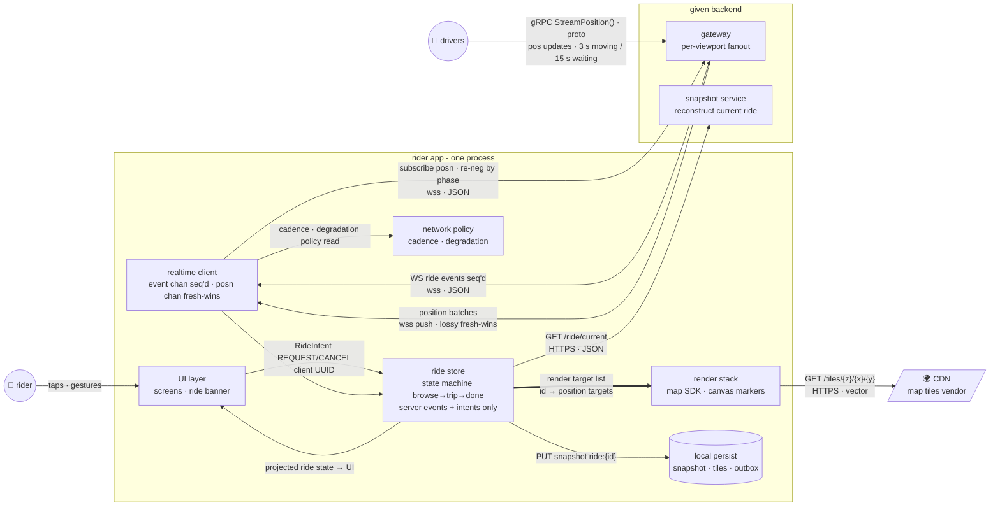

# 03 — Architecture (client-side)

## The client in one line

Two apps (rider/driver), one shared client core: a **render stack** (map + animated
vehicle layer), a **realtime client** (two channels with different guarantees), a **ride
store** (single source of client truth: state machine + reconciler), and a **network
policy engine** (battery/network-aware throttling and degradation).

## High-level diagram

Q: How do rider events and driver positions flow into one client-side ride store and out to the render stack?

## Components

**Ride store + state machine** — the client's single source of truth. One state machine
per active ride; every UI surface (map banner, driver card, payment sheet) projects from
it. Server events (seq'd) and user intents are the only inputs; local clock never decides
transition validity. Deep dive 3.

**Realtime client** — deliberately **two channels**, two contracts:

1. **Event channel** (socket): small, rare, must-not-lose rides events with sequence
   numbers, retransmit on gap — the WhatsApp-style wire protocol
   ([Case 03](../03.whatsapp/04-deep-dives.md), at-least-once + client dedup).
2. **Position channel**: high-cadence, **lossy-tolerant**: freshest-wins, no retransmit,
   batched — retransmitting a stale position is worse than dropping it. Same call
   WhatsApp made in reverse: *messages are MUST-NOT-LOSE, presence is
   MUST-NOT-COST-ANYTHING* — here, position is in between (fresh-wins, evented only when
   state changes).

**Render stack** — map SDK (tiles from CDN) + a private canvas layer for moving markers,
decoupled from the store by a "render target list" (id → position targets). Deep dives 1, 5.

**Network policy engine** — one component owning: connectivity classification, battery
mode (normal / low-power), foreground/background, and the resulting cadence + degradation
decision for every stream. Single owner, because every subsystem (send cadence, receive
cadence, tile prefetch, ETA polling) reads the same answer. Deep dives 2, 4.

**Local persist** — ride snapshot cache (instant rehydrate on reopen), tile cache (~200 MB
budget), search/recent places, and a small outbox for driver-app intents sent while offline.

## Data flows (numbered)

1. **Browse**: app start → map SDK loads style+tiles (CDN) → subscribe viewport vehicle
   channel → batches every 4 s → dead-reckoned drift on the canvas layer between batches.
2. **Request**: intent `REQUEST` → optimistic `requesting` state with search animation →
   server event `MATCHED {driver_id, quote, seq}` → state machine transitions → UI swaps
   to pickup mode → switch viewport channel off, subscribe `driver_car` channel.
3. **Pickup**: driver positions every ~3 s (relayed server-side) → rider canvas
   interpolates between known points → ETA evented on change → arrival event `ARRIVED`
   flips state, banner + haptic.
4. **Trip**: same position channel, car on route; reroute events replace polyline;
   completion event `COMPLETED` → payment sheet renders fare (server truth) → `receipted`
   closes the machine; snapshot written to local persist.
5. **Reconnect/reopen**: socket resume with `last_seq` → gap? retransmit → ride store
   asks snapshot service for current ride truth (`GET /ride/current` ≈ 5–20 KB) →
   reconciler folds snapshot + missed events → render resumes with last-known positions
   while fresh ones stream in.
6. **Network loss** (rider in ride): policy engine flips to degraded: keep last
   positions, label "last updated Xs ago", back off to polling with backoff, keep the
   state machine's *event* channel on long-backoff retries, never auto-cancel or
   auto-confirm anything on the client — money transitions always need server truth
   (deep dive 4).

## What is deliberately not in the diagram

- No client-side business logic on fares/matching: client renders; server decides.
  (Same discipline as Case 19: the optimistic UI fakes a *view*, never an *irreversible*
  action.)
- No separate per-screen state: screens are pure projections of the ride store; two apps
  share the store/render cores with different projections (ride banner vs offer card).
- No server diagram beyond the contract: gateway fanout, matching, snapshot service are
  given services — this doc defines only their client-facing contracts (seq'd events,
  fresh-wins positions, idempotent snapshot).
