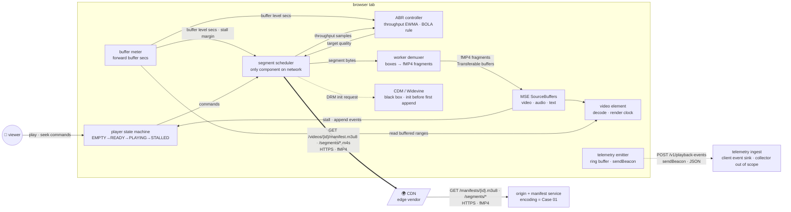

# 03 — Architecture

## The player pipeline inside the browser tab

Q: How do manifest and segment bytes get from CDN edge to pixels, and how does ABR steer quality?

## Components

- **State machine owner.** Single authority for the player's phase (idle, loading,
  playing, stalled, seeking, ended). UI reads it; controllers command it through it.
  Deliberately NOT the UI framework's state — the machine survives React re-renders and
  background throttling (04 §4, same split as the chat case's message store:
  [Case 19](../19.frontend-chat-app/04-deep-dives.md)).
- **ABR controller.** Consumes throughput samples (per segment fetch) and buffer level,
  emits the target rendition. Pure function of (samples, buffer, current quality) —
  testable without a network (04 §1).
- **Segment scheduler.** The only component that touches the network for media. Keeps a
  small priority queue: playhead-adjacent first, audio over subtitles, preview-sprite
  requests last and abortable. All requests carry the CDN-friendly URL form; retries are
  bounded and back off (they land on the shared edge: Case 09).
- **Worker demuxer.** Parses container boxes (init/segment), converts to fMP4 fragments
  MSE can append. Runs off-main-thread so parse cost never janks controls; bytes cross
  via Transferable ArrayBuffers (no copy) (04 §5).
- **MSE + `<video>`.** The browser's decode/render clock. The player never renders
  manually; it only fills SourceBuffers and reads back `buffered` ranges and media time.
- **Buffer meter.** Reads `video.buffered` (the browser's own truth), exposes forward
  buffer seconds and the stall margin to ABR and scheduler.
- **Telemetry emitter.** Append-only ring buffer, flushed every N events or T seconds
  via `sendBeacon` (survives tab close; nothing here blocks playback).

## Data flows

1. **Start (VOD)**: UI mounts player → EMPTY: fetch manifest (+ DRM init in parallel) →
   parse ladder and segment timeline → ABR picks startup rendition (low or conservative
   throughput-based) → scheduler fetches init + first 2–4 segments → worker demux →
   append until buffer ≥ ~2 segment durations → CAN_PLAY → play() → first frame. Manifest
   and first-segment fetch overlap wherever the manifest's first-listed default works.
2. **Steady state**: playhead advances → buffer meter shows forward buffer shrinking →
   scheduler tops up toward the 30s target at the ABR-chosen quality → telemetry ticks.
3. **Quality switch**: ABR emits new target at segment boundary → scheduler switches
   rendition for the *next* append → SourceBuffer timeline stays continuous (both
   renditions share the same segment alignment from the ladder — Case 01 §2).
4. **Seek**: pause appends → `remove()` unneeded buffered ranges → fetch at new position
   (byte-range from keyframe-aligned segment start) → append → resume. Scrub bar previews
   come from a static sprite sheet — one cacheable request, zero CDN churn.
5. **Live**: scheduler keeps re-fetching the live manifest every segment duration to
   learn new segments; playhead rides the live edge minus a safety lag (04 §3); DVR seek
   is the VOD seek flow against the availability window.
6. **Stall/recovery**: `media time` reaches the end of buffered → STALLED (04 §4) →
   scheduler drops rendition (panic rule), retries remaining segment, appends the gap →
   auto-resume at small buffer margin.

## Key constraints enforced by this split

- **One network-touching component.** Every fetch decision (what, when, which quality) is
  in the scheduler/ABR pair; the player core only knows phases. That's what makes the
  system testable and what keeps telemetry honest about who asked for bytes.
- **Buffer is the shared currency.** ABR, scheduler and state machine all speak in
  "seconds of forward buffer" — not Mbps, not segments — so one number drives all three.
- **Main thread does not parse.** Decode is the browser's job; demux is the worker's; the
  main thread does decisions and DOM. Background-tab throttling then hits only the parts
  that are allowed to stop (04 §6).
