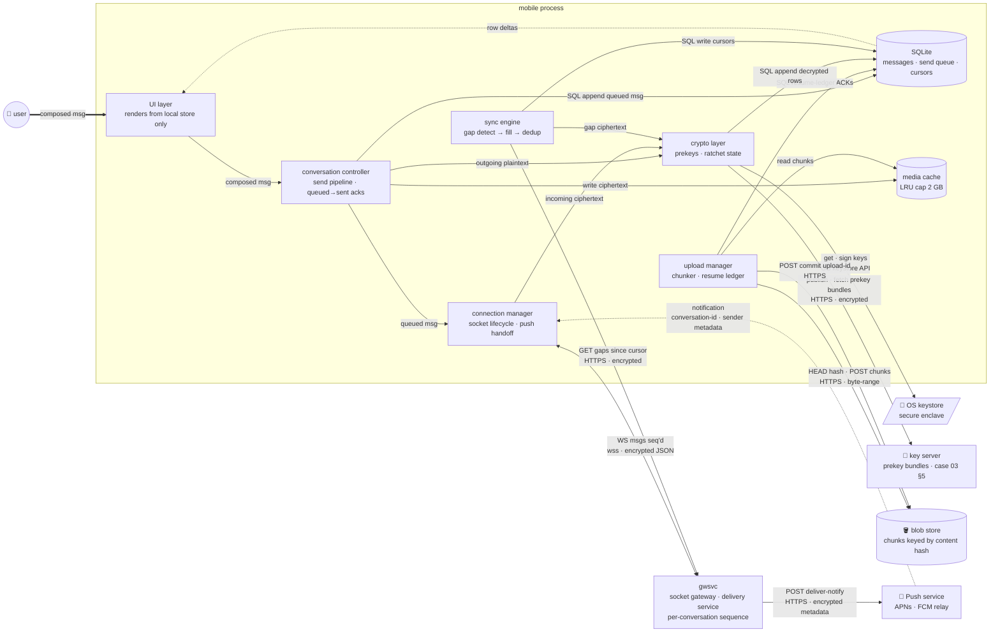

# 03 — Architecture

## Component diagram (client process + given server fleet)

Q: Can the client send, sync and upload durability-first, surviving socket loss and background dormancy?

## Components and their contracts

- **UI layer** — renders from the local store only. Network state never appears as a
  data dependency in the UI: the conversation list opens identically offline. UI
  subscribes to store deltas, not to socket events.
- **Conversation controller / send pipeline** — appends outgoing messages to a
  durable send queue in the store, then hands them to the connection manager. The
  send is *acknowledged to the user as "queued"* at the moment the row
  commits, and escalates to "sent" on server ACK; "delivered/read" arrive later from
  receipts. Durability is achieved before any network dependency.
- **Local store** — single SQLite DB (with WAL mode). Holds: message rows keyed by
  (conversation, server sequence) or client UUID pre-ACK, sync cursor per conversation,
  upload resume ledger, schema-versioned migration chain, feature flags. The store is
  a system of record, not a cache (defended in 04 §3 and §6).
- **Sync engine** — on any new connection: compare local per-conversation cursors with
  the server's sequence high-water marks; fetch only gaps, dedup client-side by
  message UUID (the at-least-once wire + client dedup pattern from case 03 §1).
- **Connection manager** — a small state machine: FOREGROUND_CONNECTED ↔
  BACKGROUND_STANDBY (push served) ↔ CONNECTING (jittered backoff) ↔ SUSPENDED (OS
  killed process or doze; no state, no timers). Owns the push-vs-socket handoff (04 §1)
  and battery-aware backoff (04 §4).
- **Upload manager** — chunks media (e.g. 1–4 MB chunks, content-hash-addressed),
  persists a resume ledger, uploads via plain HTTPS to the blob store so a broken
  upload never depends on socket state (04 §2).
- **Crypto layer** — keys live in the OS-provided secure enclave/keystore where
  possible, session/prekey state in the app DB; enforces the multi-device model of
  case 03 §5 from the client side (04 §5).

## Data flows

**F1 — Send while online.** UI → controller: encrypt (crypto layer) → append row
(state=queued) → connection manager submit → server ACK (sequence number) → update
row (state=sent) → receipts stream in asynchronously. At every instant the row is the
truth; the socket is only an accelerator.

**F2 — Receive.** Server push (background) → client wakes → open socket → sync
engine finds sequence gap vs cursor → gap-fetch + decrypt → write rows → store emits
delta → UI (if any) renders → notification. Receive while foregrounded skips push
entirely: live socket delivery appends straight to the store.

**F3 — Media upload.** Controller encrypts file → writes to media cache → upload
manager: HEAD blob-by-hash (already uploaded? skip) → POST chunks with byte-range +
upload ID → persist per-chunk ACK in ledger → on any failure, next retry resumes from
the last ACKed chunk → server-side "commit" ends it; message send then references blob
hash — never inline bytes through the chat socket.

**F4 — Background dormancy.** OS suspends process → connection manager keeps *no*
timer-based work; all background delivery is via push service → on app relaunch,
state machine enters CONNECTING with jittered backoff, sync engine reconciles by
cursor — the process never "resumes" its old socket, it builds a new one.

**F5 — App upgrade.** New binary launches → store opens at version N → migration
chain runs N→N+1 transactionally (04 §3) → normal startup path. The migration is on
the cold-start critical path, which is why it must be incremental and not one big
ALTER (also 04 §6).

## Server assumptions (given, not designed here)

Socket gateway + connection registry, delivery service with per-conversation
sequence numbers (case 03 §3), push service, blob store (case 07), key server
(case 03 §5). The client design treats each as: (a) reachable when the OS allows
network, (b) at-least-once, (c) possibly stale — and is correct in all cases.
