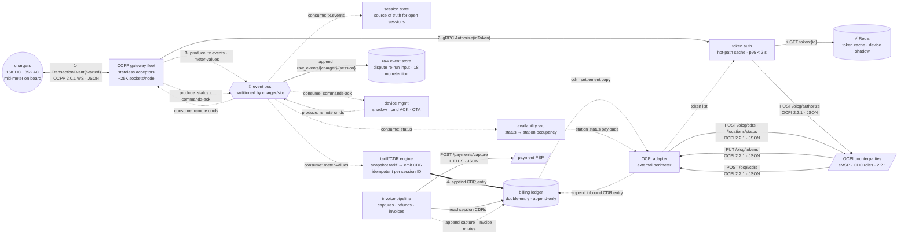

# 03 — Architecture

## High-level picture

Q: How does a charging session flow from the charger through the OCPP gateway and event bus to billing, and how do partners exchange tokens, CDRs, and occupancy over OCPI?

Site level (per site, autonomous): a site controller — a PLC/edge box — enforces the grid
connection limit. The cloud is advisory (schedules, prices, optimization) and is never in
the power-control critical path. The diagram above intentionally omits the site controller
and the cloud load advisor: it answers the session/billing/OCPI question only, and the
power-control path never crosses the WAN (deep dive 4).

## Components

1. **OCPP gateway fleet** — stateless WebSocket acceptors. Charger identity + state
   (device shadow) lives in Redis/DB, so any gateway node can serve any charger after
   reconnect; nothing device-specific pins to a node. Sized for the reconnect storm, not
   the average (~400 new sockets/s for 2 min on carrier recovery — [02](02-scale-estimates.md)),
   with N+1 node headroom: ~25K sockets/node is the steady-state share, and a node loss
   during a storm concentrates the survivors, so sizing uses (steady share × N+margin) +
   storm replay load, not the steady alone. Ack discipline: a charger deletes its queued
   record on receiving the response, so the gateway responds only after the event is
   durably on the bus (deep dive 1).

2. **Event bus** — partitioned by key with per-consumer ordering discipline: transaction
   events by charger, meter values by (charger, session), status by charger. At-least-once
   delivery; every consumer is idempotent. Same reasoning as
   [13.kafka](../13.kafka/README.md); the bus exists because "no message lost, ever,
   across gateway crashes" is a requirement, not because volume demands it.

3. **Authorization** — token registry (our app tokens, RFID UID, eMSP roaming tokens via
   OCPI, Plug & Charge certs). Partners push token lists to us over the OCPI adapter
   (ingress), so the hot path is a local token cache (< 2 s p95 target); a cache miss
   pulls from the partner API, budgeted. Lookup failure degrades to charger-side cached
   authorization (deep dive 2) for locally authorizable tokens — never to a
   "backend down, cannot charge" for them; unfamiliar roaming tokens are refused offline
   by decision (deep dive 2), not opened to an unbounded fraud window.

4. **Session state / transaction lifecycle** — consumes transaction events,
   tracks session state machine (authorized → charging → stopped → CDR'd → settled), and
   is the source of truth for "is this session open". The charger also holds this state —
   the two are reconciled by session ID, not assumed identical.

5. **Tariff engine & CDR generation** — *snapshot the tariff* at session start (a price
   change mid-session must not silently reprice a running session); consume meter samples;
   emit a CDR once, keyed by session ID, into the ledger. Deterministically re-runnable
   from the raw event store. Deep dive 3.

6. **Billing ledger** — double-entry, append-only. CDRs, PSP captures, refunds, partner
   settlements, VAT breakdowns are entries, not states. All "what did this driver pay" and
   "what do we owe partner X" questions are ledger queries.

7. **Availability service** — normalizes charger status transitions into station-level
   occupancy; OCPI partner pushes ride the **per-partner queue** (through the OCPI
   adapter) with per-partner backpressure — a partner outage slows only their push, never
   blocks others; per the OCPI spec, failed pushes are not retried forever — the partner
   recovers by pulling (GET) from our retained, resync-capable endpoints; our driver app
   (webhook/WS) and the POI feeds consume the normalizer's output directly — different payloads, different channels, not "the app as its own OCPI
   partner". Deep dive 5.

8. **Device management** — device shadow (desired/reported config), OCPP command
   dispatch with per-device ACK tracking, firmware OTA with staged rollout and
   health-gated advance. Deep dive 6.

9. **Site controllers** — a small edge box per multi-stall site owns the physical power
   limit. Cloud sends schedules and setpoints as *advice*; the controller applies them
   within its local safety rules and keeps working when the WAN is down. Deep dive 4.

## Key data flows

- **Start a session** (roaming driver): charger → gateway `TransactionEvent(Started)`
  carrying the idToken → token service (cache hit; eMSP miss → partner OCPI lookup,
  budgeted) → `IdTokenInfo` accepted → session state machine opens → meter stream begins.
  Total p95 < 2 s at the plug on the cached-token path; a *cold* roaming token rides the
  partner API and is budgeted separately, not inside this number (deep dive 5).
  (Legacy 1.6 fleet lines express the same flow as
  `Authorize` → `StartTransaction`; the design is identical, only vocabulary differs.)
- **End a session**: charger sends `TransactionEvent(Ended)` + final register reading →
  bus → tariff engine emits CDR (idempotent per session ID) → ledger entry → push CDR to
  relevant partner queue → invoice pipeline. Offline case: everything above arrives in a
  replay burst later; the flow is *identical*, just late — that is the design point.
- **Inbound roam** (we are the eMSP): another CPO's CDRs for our drivers arrive at the
  OCPI adapter's inbound endpoint → validation (schema, duplicate detection, price
  sanity) → priced against our tariff for our driver → ledger entry in the "we owe
  partner X" direction. Same adapter perimeter as outbound: a partner schema bump is
  still an adapter change.
- **Publish availability**: charger status → normalizer (station = aggregate of
  connectors; rules for "one bad connector doesn't close the station") → station
  occupancy table + per-partner queues → OCPI push.

## What is deliberately *not* in the backend

- Power control, safety cutoffs, EV communication (ISO 15118 link layer) — the charger
  and site controller own physics.
- The payment PSP, the PKI for Plug & Charge, the OCPI hub connections — externalized
  contracts; we integrate through adapters so a partner schema bump is an adapter change.
- Any state without a durable home: every device-visible piece of state (sessions,
  pending commands, firmware targets) lives in a store that survives a gateway crash —
  the gateway is a connection multiplexer, not a database.
