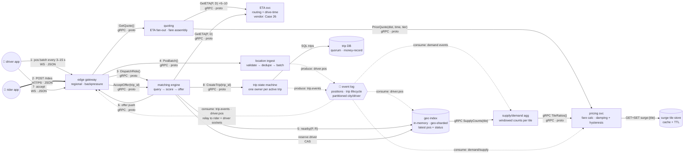

# 03 — Architecture

## High-level diagram

Q: How does a ride request get matched to a driver with the right surge price, and how do driver positions flow into the geo index, trip state, and the surge control loop?

## Components

**Edge gateway (per region)**. Terminates driver and rider sockets, does auth and
connection lifecycle. Its one design job: apply *backpressure to telemetry* (drop a
position sample, never a lifecycle event) so a burst cannot melt the ingest path.
Same connection-management shape as [Case 03](../03.whatsapp/03-architecture.md)'s
gateways.

**Location ingest service**. Consumes position batches from the gateway, validates
(jump detection, staleness), dedupes by driver id+timestamp, and publishes to the
event log. It does *not* write the geo index itself — it streams, consumers materialize.

**Event log** (partitioned, Kafka-style). Partitioned by city/driver-id so per-driver
order is guaranteed; carries position samples (high volume, lossy-tolerant) and trip
lifecycle events (low volume, must-not-lose) on *separate topics with different
retention/delivery guarantees* — the "different signals, different channels" decision
from [Case 03](../03.whatsapp/04-deep-dives.md). Consumers: geo index, rollups, analytics/ML.

**Geo index / driver availability store**. In-memory, geo-sharded (deep dive 2):
each shard holds latest position + status for drivers registered in its cells. Serves
two reads: "drivers near P within R" (matching) and "viewport vehicles" (map view).
Offers compare-and-swap reserve/release so one driver cannot be double-assigned.

**Matching engine** (deep dive 3). Takes a ride request, queries the geo index,
scores candidates (ETA, driver preference, product tier), extends the set if empty,
sends offers over the socket, and drives offer/ack. Owns reservation of the winning
driver and hands the trip to the state machine.

**Pricing service** (deep dive 4). Stateless fare computation (base + distance + time
+ tier) reading *surge multiplier* from the tile store. Consumes supply/demand events
to update the tiles, with damping and hysteresis so the control loop does not
oscillate. Riders see the multiplier; drivers see the effective (multiplied) earnings.

**Supply/demand aggregator**. Windowed counts of requests vs available drivers per
tile, fed from the event log; its output is the surge tile time-series.

**Trip state machine** (deep dive 5). One owner per active trip (geo-located to the
trip's region). Persists transitions to the trip DB with idempotency keys, emits
lifecycle events, and arbitrates conflicts (double cancel, driver crash) via
transition guards. The trip DB (quorum-replicated, money-record durability) is the
system of record; everything else is a projection.

**Trip DB**. Trips: 20 GB/day, quorum-replicated [Case 12](../12.bigtable/README.md)
-style wide-column or plain relational by city+time; must answer "reconstruct trip"
after app-reopen (Case 22's snapshot rebuild depends on it).

## Data flows

**Position flow (write-heavy, lossy)**: driver app → gateway (batch) → ingest →
event log → geo index (latest-position update) + rollup consumers. A dropped message
costs at most one stale sample; the next update corrects it within seconds.

**Ride flow (read+write, latency-critical)**: rider request → gateway → matching →
geo-index query → candidate scoring (calls ETA service) → offer push → driver accept
→ reserve driver → trip state machine creates/marks trip → both apps updated via
lifecycle events. Target end-to-end p50 ≤ ~3 s, dominated by offer-accept human
latency, not machinery.

**Quote flow (read-heavy)**: rider opens app → quoting → surge lookup + fan-out ETA
calls → fare returned. No writes except rate-limit counters.

**Surge flow (control loop)**: request events + geo-index supply counts → aggregator
→ pricing service updates tiles → riders/drivers see new prices → demand changes →
next window measures it (deep dive 4; a feedback loop).

**Failure isolation**: every city maps to specific geo shards, matching capacity, and
log partitions; a Mumbai traffic spike cannot consume New York's matching budget
(geo-sharding is also blast-radius sharding).
