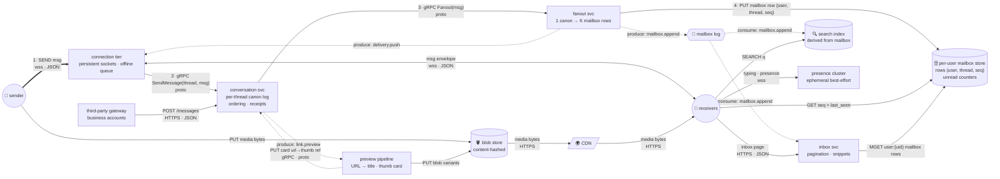

# 03 — High-level architecture

## Diagram

Q: How does one sent message become K per-recipient mailbox rows plus a live push, and where do media, previews, and search leave the chat path?

Outside the chat path: business accounts / platform apps write in through the third-party
gateway; abuse/moderation and ML ranking consume the plaintext-era content stream
(E2EE: unavailable). E2EE regime (post-migration): the plaintext-era features — mailbox
canon content, preview fetch, server search — either keep *metadata only* or move
client-side. Feature-by-feature consequences: see deep dive 5 in
[04-deep-dives.md](04-deep-dives.md#5-the-e2ee-migration-what-server-truth-buys-and-what-it-costs).

## Components

| Component | Job | Key data |
|---|---|---|
| Gateway/connection tier | persistent sockets, push-first delivery — same primitive as WhatsApp | route registry user→gateway |
| Conversation service | authoritative per-thread append log; assigns (thread, seq); ordering + receipt bookkeeping | canon message copy |
| Fanout service | one canon send → K per-recipient mailbox entries; live push or park | per-recipient queue |
| Per-user mailbox store | durable per-user history: rows keyed (user, thread, seq); inbox index; retention | ~200B entries/day at assumed scale |
| Inbox service | thread-list pagination, snippets, unread counts (materialized, not counted-on-read) | per-user thread summaries |
| Search index | async index over mailbox (historical plaintext-era; E2EE: client-side) | derived |
| Media blob store + CDN | content-addressed photos/videos; resumable upload | bytes never in chat path |
| Preview pipeline | image variants; **link fetch** (title/thumbnail) server-side | crawl cache |
| Third-party gateway | business accounts, platform apps → API-shaped writes into conversation service | abuse surface, rate limits |
| Presence/typing cluster | ephemeral, best-effort (same call as WhatsApp's presence tier) | never durable |

## Key data flows

**Send, receiver online (any device set)**: client → gateway; conversation service appends
to the thread log (assigning the thread sequence), fanout writes one mailbox entry per
recipient, then live-pushes to each recipient's connected devices. The mail inbox and
unread counters are updated async from the mailbox rows — never counting on read.

**Receiver offline**: same writes; push skipped; on reconnect, parked entries replay in
`(thread, seq)` order — the offline queue machinery is WhatsApp's (see
[that architecture](../03.whatsapp/03-architecture.md) for the detail we don't repeat here).

**Multi-device sync**: trivialized by the mailbox model. A device that comes online needs
no peer-to-peer sync or encrypted device-fanout channel — it *queries its own mailbox* for
threads with `seq > last_seen_seq`. This is the single biggest architectural divergence
from WhatsApp-2013..2021's single-primary-device era, and it is only possible because the
server holds history (the cost of which is exactly what the E2EE migration reclaims — see
[deep dives](04-deep-dives.md#5-the-e2ee-migration-what-server-truth-buys-and-what-it-costs)).

**Media**: bytes take the blob-store path; the chat message carries only a reference.
Links carry a reference the *server* materialized via preview fetch. Stickers/GIFs are
catalog references — the sender sends an ID, the CDN serves the bytes.

**Group message**: K mailbox entries per group member list (K = group size, hundreds max
for Messenger's model), unlike Discord's per-channel single-copy model — the trade-off
that decides the mailbox read path is in [deep dives](04-deep-dives.md#2-group-chat-fanout-at-scale-the-mailbox-vs-the-channel).

## Where the money is

- **The per-user mailbox fleet** — ~200B entries/day and ~PB-scale corpus under the
  assumptions in [02](02-scale-estimates.md): this is the component Messenger uniquely owns
  (the connection tier it shares with WhatsApp).
- **Inbox read path** — thread lists and unread badges for ~600M DAU from the same mailbox
  rows; materialized indices rather than COUNT queries.
- **The preview/crawl pipeline** — a small crawler with blast-radius concerns (SSRF, cache
  poisoning) attached to the hottest endpoint in the product.
