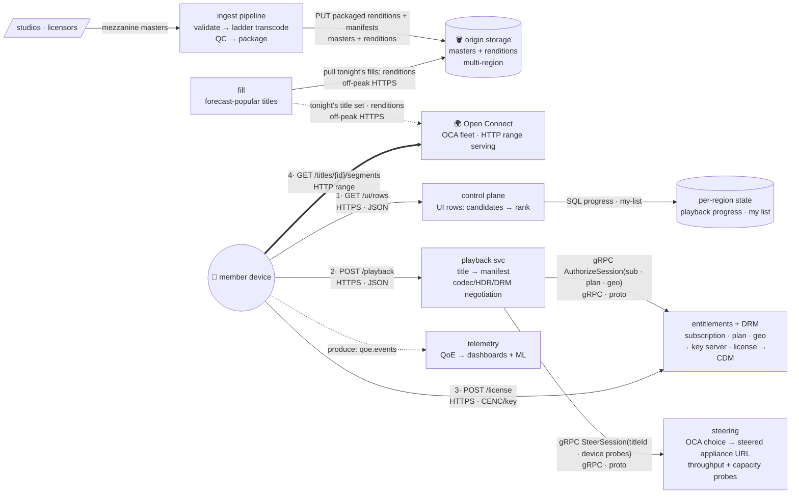

# 31.03 — Architecture

Two halves that barely touch on the hot path, and that separation *is* the design:

- a **control plane** (cloud, multi-region) that decides what each member sees and proves
  they may watch it;
- a **data plane** (Netflix's own CDN, Open Connect) that moves the bytes, almost entirely
  without talking to the control plane.

## High-level diagram

Q: How do the bytes reach the member from Netflix's own CDN while the control plane only brokers discovery, the manifest, and DRM?

## Components

**Ingest pipeline** (F1–F4): batch work orders with release deadlines, not streaming.
Mezzanine in → validation/normalization → analysis pass → ladder transcode → human+automated
QC gate → package (per-codec manifests, DRM packaging keys, artwork, localized tracks) →
replicated origins. See deep dive 1.

**Origin storage**: masters (durability-critical, kept for regeneration) plus every
playable rendition, replicated across regions. Tiny by big-video standards (02).

**Open Connect (data plane)**: appliance fleets embedded inside ISP networks and IXPs;
an off-peak **fill** process pulls each night's forecast demand from origins and pushes it
out; daytime serving is read-only local disk, no origin contact. **Steering** decides which
appliance serves which member based on measured throughput/latency/capacity — Netflix
steers *to its own fleet* rather than DNS-falling into whichever POP is nearest. Deep dive
2; generic CDN mechanics in [Case 09](../09.cdn/README.md).

**Control plane** (F6–F12): stateless services fronted by a gateway; regional deployments
with per-region state for playback progress; a recommendation stack (candidates → rankers →
re-rank, [Case 15](../15.ml-ranking-system/README.md)) that only has to sort a handful of
thousands of items but must personalize *surface*, not order (deep dive 4).

**Entitlements + DRM** (F8–F9): session-scoped checks at playback start (subscription
state, plan limits, geo/age rating, concurrent-stream count) followed by multi-DRM license
issuance to the device's CDM. Deep dive 5.

**Telemetry**: the same session events that surface player failures also feed QoE dashboards
and offline experiments — playback quality tracking is an ML input and an incident signal
(deep dive 3).

## Data flows

**Ingest** (days ahead of release): mezzanine → pipeline → packaged renditions at origins →
enters the prepositioning candidate pool. Nothing here touches a member device.

**Playback** (latency-critical, every session):

1. Device → gateway → UI orchestration: identity/profile, personalized rows (F6).
2. Device chooses a title → playback service returns a manifest *and a negotiated delivery
   path* (codec/HDR/DRM the device supports, CDN URL pattern pointing at the steering pool).
3. Device obtains a DRM license bound to its CDM and session (F9) — this is the money gate.
4. Device fetches chunks directly from an OCA on the steered appliance for the session's
   duration; ABR runs client-side ([Case 23](../23.frontend-video-streaming/README.md)); the control plane is not touched again.
5. Session events (starts, rebuffers, exits, QoE) stream back asynchronously.

**Fill** (nightly, off-peak): forecasting + viewing plans choose what to place → fill
servers pull from origins, push to appliances inside ISP networks during the ISP's idle
hours → by evening the appliance set serving tomorrow's peak already holds the bytes.

## The load-bearing decisions (all argued in 04)

| # | Decision | Why not the obvious alternative |
|---|----------|--------------------------------|
| 1 | Per-title/shot-aware ladder transcode | One-size ladder over-serves short content and starves art-house cinematography |
| 2 | Preposition into own ISP-embedded fleet | Rented CDN burst cannot guarantee 175 Tbps at Friday 9 PM at flat cost |
| 3 | Client ABR + server QoE telemetry loop | Server-side ladder control would need per-session state at 50M concurrency |
| 4 | Personalize surface (rows/artwork), rank a small catalog | Full-scale retrieval over a small catalog buys nothing (Case 15 contrast) |
| 5 | Session-scoped entitlement + multi-DRM key server | Client-side trust alone is a piracy giveaway; coarse license TTLs leak plan revenue |
| 6 | Chaos experiments in production as routine | Testing only in staging cannot reproduce member-visible failure at this scale |
