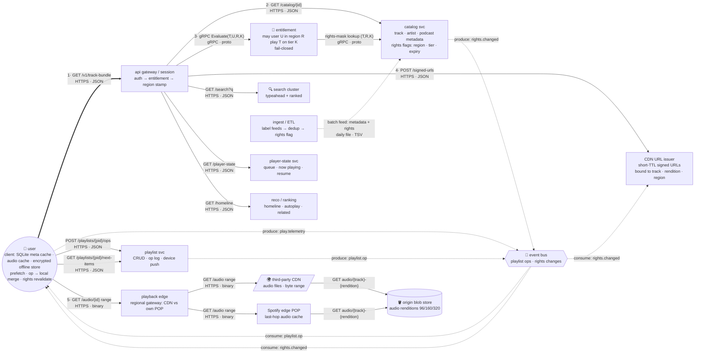

# 03 — High-level architecture

Same two-plane shape as 01.youtube, but the planes carry inverted weights: the **content
plane** moves few bytes per request and the **control plane** is touched at every track start
(~59K starts/s — see 02). The interesting design work is the *handshake between the planes*:
the client is deliberately autonomous (caches, prefetches, plays offline) while the server
stays authoritative over *what may be played*.

## Diagram

Q: What does one 300 ms track start touch, and how do rights reach both the audio stream and the offline client?

## Components

| Component | Job | Notes |
|---|---|---|
| Client (the biggest component, deliberately) | caches metadata in SQLite, caches audio files, prefetches next track, plays offline | the client holds most of the latency budget on its own disk (publicly documented architecture); it must be treated as a distributed system node that can be weeks stale |
| API gateway / session | authenticates, resolves entitlement + region once per session | region is resolved here and stamped onto signed URLs; the edge never re-derives it |
| Catalog service | track/artist/album/podcast metadata + rights flags | read-dominated; sharded by entity ID; top-popularity working set cached globally (10.distributed-cache) |
| Rights/entitlement layer | "may user U in region R play track T on tier K, now?" | must be cheap (called ~59K/s avg) and must be *fail-closed* on doubt — a wrong "yes" is a contract breach, a wrong "no" is one sad user |
| CDN URL issuer | hands out short-TTL signed URLs bound to (track, rendition, region, entitlement) | TTL short enough that a revocation propagates in minutes–hours; see deep dive 1 versus deep dive 2 trade-off |
| Playlist service | CRUD + concurrency control + event push to devices | the hardest consistency problem in the system; see deep dive 4 |
| Player-state service | queue/now-playing/resume per user-device | low volume, but latency-sensitive (device switching feels live) |
| Search cluster | typeahead over tracks/artists/albums/playlists/podcasts + ranked results | prefix index + personalization; deep dive 5 |
| Ingest/ETL | label/distributor feeds, dedup/matching, audio encoding, rights flagging, re-encoding on format changes | batch; correctness >> throughput |
| Recommendation/ranking | homeline, autoplay queue, recommendations | out of scope in depth here; shares the ranking infrastructure pattern with ../15.ml-ranking-system/04-deep-dives.md and ../31.netflix/04-deep-dives.md |
| Content plane | audio blobs via CDN + owned POPs, origin blob store | see deep dive 3 for how POPs and CDNs are mixed |

## Data flows that carry the design

**The 300 ms track start** (the flow that justifies the whole control plane layout):

1. Client has the track already? → play from local cache; no network. (Common for playlist
   chains thanks to prefetch — this is the *intended* path, not the fast path.)
2. Else: one gateway call: entitlement + catalog entry + signed CDN URLs (batched so one
   request pays for the whole next few tracks).
3. First audio chunk (range request) fetched from edge; decode starts after the first
   ~1–2 s of audio arrives (`~40 KB` at 160 kbps) — the time-to-first-sample budget is
   "one RTT to edge + ~40 KB transfer + decode", **not** "fetch the whole 4 MB track".

**The prefetch chain** (how gapless happens): while track N plays, client issues the same
gateway call for track N+1 (and N+2 if buffering capacity allows). The gateway call is the
expensive serialized part (entitlement + metadata round trip), so it is pipelined ahead of
need; the CDN fetch is the cheap concurrent part.

**Catalog change → devices**: ingest flips rights flags or takedown → catalog published →
signed-URL issuer denies at next request → offline devices get a rights-revalidation push
when they reconnect (deep dive 2 and 6). Note the asymmetric guarantees: *streaming* takedown
enforcement is fast (server denies), *offline* enforcement is eventually-in-hours
(client must sync) — and that asymmetry is contractual, not a compromise we chose freely.

**Collaborative playlist edit**: edit → playlist service (append/op log per playlist) →
event broker → push to co-editor devices' clients → their local SQLite merges. Conflicts
merge by op order, never by "last write wins on the whole playlist" (deep dive 4).

## What is deliberately *not* here

- **No video-style transcode ladder per asset.** Audio renditions are fixed bitrate tiers
  (96/160/320), not resolution-contingent; "adaptive" means *client toggles a tier on
  settings/weak-network flags*, not per-second ABR.
- **No recommendation-heavy read path in the hot loop.** Playing "Radio" or the homeline does
  call ranking, but *playing a track I already saved* — the majority of listening — requires
  only catalog + rights. Recommenders must never sit in the playback-start path.
- **No origin serving of user-scale traffic.** Origin blob store sees cache-miss traffic and
  offline-sync backfills only; see ../07.blob-store/04-deep-dives.md and deep dive 3.
