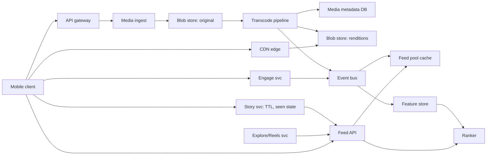

# 03 — Architecture

## High-level diagram

```
          MOBILE CLIENT (photo capture, filters, ABR playback, offline queue)
             | 1. upload original (compressed)          | 6. fetch ranked feed list
             v                                          v
      +-------------+   +------------------+   +---------------------+
      | API Gateway |-->| Media Ingest Svc |-->| Blob Store (orig)   |  (../07.blob-store)
      +-------------+   +------------------+   +----------+----------+
                                   |                      | 2. object-ready event
                                   v                      v
                        +------------------+    +----------------------+
                        | Media Metadata   |    | Transcode Pipeline   |
                        | DB (post/story   |    | (workers, retriable, |
                        |  row, state)     |<---|  async, per-rendition|
                        +------------------+    +----------+-----------+
                                                            | 3. renditions done,
                                                            |    state -> SERVING
   +-----------------+     +-------------------------+    <- state machine
   | Event Bus       |<----| Ranker / Feature Svc    |
   | (events: post,  |     | (candidate scoring;     |
   |  engage, view)  |---->|  ../15.ml-ranking-system)|
   +--------+--------+     +-----------+-------------+
            | 4. fanout / pool append  ^
            v                          | pull celebrity merges at read
   +------------------------+         |         +---------------------+
   | Feed Pool Cache        |<--------|-------->| Feed API (aggregate |
   | (per-user candidate    |         |         |  pools + celebrity  |
   |  pools, IDs only)      |         |         |  merges + rank req) |
   +------------------------+         |         +---------------------+
   +------------------------+         |                  ^
   | Story Viewers/Tray Svc |<--------+------------------+
   | (24h TTL, seen state,  |
   |  per-viewer view log)  |------------------------------+
   +-----------+------------+                              |
               | 5. story bytes                            v
               v                                  +------------------+
   +---------------------------------------------|   CDN EDGE       |
   | Blob Store (renditions, content-addressed)  |  (~90%+ hit rate)|
   +---------------------------------------------+------------------+
                        ^                                   ^
        (explore)       |                                   |
   +--------------------|------------------+                |
   | Explore/Reels Svc  |    retrieval from|  +-------------+-----+
   | (candidate gen:    |    global index  |  Engage Svc (like,  |
   |  embedding/graph)  +----------------->|  comment, save) --> |
   +---------------------------------------+  event bus -> feature store
```

*(Mermaid equivalent of the same topology:)*



## Components

- **Mobile client** does more than render: compresses the original, can encode a draft
  rendition pre-upload (04 #1), queues uploads offline, plays ABR video. It is effectively
  the first stage of the media pipeline (../25.mobile-newsfeed).
- **Media ingest**: validates, stores the original blob, writes the metadata row with state
  `PENDING`, emits `object-ready`. This is the *synchronous* part of the pipeline; everything
  downstream is async.
- **Transcode pipeline**: a worker fleet that produces renditions (resolutions, codecs,
  thumbnails, ABR ladder), writes them to the blob store keyed immutably by content hash, then
  flips the metadata row to `SERVING`. Retriable; loss of a rendition = regenerate, never
  "lose the post".
- **Media metadata DB**: post/story rows — author, caption, IDs of renditions, state, TTL for
  stories, privacy. Sharded by author ID.
- **Event bus** (Kafka-class, ../13.kafka): carries post/engage/view events to pools, features,
  and analytics.
- **Feed pool cache**: per-user candidate pools (~1–2K recent candidate IDs + scores + features,
  no media bytes) fed by fanout from the event bus. Celebrity posts are *not* here (04 #3).
- **Feed API**: merges pools + celebrity/backfill sources + explore recommendations, orders via
  the ranker, returns the first screenful; the client then pulls media bytes straight from CDN
  URLs, never through the feed API.
- **Story service**: viewer lists, active-story ring (tray ordering), 24h TTL enforcement,
  per-viewer seen state, view logs for the author. Story *bytes* live in the same blob store.
- **Engagement service**: like/comment/save/share; writes counts (cached, eventually consistent)
  and emits events to the feature store (this is the ranking loop's fuel).
- **Explore/Reels service**: retrieval over the *global* graph (embeddings, creator graph,
  engagement index), feeding the same feed API contract as follows-based candidates.
- **CDN**: the majority of media bytes; origin shield + edge. URLs are immutable per rendition,
  which is what makes ~90%+ hit rates possible and takedowns rare-but-forced invalidations.

## Data flows

1. **Post a photo**: client compresses → ingest stores original + `PENDING` row → ack to client
   (seconds). Transcode workers produce renditions → blob store (immutable keys) → metadata row
   → `SERVING` → event bus → fanout appends the ID to followers' pools. Feed readers who query
   before `SERVING` see nothing (the item is simply not yet a candidate — acceptable).
2. **Feed read**: feed API gathers the user's pool + on-read merges for followed celebrities +
   a slice of explore recommendations, requests scores from the ranker (precomputed features
   boosted by fresh signals), returns ranked IDs with CDN URLs. The client lazy-loads bytes.
3. **Story post/view/expiry**: post → viewer list fanned out (story fanout is on-write over
   followers, but per-user tray is assembled on read from "who I follow has active stories");
   view → seen-state write; expiry → TTL purge from blob store + indexes (04 #2 for why purge
   is scheduled, not swept).
4. **Engagement**: like → counter increment (cache-then-persist) + event → feature store →
   next ranking pass sees the updated signal. No feed fanout for a like except notification.

## Failure posture

- Ranking down → feed falls back to reverse-chron over the pool (the pool is content, the
  ranking is an ordering).
- Fanout queue lagged → feeds show older posts; the pool is repaired by catch-up replay, no data
  loss.
- Transcode backlog → posts are delayed, never lost (`PENDING` state is durable); a watchdog
  re-enqueues stuck items.
- CDN origin failure → edge serves stale renditions (immutable content never goes stale-wrong).
