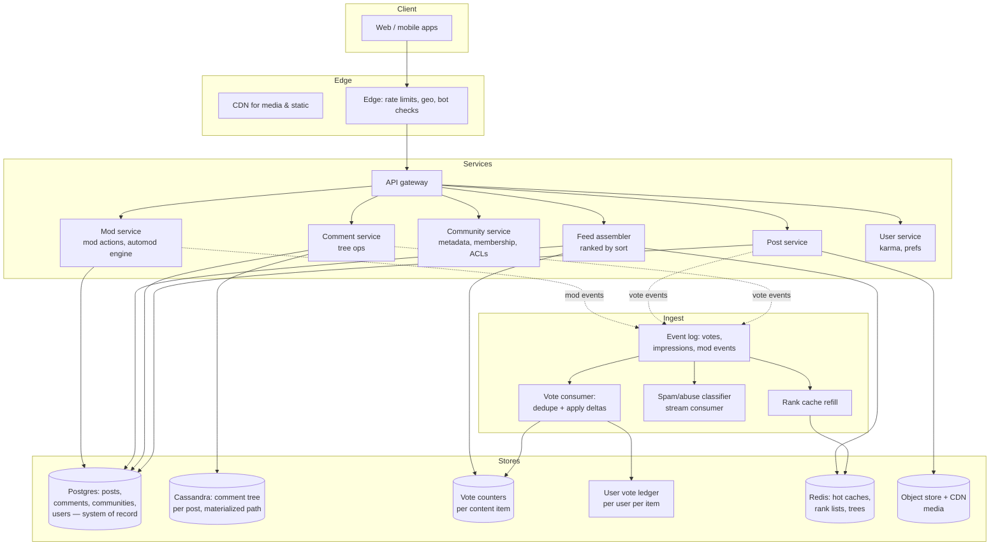

# 03 — Architecture

## High-level diagram

## Components

**Edge/GW** — terminates anonymous traffic, applies global + per-user + per-community rate
limits, runs lightweight bot heuristics before content reaches write services. The edge,
not the write services, is the first anti-spam layer (deep dive 5).

**Post service** — owns posts (CRUD, flair, NSFW flags), writes to the system-of-record
Postgres sharded by post ID, publishes to the event log. Media goes to object storage +
CDN; posts store only URLs.

**Comment service** — owns tree operations: `render_thread(post, sort, path_prefix)`,
`create_comment`, `edit`, `delete`. System of record is Postgres; a Cassandra side-store
holds one partition per post with comment rows keyed by materialized path for fast subtree
scans (this split and its rationale is deep dive 1). Write-ahead: Postgres first, Cassandra
asynchronously reconciled, cache invalidated on mutation.

**Community & mod services** — community metadata, membership, moderator lists, ban lists,
user/community permissions, mod action log (removal, restore, lock, ban, distinguished
comment), and the automod engine (rule evaluation on every content event). Everything here
is scoped by `subreddit_id` (deep dive 4).

**Event log (Kafka-class)** — one backbone for three consumer families: (a) vote ingest,
(b) ranking/caching refreshers, (c) abuse classifiers. Content writes publish here too so
counters, caches, and classifiers all see the same ordered stream (pattern as in
[13.kafka](../13.kafka/README.md)).

**Vote ingest consumers** — dedupe (per-user-per-item once), then apply deltas to per-content
counters and the per-user vote ledger. Delivered-at-least-once upstream; made idempotent at
the consumer using `(user_id, content_id, revision)` (deep dive 2).

**Feed assembler** — for `r/home` and `r/all`, merges candidate pools per community and
ranks by the requested sort. It is fanout-on-read (Twitter contrast:
[../02.twitter/04-deep-dives.md](../02.twitter/04-deep-dives.md)) — no per-user materialized
timeline is kept; instead a small set of shared, heavily cached per-community and per-cohort
candidate lists serve every user's merge.

**Caches (Redis)** — comment tree pages keyed `(post_id, sort, prefix_page, version)`,
community hot lists keyed `(subreddit_id, sort, window)`, user vote ledger hot entries, and
rank inputs. Invalidation is explicit and versioned, not TTL-only, because thread reads are
extreme cache-critical (see the arithmetic in 02).

## Data flows

1. **Submit a post** — GW → post service → Postgres (durable) + event log. Feed caches pick
   it up asynchronously; ranking recomputes lazily per read (hot is cheap to compute, deep
   dive 3).
2. **Read a thread** — GW → comment service → Redis tree cache for the requested
   `(post, sort, prefix, sort-version)`; miss → Cassandra prefix scan → Postgres fallback
   only for reconciliation; cache the page, bump version on mutation.
3. **Vote** — GW → vote API → event log (fast ack to the user). Vote consumer applies delta
   to counters + ledger with idempotency; rank caches refresh on a short lag;
   thread caches are version-bumped (score displays refresh, tree version unchanged).
4. **Mod action** — mod service writes an immutable action-log row, produces a mod event;
   the automod engine and the feed assembler receive the event and apply the content state
   (removed content drops out of feeds within seconds, not on full re-render).
5. **Render home feed** — feed assembler reads the user's subscribed communities, takes the
   top-N candidate lists (per community, from cache), merges the ~1–2K candidate pool, ranks
   by the requested sort with per-user boosts, hydrates posts.

**Sharding summary**: Postgres rows by content ID; Cassandra comment tree by `post_id`
(one partition per post — bounded, since a post's comments are bounded by human behavior);
vote counters by content ID; communities are the unit for service-side routing and cache
keys, with a routing rule for mega-communities (deep dive 4).
