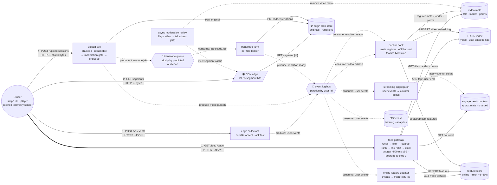

# 03 — Architecture

## High-level shape

Five planes: **serve** (the per-request funnel), **ingest** (upload→transcode→publish),
**observe** (the telemetry loop), **store/edge** (blob + CDN, treated as given), and a
shared **metadata/feature substrate**. The defining property: the serve plane computes
the feed per request from live state — nothing stores "your feed".

Q: How does one swipe run the serve funnel, and how does the event loop close back into features before the next fetch?

## Components

**Serve plane.**

- *Feed gateway*: owns the per-request deadline. Recall retrievers run in parallel;
  the funnel shortens under load (drops stages from the end, never the middle) —
  degrade from "step-5 slate" to "step-3 ordering" rather than to anything that
  ignores relevance.
- *Recall*: per-user candidate retrieval — an interest index over user embeddings,
  ANN over video embeddings, follow graph, trending, sound/hashtag indexes, rewatch
  candidates. Recall is cheap retrieval; it must not score, only retrieve.
- *Coarse rank*: a tiny model over cheap features shared across all candidates; sized
  from 02's arithmetic (~2B scores/s mean fleet-wide, estimates).
- *Fine rank*: the expensive model over the ~600 survivors, with item features cached
  in-process and user features computed once per request. Ranker internals are
  [Case 15](../15.ml-ranking-system/03-architecture.md)'s subject; this plane only
  owns the funnel boundaries and budgets.
- *Slate layer*: turns a ranked list into a feed — interleave by content type and
  creator, apply frequency caps ("user saw this author 50 times today"), inject the
  exploration pool (dive 5), enforce seen-item suppression against a per-user
  impression bloom/log.

**Ingest plane.**

- *Upload service*: chunked, resumable, idempotent upload sessions (mobile networks
  drop); stores the original in the blob store and enqueues transcoding.
- *Pre-publish moderation gate*: a cheap automated check that *blocks serving* — full
  moderation continues async with takedown recall (N7).
- *Transcode farm*: queue-driven workers producing the per-title ladder (dive 2);
  publish does not wait for it (dive 3). Priority is by predicted audience so the
  exploration burst always has renditions ready.
- *Publish hook*: registers video metadata, upserts the video embedding into the ANN
  index, bootstraps item features — the reason a 30-second-old video can be recalled.

**Observe plane.**

- *Collectors → event log bus* ([Case 13](../13.kafka/README.md)-class), partitioned
  by user id; three consumer families: online feature updater (the ≤5–30 s freshness
  budget), streaming aggregator for approximate counters, and the offline lake for
  training. Details in dive 4.

**Metadata substrate** (shared): video metadata service, sharded approximate counters,
item-feature cache, embedding indexes. Read-heavy and cache-served; counters are
eventually consistent by design.

## Data flows

1. **Swipe**: client → gateway → funnel → 10 IDs + rendition URLs + metadata → client
   player prefetches renditions from CDN edges ([Case 25](../25.mobile-newsfeed/README.md)
   owns that half). Every event generated flows to the observe plane within seconds and
   back into the feature store before the next fetch, most of the time (N2).
2. **Publish**: upload completes → moderation gate → *publish* (1st rendition + meta +
   index upsert) → exploration burst begins → transcode completes the ladder in the
   background → enrich renditions as they land.
3. **Takedown**: async review flags a video → removal propagates to meta service →
   feed caches and CDN eviction → next fetch never recalls it.

## What is *not* here, deliberately

No timeline store: [Case 02](../02.twitter/04-deep-dives.md) precomputes timelines
because followers define the audience; here candidate generation is the audience, and
attempting to materialize "a feed" per user would freeze a model that must react within
seconds (dive 1). The feed exists only for the duration of one request's funnel —
plus a short client-side session cache of next-up candidates, which is where any
precomputation actually lives.
