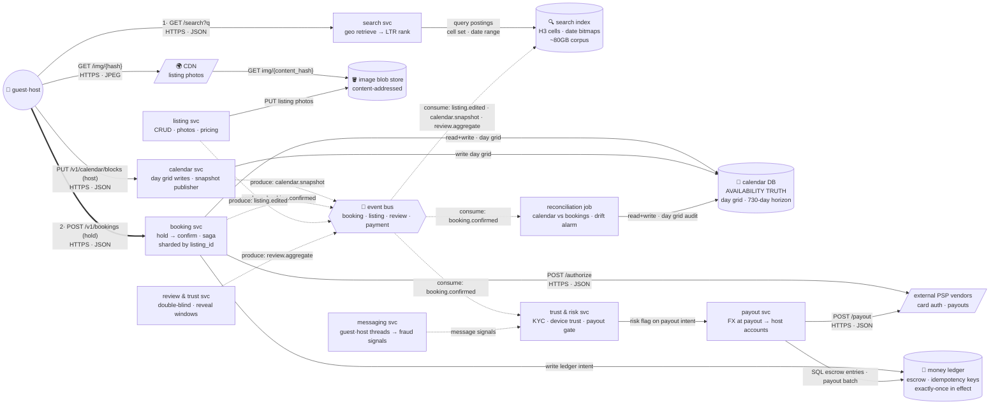

# 03 — Architecture

## High-level diagram

Q: Which writes are authoritative (calendar day grid · hold · ledger) and which reads stay advisory (search index · photo CDN)?

## Components

- **Search service + search index** — the only consumer of the ~80GB listing corpus.
  Query = (geo shape/cell set, date range, hard filters) → candidate postings → rank.
  Two-stage: cheap candidate retrieval → learning-to-rank top-N (same shape as
  [15.ml-ranking-system](../15.ml-ranking-system/README.md)). Index updated by a stream of
  listing edits and calendar snapshots (see dive 2): search availability is **advisory**.
- **Listing service** — CRUD for listing metadata, photos (blob + CDN), amenities,
  pricing rules. Publishing a listing goes through an initial review gate (dive 6).
- **Calendar service** — the **availability truth**: per-listing day grid (booked /
  blocked / open / on-hold), 730-day horizon. All reads from search and from the detail
  page go through derived snapshots; all *writes* (holds, bookings, host blocks) commit
  here first.
- **Booking service** — implements hold → confirm (dive 3). Partitioned by listing_id so
  one listing's nights have exactly one ordering authority. Coordinates the calendar
  write and the payment authorization; runs the compensation saga when either leg fails.
  Handles instant book (auto-confirm) and request-to-book (host accept step with timeout).
- **Money ledger + PSP adapters** — every charge, refund, payout, and fee is a ledger
  entry with an idempotency key; PSP calls are attempts *against* ledger intent, never
  the source of truth. Exactly-once-in-effect discipline per
  [06.apple-app-store](../06.apple-app-store/04-deep-dives.md). Escrow accounting: guest
  funds land in a platform liability, host payouts release from it (dive 4).
- **Payout service** — batched payouts in host currency after check-in, FX conversion at
  payout time, risk-gated (a flagged payout waits; nothing accelerates).
- **Messaging service** — guest/host threads; also a fraud signal surface (dive 6:
  off-platform payment pressure is pattern-matched here).
- **Review & trust service** — double-blind review flow with reveal windows, aggregates
  feeding ranking (dive 5).
- **Trust & risk service** — KYC tiers, device/session trust, risk scoring on bookings and
  payouts, listing takedowns. Subscribes to everything.
- **Event bus** — booking lifecycle, calendar mutation, listing edit, payment event
  streams. Feeds the search index updater and the calendar-vs-bookings reconciliation job.

## Data flows

1. **Search** (read, hottest): client query → search service → geo-cell candidate postings
   → date-range check against per-listing availability bitmaps (advisory) → hard filters
   → rank → return top-N with CDN image URLs. Map panning = same query with a new cell
   set, debounced client-side (dive 1).
2. **Hold** (write, correctness-critical): booking request → booking service resolves
   listing shard → acquires per-listing write turn → re-checks calendar truth (not the
   search index) → writes hold (nights → on-hold, TTL) → PSP authorization → commit hold
   (instant book: promote to confirmed; request-to-book: stays pending-host) → calendar
   snapshot published to the index updater. Any failed leg triggers the saga: release
   hold and/or refund authorization (dive 3).
3. **Confirm & settle**: ~24h after check-in, ledger releases escrow → payout batch
   (FX → host instrument). Cancellations walk the same ledger in reverse with policy
   percentages (dive 4).
4. **Review**: stay completes → both parties may submit → reveal on both-or-expire →
   aggregates (avg, count, decayed) recomputed and pushed into the search index (dive 5).
5. **Fraud loop**: signals from messaging, listing review, payment velocity, device trust
   → risk service → outcomes: require KYC step, gate payout, shadow-ban listing, or
   nothing. The structurally load-bearing outcome is the **payout gate** (dive 6).

## Key architectural stances

- **Search is advisory, holds are authoritative** (N2/N3): the index may be minutes stale;
  the booking service re-checks the calendar inside the hold critical section. Every
  "why does search show a place that isn't available" bug report is answered by design,
  not fixed.
- **One listing, one ordering authority**: partition the booking+calendar write path by
   listing_id; cross-listing coordination does not exist because no legitimate operation
   needs it (except host merging calendars, which becomes an async replication policy).
- **Ledger over PSP**: PSP responses are facts about attempts; the ledger is the
  truth. Refunds are entries, not deletions.
- **The CDN is part of the product**: 90%+ of image requests never hit us; image URLs are
  content-addressed so fake-listing detection can compare image identity across listings
  (dive 6), and CDN invalidation on listing edit behaves like the
  [09.cdn](../09.cdn/04-deep-dives.md) invalidation trade-off (dive 1 covers the
  cache-key design).
