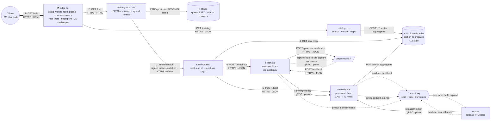

# 03 — Architecture

## High-level diagram

Q: How does the on-sale request path move fans from the edge queue to a seat hold, checkout and the seat/order event log?

## Components

**1. Edge tier (CDN + WAF + bot filtering).**
Front door for everything. Static waiting-room assets and position pages served at the
edge (most waiting-room traffic never reaches an origin — see the backoff math in
[02-scale-estimates](02-scale-estimates.md)). Rate limiting per IP is nearly useless
alone (botnets are many IPs); the edge does device/browser fingerprinting, JS/proof-of-work
challenges on suspicious clients, and tags requests with a risk score the downstream
tiers consume. This is the first, coarse layer of the anti-bot story (dive 5).

**2. Waiting room service.**
The load-shedding and fairness mechanism. Maintains, per on-sale event:

- an **admission order** — a Redis sorted set + rotating issue epochs so late joiners
  cannot retro-inject ahead of the queue; positions are assigned on entry (FCFS) with
  a documented randomized tie-break under unbounded storm load;
- **coarse position counters** ("position ~400,001–410,000"), so any replica answers
  any client without per-user state — position is a count, not a lookup;
- a **signed admission token** with TTL, issued when a user's turn comes; only token
  holders may reach inventory.

Design contract: it must survive the arriving flood with sub-second latency and never
be the thing that crashes (that is what the edge statics are for). Details and
fairness trade-offs: dive 1.

**3. Inventory service (per-event shard).**
The only writer of seat state. Each on-sale event gets a dedicated inventory shard:
in-memory seat state (available / held:hold-id:expiry / sold) plus the code to
compare-and-swap it. Operations: `hold(seats, group)`CAS-atomic, `commit(hold-id)`,
`release(hold-id)`, `reap-expired()`. All mutations stream to the event log. Reads go
through the cache tier, never through the shard (reads are 50K/s vs 15K/s writes — and
reads don't need exactness; every mutation path revalidates). Hot-key and sharding
strategy: dive 6. Hold semantics vs the lock machinery in
[11.zookeeper](../11.zookeeper/04-deep-dives.md): dive 2.

**4. Sale frontend.**
Seat-map UI and hold/checkout orchestration for admitted users only. Renders per-section
aggregates from the cache tier (~1 s staleness tolerated; the hold step is authoritative
and will fail honestly if the UI was stale). Enforces per-request purchase caps at this
layer *and* at inventory (defense in depth — never trust the client, never rely on one layer).

**5. Order service + payment.**
Owns the order state machine: `PENDING_HOLD → PAYMENT_AUTHORIZING → AUTHORIZED →
CAPTURING → PAID → FULFILLED` (+ `EXPIRED`, `REVERSED`), matching dive 4. Idempotency keys on every mutating endpoint; authorization
and capture are two steps with reconciled webhooks (at-least-once delivery from payment
rails, deduplicated by the receiver). Cross-ref: the money pipeline in
[06.apple-app-store](../06.apple-app-store/04-deep-dives.md) — same at-least-once
producer / exactly-once-effective consumer shape. Details: dive 4.

**6. Event log (Kafka-shaped).**
Immutable stream of seat transitions, orders, holds, reaps. Three consumers: (a)
inventory shard replicas for failover and rebuild, (b) the reaper that releases expired
holds, (c) analytics/audit/dispute replay. This is the standard "events as the source of
truth, relational tables as projections" pattern from [13.kafka](../13.kafka/04-deep-dives.md).

**7. Catalog service + cache tier.**
Unexciting e-commerce: search, venue pages, historical orders, plus the cache tier
holding section-aggregate seat maps for hot events (~1 s stale — see
[10.distributed-cache](../10.distributed-cache/04-deep-dives.md) for cache-tier
structure). Strictly partitioned *by event*, so one on-sale's storm cannot evict or
saturate other events' catalog work.

## The two data flows that matter

**Steady state**: edge → catalog → order → payment. Nothing special. The seat map is
read-mostly; contention is negligible for a Tuesday-night jazz show.

**On-sale (t = 0)**:

1. 10:00:00. Waiting room opens. Arriving flood lands at the edge; ~everything is
   answered by static pages and coarse counters. Users are queued; position estimates
   stream via coarse refresh.
2. Over the next minutes, the waiting room admits users in order, at the rate the
   inventory tier can absorb (~admission budgeted to hold-attempt capacity — dive 1
   shows why this rate coupling is the design's heart).
3. Admitted users load the map (cache tier), attempt holds (atomic, inventory shard),
   either fail-fast and return to the back of the pool, or proceed to checkout with a
   TTL hold.
4. Checkout authorizes payment → order service commits the hold → capture → ticket
   delivery. TTL expirations anywhere along the path trigger release and re-admission
   of the seat to inventory, streamed via the log.
5. Seat count → 0. Waiting room switches to an immediate "sold out" page; remaining
   queue collapses cheaply.

## Failure handling summary (deep dives cover each)

| Failure | Where handled | Dive |
|---|---|---|
| 2M users crash the waiting room | Edge statics + coarse counters | 1 |
| Queue position forged / bot jumps queue | Edge fingerprints + signed tokens, per-account caps | 1, 5 |
| Seat double-sold under contention | Atomic CAS on inventory shard; no read-then-write | 2, 6 |
| Buyer walks away, seat stays blocked | TTL hold + reaper on event log | 2 |
| Payment retried → double charge | Idempotency keys + order state machine | 4 |
| One hot event saturates one shard | Per-event sharding + tier/strip partitioning | 6 |
| Whole shard host dies mid-sale | Event-log replay to rebuild seat state on standby | 3, 6 |

## Deliberate non-features

- **No "let everyone in and use graceful degradation"**: that loses inventory to bots
  and melts the map tier; admission control is better than degradation here.
- **No distributed-lock-per-seat via an external coordinator** during the hot path:
  the CAS happens in one process that owns the event's memory; an external lock service
  would add a network RTT to the single tightest bottleneck in the system (though the
  same lease/TTL semantics apply — see the lock-service warnings in
  [11.zookeeper](../11.zookeeper/04-deep-dives.md)).
- **No pre-announced dynamic pricing changes mid-on-sale**: pricing is fixed per tier
  at on-sale start; changing price while 2M people watch poisons fairness perception
  (a product call, noted here because it constrains the data model).
