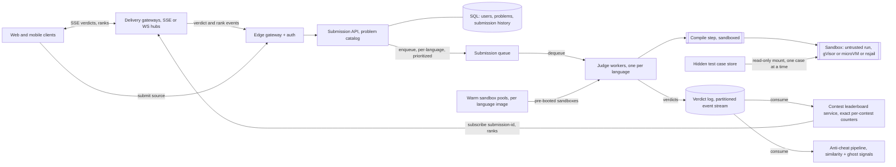

# 03 — Architecture (high level)

Two planes: a **web/API plane** (ordinary read-heavy product) and a **judge plane** (an
untrusted-code batch system with interactive latency). They meet only at the submission
queue and the result stream — nothing else reaches into the judge fleet.

## Diagram



(ASCII sketch of the judge sandbox, the security-critical box:)

```
        ┌─ judge host (64 vCPU) ──────────────────────────────────────┐
        │  worker supervisor                                          │
        │   ├── warm sandbox pool (pre-booted, per language)          │
        │   └── dispatcher: pull job {source, problem, limits}        │
        │                                                             │
        │  sandbox (one per submission round)                         │
        │   ├── isolation: gVisor | nsjail-sealed container | microVM │
        │   ├── mounts: /run/in (read-only: compiled binary, testcase)│
        │   │            /run/out (write-only tmpfs, size-capped)     │
        │   ├── no network namespace (or egress-only to null proxy)   │
        │   ├── limits: wall clock + CPU time, RSS, nproc, fsize,     │
        │   │           output size, syscall allow-list               │
        │   └── scrub on exit: destroy sandbox, or reset tmpfs + fork │
        │             budget before returning slot to the warm pool   │
        └─────────────────────────────────────────────────────────────┘
```

## Components

1. **Submission API + queue (control plane)**. Validates the user, quotas, and the
   language; writes the submission row durably, then enqueues a job `{id, source ref,
   problem id, mode, limits}`. The queue is **per-language** (each language has its own
   image and worker type) with priority lanes: `contest-submitting-user-fix > practice >
   re-validation > anti-cheat re-runs`. Queue is bounded per user (see rate limits) —
   enqueuing is cheap, judging is expensive, so the queue's shape decides fairness.
2. **Judge workers**, horizontally scaled per language. A worker pulls a job, compiles
   (a compile failure never needs a sandbox for compilation in managed-language mode —
   the *compile* itself can be sandboxed more cheaply than a run because compile has a
   fixed wall-clock budget and no need for interactive limits), then drives the sandbox
   through N test executions. Verdicts go to the verdict log as append-only events.
3. **Warm sandbox pool**. The unit of pre-warming is a *booted, scrubbed sandbox of the
   right language image*. Refilling from zero at contest start is impossible (see burst
   math in [02](02-scale-estimates.md)), so pools run hot pre-contest and refill as slots
   are consumed; each sandbox is reused ~5–20 times (K is tiered per language — see
   [04](04-deep-dives.md)) with a scrub (reset tmpfs, re-check
   fork limits), then destroyed. This is the warm-runner pattern of
   [Case 04](../04.deployment-system/03-architecture.md), tightened to seconds.
4. **Test-case store**. Hidden test data is mounted **read-only** into each sandbox and
   never copied into tmpfs the program can address in bulk; per-case output is capped.
5. **Verdict log**. Kafka-shaped append-only stream ([Case 13](../13.kafka/README.md)) of
   `{submission_id, problem, verdict, cpu_ms, mem_kb, per-case events}`. Both result
   delivery and downstream (leaderboard, anti-cheat) consume from it; the API never
   polls the judge worker directly, which is what makes judges stateless.
6. **Delivery layer**. SSE/WebSocket hubs keyed by `submission_id`, held by the API
   plane. A client that disconnects falls back to polling the submission row (idempotent).
7. **Leaderboard service**. Per-contest in-memory structures (Redis-shaped shard plus an
   on-host copy for top-k), fed from the verdict log; final standings recomputed offline
   from the log to correct any race.
8. **Anti-cheat pipeline.** Asynchronous, over the verdict log: k-gram similarity of
   sources, ghost-submission signals (see [04](04-deep-dives.md)), and anomaly flags on
   CPU/time distributions. It never blocks a verdict from being delivered — it only flags.

## Data flows

- **Submit → verdict (happy path)**: client POSTs source → API writes row + enqueues →
  per-language queue → judge worker compiles + runs in sandbox → per-case events appended
  → verdict event on the log → delivery hub pushes over the client's SSE conn; client that
  reconnected reads the verdict from the API (read model).
- **Verdict → leaderboard**: leaderboard consumer applies scoring rules in submission order
  (see ordering in [04](04-deep-dives.md)); pushes top-100 deltas to subscribed clients
  and maintains each participant's own-rank projection.
- **Verdict → anti-cheat**: similarity hashing enqueues at low priority; contest sweep
  runs post-contest, produces flags for human review, not auto-bans (a wrong false
  positive destroys trust in a community product).

## What is deliberately *not* here

- No build DAG — one submission is one job, unlike CI's pipeline trees
  ([Case 04](../04.deployment-system/README.md)).
- No multi-tenant secrets — the sandbox has nothing worth stealing except test data, so
  the secret-brokering machinery of CI (OIDC federation, scoped tokens) is unnecessary;
  instead the entire budget goes into *isolation*.
- No CDN/content plane — problem statements and static assets are small and cached.
