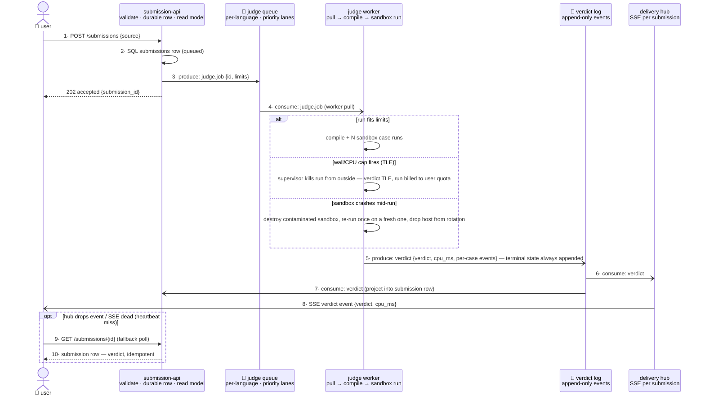

# 04 — Deep dives

## 1. Sandboxing untrusted submissions

Every run is adversarial. The threat list: read the hidden test data; escape to the host;
fork-bomb or thread-bomb to grab CPU; allocate memory to kill the node; write unbounded
output (to disk, to stdout, to stderr); exhaust the process table; abuse wall-clock
accounting (sleep, then answer); open a network socket to exfiltrate or to phone home.

**Option A — firecracker-microVM-per-run.** wins: the hardest boundary (hardware-
virtualized kernel, ~publicly documented boot times in the tens of ms after snapshot
restore on modern Firecracker), each run gets its own kernel so a kernel exploit in the
guest does not threaten the host; loses: heaviest footprint (~30 MB+ per VM plus guest
kernel), slower to warm to fleet scale, and the tooling for injecting language images.
**Option B — sealed containers (namespaces/cgroups via nsjail/bwrap (bubblewrap)
patterns): new
PID/net/mount/user namespace, cgroup memory + pids caps, no caps, read-only rootfs,
no network.** wins: cheapest, boots in ~100 ms, trivially packed 50-per-host, the classic
competitive-programming judge approach; loses: a single shared host kernel — a kernel
0-day escape is a *host compromise*, and noisy-neighbor CPU/SMM pressure is real.
**Option C — gVisor (user-space kernel in front of the host kernel) in a container.**
wins: syscall surface is mediated by a Sentry re-implementing most of the Linux syscall
interface in user space (a deliberately reduced, monitored subset — est.), cutting kernel
attack surface enormously while staying container-cheap; loses: per-syscall overhead
(cpu-bound loops are 10–30% slower, and syscalls dominate I/O-heavy runs), some syscalls
/proc semantics are approximated (fine for judges, annoying for programs that introspect
themselves), gVisor's own GPU/ptrace-adjacent gaps.
We pick **A layered hybrid**: **gVisor-sealed containers as the default per-run sandbox**
(the per-run boundary plus a mediated kernel at container cost), **microVMs as the
boundary for the compile step of any language whose toolchain is huge (JVM, .NET) and for
"premium/unverified" languages**, and namespace-only sealed containers for *compile*, not
run, when the language toolchain needs raw speed. Rationale: the run is the exposed
surface and gVisor buys kernel mediation for free; compile inputs are user-supplied but
the compile step's blast radius (no hidden test data mounted, output size-capped) is
smaller. This mirrors the layering argument in [Deployment System's isolation section](../04.deployment-system/04-deep-dives.md)
but pushes one tier stricter, because CI tenants are semi-trusted and ours are hostile.

**Failure/limit enforcement** — every limit is set in two places, enforced per sandbox,
and *never* trusted from the client:
- CPU time vs wall clock measured **in the supervisor** (getrusage on the sandbox's
  cgroup), not via the program's clock; a run that calls `sleep(60)` still hits its CPU
  or wall budget from outside. TLE is decided by the judge, not the sandbox — this is
  what makes "sleep then answer" attacks pointless: wall cap fires, verdict TLE, and the
  time is *billed against the user's queue quota* (see deep dive 6).
- Memory: cgroup RSS cap → MLE on `malloc(8GB)`; fork budget: pids-cgroup cap → kills
  fork bombs in <1 s; output: per-stream cap on captured stdout/stderr (say 64 KB) and
  tmpfs size cap → Output-Limit attacks become a cheap OLE, not a disk fill.
- Test data: mounted read-only, but mounted *one test case at a time*, path-randomized
  per run, so a submission that reads the file sees only that case's input — leaking one
  case is annoying; leaking the suite (which contestants would scrape to brute-force)
  is the real loss, and per-case mounting caps the loss at one case.
- Failure modes: (a) sandbox leak — a submission crashes gVisor's Sentry; the supervisor
  treats any crashed sandbox as *contaminated*, destroys it, re-runs the submission once
  on a fresh sandbox, and drops the judge host from the rotation until bisected;
  (b) limit-escape via `/proc/self/...` spoofing — accept that in-sensor readings are
  untrusted and only the cgroup reading is authoritative; (c) a language runtime that
  legitimately needs more processes (e.g. a JVM's GC threads or an Erlang VM) needs
  per-language limits, not a global default — get this wrong and every "legitimate"
  submission in that language TLEs.

The full interaction, traced against those failure modes (the delivery-side fallbacks are
deep dive 3):

Q: Between submit and the verdict on the user's screen — if the run TLEs or the sandbox crashes mid-run, what does the user see, and how does the verdict log still end up with a terminal verdict?

The point of the `alt`: every branch — the normal run, the supervisor-imposed TLE, even a
crashed sandbox and its one re-run — converges on the same step 5, so the log is the one
place that always holds a final state per submission; the judge never talks to the client
and the API never polls the judge (both sides only meet at the queue and the log).

## 2. Warm pools, per-language images, and judge-worker queueing

Judge throughput is a queueing problem, not a compute problem. Cold paths: pulling a
language image, booting a sandbox, warming a JIT. A judge that pays cold cost per request
at contest-start burst (800/s arrivals — see [02](02-scale-estimates.md)) is dead on
arrival.

**Option A — cold start per submission.** wins: perfect isolation, no state reuse; loses:
adds ~1–3 s of pure overhead per request, and 800/s × 2 s ≈ 1,600 concurrent cold boots
in flight with no reuse — impossible to sustain at peak, wasteful off-peak. **Option B — long-lived worker process, sandbox
per submission.** wins: worker keeps registry/runtime connections warm; per-submission
cost is only sandbox boot; loses: still 800 boots/s, and a persistent worker accumulates
risk (memory growth, shared runtime state) under adversarial load. **Option C — reusable
sandbox per worker with scrub.** Each worker owns a booted sandbox; between submissions
it resets tmpfs, re-arms PID/file/memory caps, and re-verifies syscall policy; the
sandbox is destroyed and rebuilt every K runs (K ≈ 50) or on any anomaly. wins: near-zero
per-submission overhead at burst, and contamination does not accumulate; loses: a
sandbox that survives a subtle exploit attempt can be reused by another user's run, so
the scrub must be aggressive — tmpfs reset is *not* enough, kernel-level (gVisor
snapshot restore, or full relaunch every K) is required.

We pick **C, with K small and language-tiered**: Python/JS sandboxes get K = 20 with a
cheap snapshot reset (interpreted, lower escape payoff), compiled-language sandboxes get
K = 5 and a full sandbox relaunch. Warm pools are pre-sized per language image: Python,
C++, Java, JS cover ~70–80% of traffic (est.), so only those get deep warm pools; the
long tail (Rust, Go, Kotlin, …) runs a shallow pool and absorbs occasional cold start —
Option D would be "warm everything equally", which wins uniformity and loses fleet
efficiency; at 20 languages the long tail is cheap to leave mostly cold.

**Queue discipline.** Per-language priority queues with per-user fairness (a round-robin
ring across submitting users, not FIFO): one participant who resubmits 10 times must not
push 10 other participants' first submissions behind theirs. Judge capacity is not
scheduled by queue position alone during contests — the contest start is a scheduled
event, so the fleet pre-allocates lanes (contest lane gets 70–80% of slots for the first
minutes) and the *practice* traffic queues instead of competing for slots. This is
essentially the fair-scheduling CI runner idea from [Case 04](../04.deployment-system/04-deep-dives.md)
compressed: with 15-second latency budgets, backpressure has to be *upstream* (queue
admission per user) rather than downstream (long queue wait), or a queue-depth SLO of
"<20 s to first run" blows through.

**Failure modes.** (a) A broken language image (bad compiler flag) poisons an entire
language: mitigation is a canary — each language has one "self-check" job that runs a
known-good reference solution on deploy and before any contest, so a broken image is
detected in minutes, not by contest participants ([same pattern as CI pipeline canaries](../04.deployment-system/04-deep-dives.md)).
(b) A judge host that starts returning systematically wrong verdicts (e.g. clock skew
making everything TLE) — every judge host runs the reference solution periodically and is
quarantined if its verdict histogram deviates from the fleet. (c) Queue pile-up from a
thundering herd of identical re-submissions (a viral "this problem is broken" bug):
per-user and per-problem-submission caps, plus a global circuit breaker that degrades to
"verdicts delayed, queue position visible" instead of dropping submissions.

## 3. Result delivery: poll vs WebSocket vs SSE

The verdict is an async event ~10 s after submit; the client may have navigated away, or
may be long gone. Choose the delivery mechanism.

**Option A — client polling with fixed/adaptive backoff.** wins: dead simple, works
through any proxy, survives every client; loses: at burst scale, naive polling is a QPS
explosion — 800 verdicts/s × clients polling every 500 ms across ~150k concurrent
participants is ~300k+ wasted reads/s at peak (see the arithmetic in
[02](02-scale-estimates.md)); each poll has to hit a cache and still does not *feel*
instant. **Option B — WebSocket per client.** wins: bidirectional; a contest client can
have one socket for verdicts AND leaderboard AND chat; loses: heavier gateway state, more
failure modes (half-open connections, reconnect storms), more engineering per hub.
**Option C — SSE for verdict/leaderboard push, HTTP polling as fallback.** wins:
one-way is exactly the shape of this data, reconnects are cheap, works with HTTP/2
multiplexing, hubs are simpler than WS hubs; loses: not bidirectional (fine; we don't
need client→server here besides "submit") and older proxies/HTTP/1.1 head-of-line issues
(mitigated by HTTP/2 to the gateway).

We pick **C**: SSE for verdicts and per-contest leaderboard ticks, with polling of the
submission row as the fallback when SSE is unavailable or after N missed heartbeats.
Poll intervals on fallback are exponential (500 ms → 2 s → 8 s, cap 15 s) so the
fallback never re-introduces Option A's QPS explosion. This is the same decision WhatsApp
and Discord face ([push delivery for async events](../03.whatsapp/04-deep-dives.md), [fanout at burst](../05.discord/04-deep-dives.md)),
except here there is no two-way chat on the socket, so SSE is enough. Delivery is keyed
by `submission_id`; a participant refreshes their browser and re-subscribes — the verdict
is durable in the row (or in the read cache) so the same event never needs to be re-run
by the judge.

**Failure modes.** (a) Reconnect storm after a gateway hiccup: jitter each client's
reconnect with a client-specific delay and cap new SSE registrations per gateway per
second. (b) A hub that drops a verdict silently: every verdict event is idempotent and
the client can always resync from the row; heartbeat every 15 s detects dead sockets.
(c) The classic mobile case — network drops mid-contest: the participant reloads and
gets their own rank and submission states from the read path, not from a replayed socket
stream.

## 4. Anti-cheat & plagiarism

Cheating comes in the same four shapes contest after contest: shared source across
accounts (MOSS-style similarity), *ghost submissions* (submissions that "know" hidden test
data — e.g. code with hardcoded case-specific special cases, or submissions that read
test inputs to reverse-engineer hidden patterns), multi-accounting for rating, and
automation bots. We focus on the two the judge is uniquely positioned to detect:
similarity and ghosts.

**Similarity: k-gram fingerprinting (MOSS / winnowing-style).** Normalize source (strip
comments, normalize identifiers optionally — with care, renaming is a legitimate
obfuscation), hash k-grams (k ≈ 5–10), keep the *winnowed* (min-selected) fingerprints,
compare across submissions per problem and per contest; store fingerprints durably so a
post-contest sweep compares against *all prior eras*, not just the live contest. The
hierarchical approach — exact-match (cheap, catch copy-paste), then token-sequence LCS
(catches renames, reorders, some reformatting), then AST-diff for compiled languages
(catches heavier refactoring, but is expensive) — runs as a *pipeline*, not a per-submission
block: a submission always gets its verdict (anti-cheat must not slow the judge), a flag
travels with it, the sweep is a scheduled batch job that produces review evidence, not
auto-bans.

**Ghost submission detection** has a signature: a submission that passes all hidden tests
but is (a) unusually short for the problem, (b) has hardcoded outputs for specific inputs
or (c) reads patterns from the test data itself, or (d) has implausibly uniform CPU times
across cases for an algorithm that shouldn't scale that way. The judge's per-case timing
and memory telemetry — precisely the data we collect for verdict scoring anyway — is
enough input to flag these *statistically*, over *epochs* of submissions (a "hardcoded
answer for hidden test 7" submission is detectable when the same per-case pass pattern
appears in a cluster of accounts). This is signal-driven detection, not a rule: the
anomaly detector's job is to *narrow the review queue*, not to convict.

**Failure modes.** (a) False positives: two people writing correct code for a simple
problem will look similar regardless; threshold on similarity alone is wrong —
**co-occurrence of similarity + shared behavioral anomalies + timing correlation within a
contest window** is what gets a flag. (b) An adversary who knows the detector: similarity
with identifier randomization + per-problem reordering is cheap to defeat — accept the
arms race for *individual* detection, but rely on the *correlated* signals (timing,
per-case output patterns, submission cadence across accounts) that are harder to spoof;
that is the honest trade-off. (c) Post-contest sweep latency: a disqualified participant
who already spent a day at rank 1 generates community drama; mitigation is clear comms
(a flagged-until-review state on the public rating, or a "results provisional" banner for
the contest window) rather than trying to make detection instantaneous.

## 5. Contest leaderboards: top-k under write burst

150k participants, each with score changes; the visible surface is top-100 + your own
rank; writes arrive at hundreds-to-low-thousands/s during the first 10 minutes (the
[02](02-scale-estimates.md) burst of ~263–800/s submissions; only the accepted subset
changes a score); ties are broken
by total penalty time (sum of minutes-elapsed at accepted-solve time), which means a
score change has a *timestamp-dependent* component, not just a counter increment.

**Option A — exact global sort on every write.** wins: exactly consistent, trivially
correct; loses: each accepted submission re-sorts 150k entries, and even with a heap it
re-ranks *everyone below the changed entry*, so top-100 update cost is fine but "your
rank" for a mid-pack participant is not — rank-of-X is `1 + count(above)`, which with
exact ordering is a scan, not an O(1). **Option B — approximate/order-statistic
structure (sorted skip-list or count-based tree) in a Redis-shaped store, one
ZSET per contest keyed by `(score, penalty, id)`.** wins: atomic `ZADD`/`ZRANK` per
submission is O(log N), top-100 is `ZRANGE`, per-contest ~30 MB of state (see
[02](02-scale-estimates.md)) fits a shard easily, and the whole thing is rebuildable
from the verdict log; loses: Redis's single-threaded ZADD path at contest burst —
thousands of writes/s plus rank queries — is real but manageable, and cross-shard
"global rank" needs a shard map (rank within shard + sum of shard sizes above).
**Option C — approximate sketches (count-min over score buckets, streaming
heavy-hitters).** wins: sub-µs updates, tiny memory; loses: approximate ranks are wrong
in exactly the places users care (the boundary around rank 100 becomes contested, ties
at the cut are argued publicly), and for a *contest* the standings are the product's
integrity statement — approximation here is acceptable for a *recommendation* surface,
not a scoreboard.

We pick **B, exact per contest, sharded by participant-id bucket**, with **Option A-style
recompute offline** (rebuilding final standings from the verdict log deterministically
at contest close, so provisional results converge to a canonical answer). Within a shard
we accept O(log N) writes and a fan-in "prefix count" pass for global rank; top-100 reads
come from a per-shard heap fan-out. This is the *distributed-cache* decision, not the
*streaming top-k* decision: a contest is small enough to afford exactness, unlike a
global all-time leaderboard or the ranking problem in [Case 15](../15.ml-ranking-system/README.md).
For the all-time/per-problem leaderboards (billions of rows), sketches or page-based
serving is fine and Option C returns there.

**Ordering and penalty.** Scoring must be evaluated by an event stream that is ordered
per participant (a participant's submissions are ordered by submit time, which
determines penalty); the verdict log delivers globally unordered events, so leaderboard
consumers re-order by `(participant, submit_ts)` keyed per-partition — the partition key
for the leaderboard topic is *participant_id*, guaranteeing per-participant ordering
inside a partition, exactly the per-key ordering Kafka gives ([Case 13](../13.kafka/README.md)).
**Failure modes.** (a) Re-runs against a corrected test set flip a verdict after the
contest — standings must be rebuildable; if we only kept deltas in Redis we could not;
the log is the source of truth and the ZSET is just a projection. (b) A write arrives
*after* the contest freeze (common anti-cheat re-check): the leaderboard switches to a
"provisional" snapshot at freeze and stops accepting live updates, resuming with full
results after the sweep — this avoids flashing a rank up then down for reasons nobody
can see. (c) "My rank says 41 in my page, 37 in the list" — the two views read from
different projections at slightly different instants; we accept staleness within
[01](01-requirements.md)'s freshness budget (top-100 ≤ 10 s, own rank ≤ 30 s) and say
so in-product ("standings may lag by up to ~30 s") instead of chasing exact
single-copy consensus for a display surface.

## 6. Rate limiting and abuse

Judging is expensive per request (~6–10 vCPU-seconds of real work per submission at the
[02](02-scale-estimates.md) average — 2 s compile + 12 case runs × ~0.5 s — plus all the
sandbox overhead). A free product with a costly per-request backend is an abuse magnet:
submission-spam, LLM-generated bulk solving, brute-force-the-test-data by mass
resubmission (an oracle attack: probe with variants until Accepted, exfiltrating the
hidden test suite), and account farming.

**Option A — hard per-user QPS cap.** wins: simple, enforceable, predictable; loses:
feels arbitrary to an eager learner whose iteration loop *is the product*; a global cap
also punishes the fast-iteration legitimate user. **Option B — token-bucket per user
with a *dynamic* price.** Price a submission by its *expected judge cost*: compiled
languages, big input sizes, and full-suite re-runs cost more tokens than JS one-liners;
tokens refill over time. wins: charges by actual resource consumption and naturally
throttles brute-force-the-test-data attacks (each failed probe is a full-price
submission) without throttling cheap legitimate loops; loses: needs calibration per
language and per problem, and pricing bugs manifest as "I can't submit my solution",
which is support traffic. **Option C — global backpressure via queue admission with
priority.** wins: protects the fleet under *any* load; loses: it is a fairness mechanism,
not an abuse mechanism — a single abusive account can still occupy their fair share and
starve nobody else but still burn judge money.

We pick **B + C**: token-bucket with cost-based prices per submit (per-language weight ×
per-problem weight × suite-mode), *plus* hard caps per user per hour and per problem, and
the *queue*, not the limiter, handles transient burst; limiter rejections are answered
with "retry in X s"-shaped signals (the queue position), not bare 429s, because a
participant resubmitting after a wrong TLE verdict is a benign, high-priority actor.
Brute-force-the-test-data is additionally detected at the anti-cheat layer: a
distribution of submissions by an account whose *per-case fail pattern* shifts toward
Accepted in a way that leaks the test-case order is an oracle signature, not a
learning-curve signature.

**Failure modes.** (a) Pricing too aggressively → legitimate contest practice gets
throttled and forums fill with complaints; mitigate by publishing the token budget in-
product and making the cost model boring (no surprise multipliers). (b) A distributed
abuse campaign across many accounts farms rating and crowds out real contest results —
this is *not* solvable by rate limiting alone; it needs the similarity/ghost pipeline of
deep dive 4 plus signup friction and device/reputation signals, which is why anti-cheat
and rate limiting share one abuse-control feed. (c) The limiter itself (a Redis token
bucket) is on the hot path at submit time — if Redis is down we fail *open to the local
per-instance bucket*, accepting brief under-limiting rather than blocking all
submissions: blocking submissions is worse than briefly under-limiting, because the
judge fleet can degrade (deeper queues) but the submission path being down is an outage
of the product itself.
