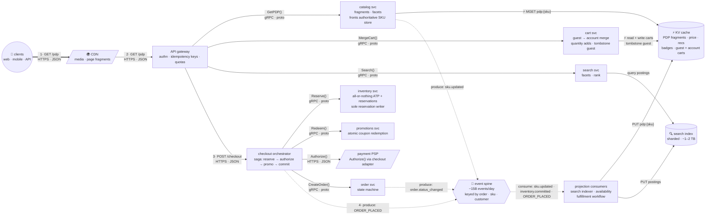

# 03 — Architecture

## Two planes, one event spine

The system is split by consistency contract, not by domain:

- **Read plane** — browse, search, PDP fragments, cart reads, availability badges,
  price display. Eventual consistency, aggressively cached, sized for ~1M QPS
  spikes, allowed to serve stale and to shed load first.
- **Transactional plane** — checkout, order creation, payment authorization,
  inventory reservation, promo redemption. Strongly consistent, small data,
  sharded by customer/order, sized for ~5K orders/s, never serves stale.
- **Event spine** — an append-only event stream (Kafka-tier, ~15B events/day) is
  the *only* link from the transactional plane to every read model. Nothing
  writes a read model inline; read models are projections and are rebuildable by
  replay.

Q: How do the cached read plane and the strongly consistent checkout plane meet one append-only event spine?



## Data flows

**Flow 1 — browse (the 99% case).** Client hits CDN (media cache hit ~90%+) and
the read plane for fragments. PDP composition reads: catalog fragment from the
KV cache, price from the price cache, availability badge from the availability
projection, recommendations from the personalize service. None of these reads
touch the transactional plane — see 02's read:order arithmetic. A stale
fragment is rendered with a "refreshed on interaction" marker rather than
blocking the page.

**Flow 2 — catalog edit → site-wide visibility (eventual, minutes).** Seller
writes SKU/price/promo to the authoritative catalog → emits `sku.updated` to the
spine → search indexer updates postings, availability projection updates badges,
cache invalidation (or short-TTL aging) drops the fragment. Legal/recall
takedowns take the synchronous kill path instead: revoke-in-catalog + cache purge
+ index tombstone within seconds — same shape as the app-store takedown fork
(`../06.apple-app-store/04-deep-dives.md`, deep dive 5).

**Flow 3 — cart lifecycle.** Guest cart lives in the KV store under a session id
issued at first visit, TTL weeks. On login, Cart svc performs the guest→account
merge (deep dive 2): read both, union line items (quantity adds, capped),
write account cart, tombstone guest cart, keep promo codes. Logouts create a
*new* guest cart; the account cart is never demoted.

**Flow 4 — checkout (the transactional case).**

```
Client                 Gateway            Checkout              Inventory        Payments   Promotions
  |  submit(cart, idem_key) |                 |                      |              |           |
  |------------------------->|  validate snapshot      |                |              |           |
  |                          |------------------------>| price+stock+   |              |           |
  |                          |                         | promo check    |              |           |
  |                          |                         |---atomic------>| (reserve all  |           |
  |                          |                         |  reserve items |  or nothing)  |           |
  |                          |                         |-------------------------->| auth       |
  |                          |                         | <----authorized/declined----|           |
  |                          |                         |---atomic----->| commit reservation        |
  |                          |   ORDER_PLACED event    | (or release on decline)  |           |
  |  <---- 201 order_id ---- |                         |----emit to spine, saga ends              |
```

Steps 1–4 are guarded at the top by the idempotency key (client-generated UUID,
written into an orders-unique index before any side effect — same trick as the
app-store purchase pipeline; this case's version is deep dive 4). A retry with
the same key replays the stored result rather than re-reserving, re-charging.
Failure at any step releases reservations (or they expire). The orchestrator is
a saga: `reserve → authorize → redeem promo → commit → emit`, with compensations — no
cross-service distributed transaction.

**Flow 5 — order lifecycle to fulfillment.** `ORDER_PLACED` on the spine starts
the fulfillment workflow (payment capture, warehouse pick/pack, carrier
hand-off). Status transitions append to the order's audit trail and emit
`order.status_changed`; the availability projection decrements display stock from
`inventory.committed` events — display stock is always a projection of the spine,
never a synchronous read of the reservation core.

## What is deliberately NOT in the architecture

- No synchronous cross-plane calls. Browse never reads the reservation core; the
  availability badge never blocks checkout. The one coupling (inventory) is
  inverted: checkout writes it, everyone else reads projections.
- No distributed transactions across services. The checkout saga plus
  expiring reservations replaces them; the failure mode is "reservation expires
  and stock returns", which is cheap — compare the eventual-consistency trade in
  deep dive 3.
- No inline analytics on the write path. All feature computation (ranking,
  personalization) is offline/stream over the spine; a personalized PDP is a
  cache lookup, not a live model call.
