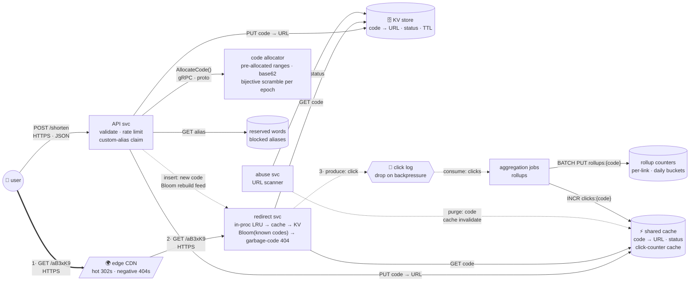

# 03 — Architecture

Two paths with completely different character: a boring write path (create), and a hot,
cache-dominated read path (redirect) that we try to terminate at the edge.

## High level

Q: How do the rare create path and the hot redirect path reach the KV store, and where do clicks and abuse verdicts land?

## Components

- **API service (shorten)**: validates the URL (length, scheme, well-formed), rate-limits
  per IP/account, checks the custom-alias claim against the reserved/blocked list, asks the
  code allocator for a code, then writes `code → {long URL, status, TTL, created}` to the KV
  store with a write-through into the cache layer before responding. The code must work the
  instant the user receives it (read-your-own-writes).
- **Code allocator**: stateless-ish service that either (a) bumps a counter and encodes
  base62, (b) hands out pre-allocated ranges like Snowflake/ZooKeeper assigns machine IDs
  (same family as [02.twitter's ID generation dive](../02.twitter/04-deep-dives.md)), or
  (c) hashes — (b) with a per-code random suffix scramble inside each range is chosen in
  deep dive 1. Not on the redirect path.
- **KV store (system of record)**: `code → long URL + status + TTL` sharded consistently
  by code hash. Also holds `status ∈ {active, blocked, expired}` so abuse/expiry changes
  take effect without rewriting the URL. Tiny records, ~11 TB over a decade.
- **Redirect service**: layered lookup — in-process LRU → shared cache
  (Redis-like, sharded by code) → KV store. On a KV miss it consults a **Bloom filter of
  known codes** to reject garbage codes fast (deep dive 2). Responses are 302 by default
  (deep dive 2 explains why not 301).
- **Edge/CDN**: terminates the hottest fraction of redirects entirely; negative-caches
  404s for unknown codes briefly so scrape traffic never reaches origin.
- **Click pipeline**: redirect services emit click events to a log (Kafka-class, see
  [13.kafka](../13.kafka/README.md)) asynchronously with backpressure-drop; stream
  aggregators maintain per-link counters and time-bucketed rollups. Never in the redirect
  request path (deep dive 4).
- **Abuse service**: URL scanner verdicts (benign / suspicious / malicious) feed a
  `status` field on the record; redirects consult the cached status. Rate limiting and
  interstitials in deep dive 5.

## Data flows

**Create**: `POST /shorten` → validate → rate limit → allocator gives code → KV put (+ write
through cache, insert into Bloom filter) → respond with code. Single-digit QPS per node;
the only latency that matters is one KV write, < ~200 ms p99.

**Redirect**: client → edge (hit: done, ~one round trip) → origin → LRU (most links are
hot) → shared cache → KV → Bloom filter rejects unknown codes cheaply. Every layer after
LRU exists for the miss case; the whole system is judged on how rarely we reach it.

**Clicks**: redirect loop → async emit (best-effort, drop on backpressure) → log →
aggregation → counters/rollup tables. A stalled pipeline costs analytics, never redirects.

## What is deliberately NOT here

- No dedup of long URLs (scope decision 2 in 01-requirements).
- No per-user ranking/personalization on redirect — nothing user-specific may touch the hot
  path, or edge caching dies.
- No read replicas of a relational DB masquerading as KV; the lookup is key-shaped and
  should live in a KV-shaped system.
