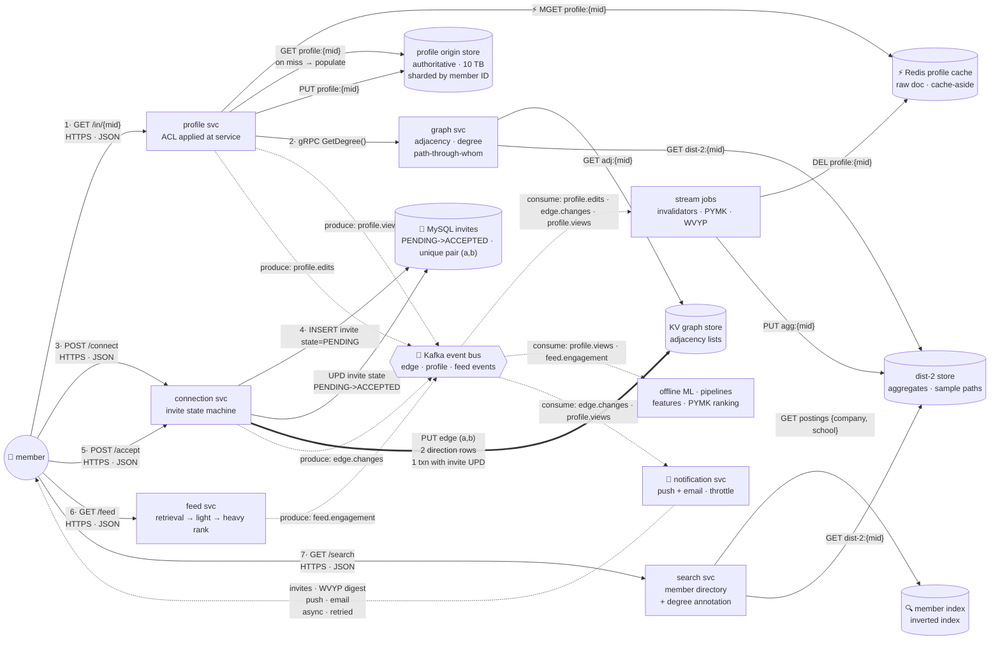

# 03 — High-level architecture

## Diagram

Q: How do profile reads, connection writes and the event bus fan out to caches, graph stores, PYMK and notifications?

## Components

| Component | Job | Key data |
|---|---|---|
| Profile service | authoritative profile read/write; ACL evaluation per request | profile doc + per-section visibility flags |
| Profile cache | hot profiles in Redis, cache-aside with edit-driven invalidation | canonical profile (viewer-independent; ACL applied after fetch) |
| Connection service | connection-request state machine (pending→accepted/…), atomic edge creation | invite rows; adjacency lists in KV store |
| Graph service | 1st-degree reads, degree checks, "path through whom" | adjacency store, cached degree answers |
| Dist-2 store | precomputed 2nd-degree aggregates + sampled paths (rebuilt from events) | per-member aggregates, not full lists |
| Feed service | retrieval → light rank → heavy rank; assembles feed page | candidate sources, features, ranked IDs |
| Search service | member directory + degree annotation | inverted index; Galene-style Lucene backend |
| Event bus (Kafka) | edge changes, profile edits, view/engagement events fan out | lineage: Kafka was born at LinkedIn |
| Stream jobs | invalidations, PYMK recompute, WVYP aggregation | Samza-type consumers |
| Notification service | invite + WVYP + feed digests via email/push, dedup'd, throttled | templates, suppression lists |
| Offline/ML | feature pipelines, ranker training, PYMK ranking | Hadoop/Spark-era jobs |

## Key data flows

**Connection request**: A→B invite written as `PENDING` (unique pair constraint) →
notification fanned out async (email/push, throttled) → B accepts → **single authoritative
txn**: invite → ACCEPTED + both adjacency lists updated (two-way edge, either both or
neither) → edge-change event lands on the bus → async: dist-2/PYMK rebuild, feed feature
refresh. B (and A) read the new edge through read-your-writes semantics on the authoritative
store — the derived stores may lag for minutes without user-visible harm.

**Profile view**: edge/API → profile cache multi-get for the raw doc → if miss, origin
read, populate cache → apply ACL (viewer degree, Private mode, blocked list) *at the service*
→ fetch degree badge from graph service → render. Degree/visibility never enters the cache
key (deep dives §3).

**Feed open**: request → candidate retrieval (sources: 1st-degree posts, groups, jobs,
sponsored, suggested) → cheap ranker orders top few-hundred → heavy model scores top ~tens
→ assemble page → engagement events stream out for training and aggregate features.

**WVYP**: view event on the bus → real-time OLAP ingest (see who viewed you,
Private-mode-filtered) → notification to the profile owner (dedup'd per viewer per period) —
the same profile-read that served the ACL also emits this event; no second read needed.

## Where the money is

- Profile reads at ~35K QPS with a ~150:1 read:write ratio — the cache fleet and the
  ACL-at-service decision dominate cost and correctness.
- Dist-2 for heavy members is combinatorially hostile — precomputed *aggregates* are the
  only way "2nd degree" is a <100 ms product answer at 30,000 connections.
- The feed is a ranking-throughput problem: ~35–85M candidate scores/sec (estimates) is why
  the funnel is staged, mirroring [../15.ml-ranking-system/04-deep-dives.md](../15.ml-ranking-system/04-deep-dives.md).
