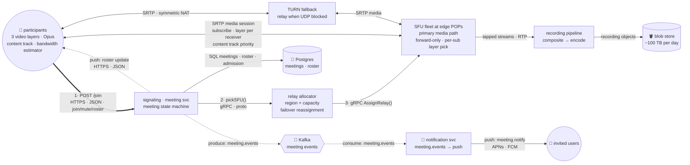
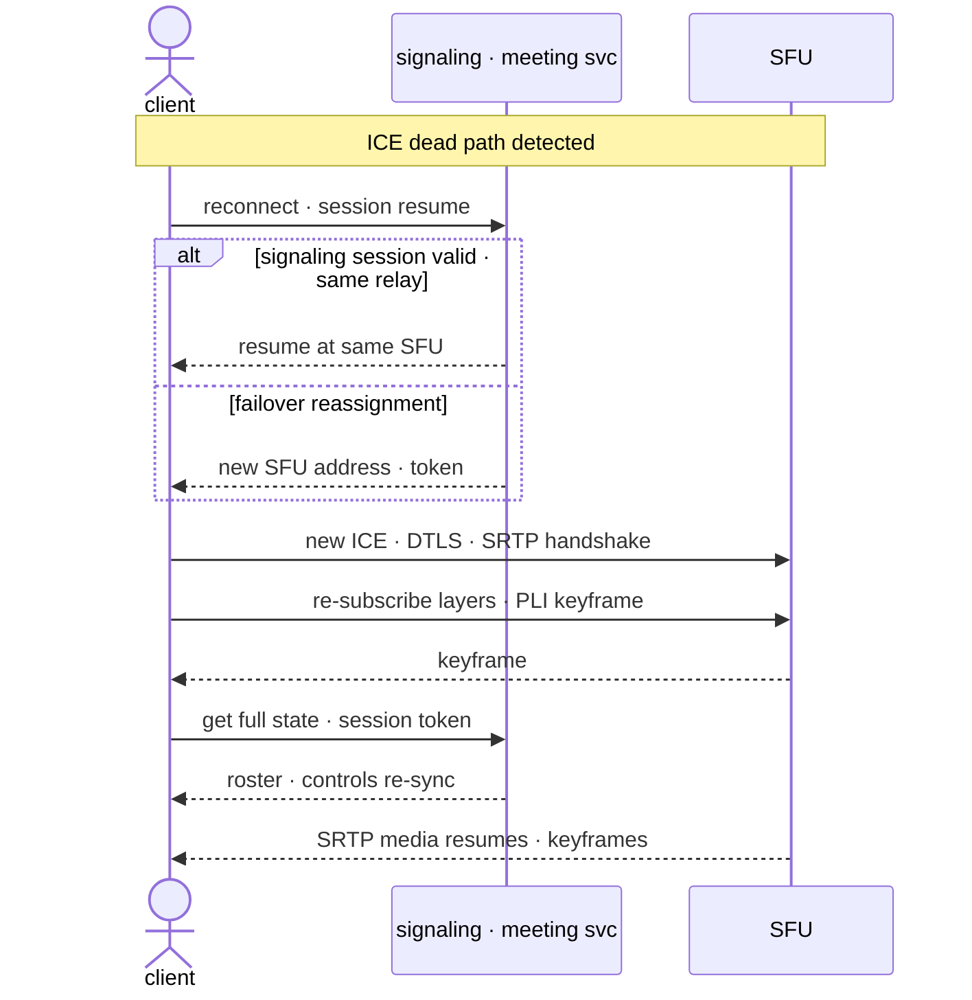

# 03 — High-level architecture

## Diagram

Q: How do clients establish the media plane — signaling, relay assignment, SFU media sessions, TURN fallback and recording?

## Components

| Component | Job | Key property |
|---|---|---|
| Client endpoint | capture/encode (3 video layers + Opus audio), bandwidth estimate, jitter buffer, layer *download* selection | receiver picks what to receive; sender publishes fixed layers |
| Signaling / meeting service | meeting state machine (roster, mute, admission, lock), join handshake, relay assignment | authoritative state, low volume, must rehydrate clients |
| Relay allocator | picks an SFU (region + load), caps sessions per node, handles failover reassignment | the media plane's capacity controller |
| SFU media fleet | receive N senders, forward per-subscriber layer selection; no transcoding on the interactive path | pure egress economics (~40 Tbps peak, est.) |
| TURN fallback | symmetric-NAT / blocked-UDP path: relay through a TURN server | raises egress cost 2×, turns "can't connect" into "connected" |
| Recording pipeline | tap the relay, compose + encode offline (not in the interactive path), write to blob store | ~100 TB/day (est.), latency-tolerant |
| Control plane | meetings/roster SQL, notifications, metrics/QoE telemetry | small data, high availability requirement |

## Key data flows

**Join**: client → signaling (auth, meeting ID, admission) → meeting state check (waiting
room/lock) → relay allocator picks nearby SFU with capacity → client opens media session to
that SFU (ICE/DTLS/SRTP; TURN fallback if UDP fails) → roster update broadcast to remaining
participants → client publishes its own streams and *subscribes* to others'.

**Ongoing media**: each sender's 3 video layers + audio arrive at the SFU; every subscriber
independently requests a layer (chosen by its own bandwidth estimator); the SFU forwards
selected layers — the *same* publisher stream feeds different qualities to different
receivers with zero server-side re-encoding.

**Reconnect** (deep dives §5): client notices dead path → signaling session still valid
server-side → new ICE to the same relay (or reassignment) → keyframe request to resume video
→ roster/controls re-sync → media flows again, no "rejoin the meeting" needed.

Q: After a dead media path, can the client resume without rejoining the meeting?

**Recording**: relay taps selected streams → composite transcoder (offline farm) → object
storage + chat/annotation merge → availability to the host minutes-to-hours later, never on
the interactive latency budget.

## Where the money is

- SFU egress ≈ ~40 Tbps peak (est.) ÷ ~15 Gbps/node ≈ ~3K media nodes — the fleet is the
  bill; the SFU-not-MCU choice cuts its cost by ~an order of magnitude.
- ~18 Tbps peak *ingress* off consumer upload lines — simulcast at 3 Mbps/sender is only
  affordable because most meetings are audio-dominant in practice (senders with video ≈ 50%,
  and mute dominates audio duty).
- Meeting-state consistency is cheap in bytes and expensive in correctness: the reconnect
  path (deep dives §5) is where real-world call quality is won.
