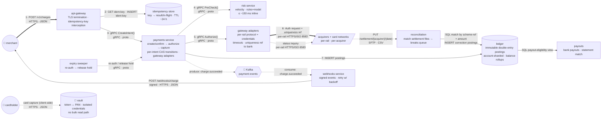

# 03 — High-level architecture

## Diagram

*Q: How does one charge intent get authorized, posted, and reconciled — and what sits at the seam to the banks?*

## Components

| Component | Job | Key property |
|---|---|---|
| API gateway | auth, rate limit, **intercepts idempotency keys** | the first dedup gate; replays served or joined in-flight (deep dives §1) |
| Payments service | payment state machine, CAS transitions, coordinates gateways | the only writer of payment state |
| Idempotency store | key → first-request result / in-flight marker | unique index on key; TTL ~24 h (deep dives §1) |
| Risk service | inline velocity/rules/model ≤ ~150 ms; async review queue | failing open = fraud; failing closed = lost sales — budget-bound (deep dives §5) |
| Gateway adapters | per-acquirer/per-rail protocol + credentials + timeouts | the *distributed-system seam*: timeouts, ambiguity, idempotency-to-the-bank |
| Ledger | immutable double-entry postings, account-sharded; balance rollups derived | the source of truth; corrections are postings, never edits (deep dives §2) |
| Tokenization vault | token ↔ PAN, isolated credentials, no bulk read path | PCI scope isolation (deep dives §6) |
| Webhooks service | signed events, exponential retry, endpoint health | at-least-once; merchant-acknowledged |
| Reconciliation | ingests settlement files, matches, raises breaks | correctness backstop (deep dives §4) |
| Payouts | funded sweep accounts → bank payouts, with statement match | ledger-funded, externally reconciled |

## Key data flows

**Charge (the flagship flow)**: gateway validates + intercepts idempotency key →
payments service: intent created (or replay/join) → risk check inline (~150 ms budget) →
gateway adapter calls acquirer (auth-only) → on response: ledger postings (authorized hold on
the merchant's pending account; fees anticipated) + state CAS `processing → authorized` →
webhook `charge.succeeded` queued. Timeout/ambiguity → the adapter's *uniqueness key to the
bank* lets a retry be idempotent against the issuer too (deep dives §3); the intent stays
`processing` with a pending-resolution flag until the ambiguity is cleared by inquiry or
reconciliation — never silently re-attempted.

**Capture/void**: merchant captures within the auth hold window (~5–7 days, ballpark) —
capture postings move pending→settled-pending; void before capture cancels the hold (no
network fee), refund after capture creates refund postings + triggers rail refund.

**Reconciliation (daily)**: acquirer settlement file → match against ledger by scheme
reference + amount + date-window → breaks classified (timing / FX rounding / missing) →
breaks queue with owners and SLAs → correction postings *as new rows* when resolved.

## Where the money is

- Not bandwidth, not fleet size: **the coupling seam to banks** (deep dives §3) and the
  idempotency/ledger pair (deep dives §1–2) are where correctness is won or lost.
- Latency budget math: of ~500 ms internal envelope, risk gets ≤ ~150 ms, gateway
  orchestration ~50 ms — the rest is yours to spend on the *ambiguity-handling* job that
  real payment systems live in.
