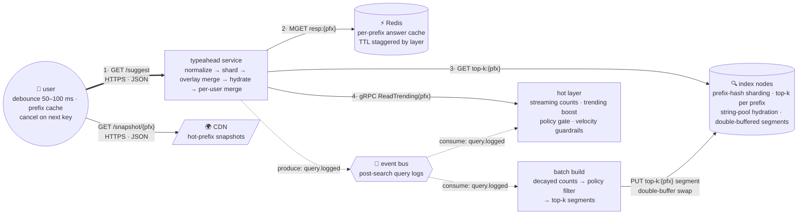

# 03 — High-level architecture

## Diagram

Q: Where does a debounced keystroke go, and how do the cache tiers, RAM index, and hot overlay compose one answer?

## Components

| Component | Job | Key property |
|---|---|---|
| Client | debounce + min-2-chars, cache per prefix, cancel in-flight on next keystroke | removes ~half of raw keystroke requests (3 debounced of ~6 candidate keystrokes, est.), hides most tail latency |
| Edge/CDN | serves static top-N snapshots for very hot prefixes | absorbs the Zipfian head (est. §Zipf) |
| Typeahead service | normalize → route → point lookup → merge overlays → hydrate | stateless; p50 compute < ~1 ms |
| Index nodes | RAM-resident materialized top-k per prefix, sharded by prefix hash, double-buffered segment swaps | ~10–30 GB per full replica, < ~1–2 GB per node (est. sheet); hot shards replicated |
| Batch build | logs → normalized decayed counts → policy filter → top-k segments | hourly quality; the *only* place strings are ranked |
| Hot layer | streaming counts, trending boost, velocity guardrails | minutes-fresh overlay merged at query time |
| Event bus | query log → counters/build inputs | small volumes; freshness not throughput is the concern |
| Per-prefix cache | Redis: hottest prefixes' merged answers, TTL staggered by layer | hot-key absorber with request coalescing |

## Key data flows

**Request**: client debounce → service normalizes (downcase, strip accents, tokenize for
mid-string) → prefix-hash shard → RAM top-k read (~100s of µs) → overlay merge with hot-layer
trending entries for this prefix → hydrate term ids → strings → apply per-user history
overlay (client- or service-side, small) → respond. No ranking model touches the path; anything
that can't be precomputed stays in the build.

**Build**: hourly job fans over query logs (90-day window + today's streaming aggregates) →
normalize/dedup → decayed counts → policy filter (blocklists, classifier gate *here*) →
materialize top-k per qualifying prefix → emit segment files → nodes double-buffer-swap
atomic replace. Nothing user-visible ever waits on the build.

**Trending**: query events → streaming counters with short windows + velocity guardrails
(absolute caps, source diversity floors) → hot-layer entries with their own shorter TTL →
merged atop the stable index at query time; hot entries that die out vanish by TTL, not by
rebuild.

## Where the money is

- The entire serving system is a *cache architecture* against an absurdly skewed key
  distribution (est. §Zipf): client cache → edge snapshots → per-prefix Redis → RAM index,
  each tier existing because the tier above misses on a predictably skewed subset.
- Build-time filtering is a *correctness* requirement (user-generated corpus): what the
  pipeline admits at build time is what the world sees; there is no online policy backstop
  (deep dives §2).
- Freshness has two legitimate speeds with incompatible cache TTLs; forcing one layer to do
  both is the classic typeahead failure ("yesterday's news, forever" or "cache-invalidation
  storms").
