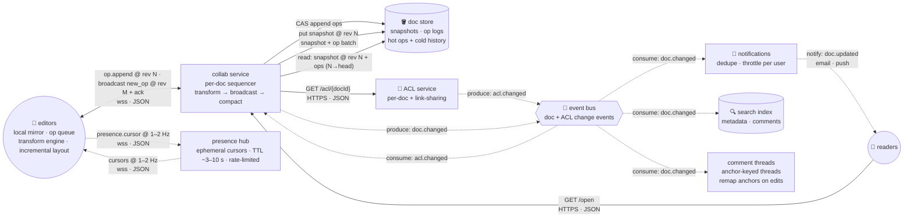

# 03 — High-level architecture

## Diagram

Q: How does an edit go from a keystroke to every collaborator's screen — ordered, durable, and with presence kept separate?

## Components

| Component | Job | Key property |
|---|---|---|
| Editor client | local mirror (offline-capable), op queue, transform engine (dive §2), incremental layout (dive §3) | never blocks typing on the network |
| Collaboration service | per-doc sequencer: order ops, assign server revisions, broadcast, snapshot/compact | the single authority per doc; star topology |
| Doc store | snapshots + op logs + history tiers (hot ops fast-store, cold history object storage) | durable before ack; replayable to any revision |
| Presence hub | ephemeral cursors/selections/typing indicators, TTL'd pub/sub, rate-limited | lossy by design; never in the op log (dive §5) |
| ACL/permission svc | per-doc ACL + link-sharing, checked at open, live re-check on change | removal applies to active sessions within seconds |
| Event bus | doc-change events → notifications, comment threads, indexing pipelines | fanout of derived consumers (all consumers, no enforcers) |
| Search/index | metadata + comments index, doc discovery | reads its inputs from the event stream |
| Notifications | dedup'd, throttled per user/period | same notification discipline as [42.linkedin](../42.linkedin/README.md) |

## Key data flows

**Edit (the op loop)**: client types → local mirror applies immediately (typing never waits)
→ op (with its `client_rev`) → collaboration service: ACL'd session, ops serialized per doc in
server revision order → for each concurrent op, server transforms against its peers →
broadcast `new_op @ server_rev` to subscribers → each subscriber transforms the remote op
against its own un-acked local ops (dive §2) → applies to mirror → renders (incremental,
dive §3) → ack flows back to the author, whose op is now canonical.

**Open**: ACL check → snapshot @ revision N + ops (N → head) → client builds local mirror →
subscribes to the doc channel → presence join (own cursor out, others' in). Cold open target:
~200 ms p95 service-side (est. sheet), warm ~50 ms.

**Offline**: local ops queue (with client revs); on reconnect: fetch server-head snapshot+ops
→ transform local queue against server ops (two-way transform, dive §4) → converge to the
same server revisions as everyone else; *timestamps are never consulted* (server revision
numbers are the only truth).

**Permission change live**: ACL edit → event → collaboration service re-evaluates active
sessions → a demoted editor's next op is rejected and their channel downgraded to view.

## Where the money is

- The collaboration service is a *sequencer with a WAL*, not a document database — per-doc
  sharding + append-only op log + periodic snapshots (~every 1K ops); everything else (history, export,
  search, notifications) is *derived* from that stream (one source of truth, many consumers —
  the same posture as [42.linkedin](../42.linkedin/README.md)'s "state machine authoritative,
  everything downstream derived").
- Presence is designed as a *separate, lossy* system (dive §5); conflating its fanout with
  the op stream is the classic first-design mistake in real-time collaboration.
- The client is a systems product itself: transform engine + offline mirror + incremental
  renderer (dive §3); the client and server split the same math correctly (§2) or the whole
  design diverges — literally.
