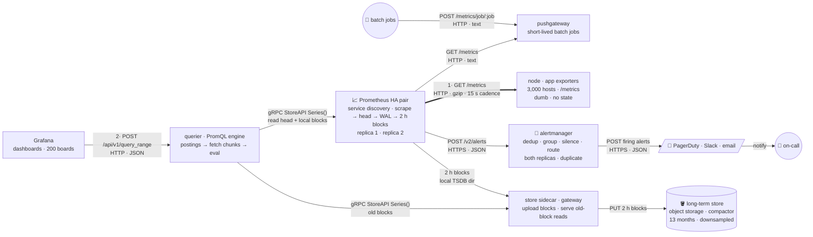

# 03 — High-level architecture

## Diagram

Q: How do ~267K samples/s get scraped, archived into immutable TSDB blocks, and answered by PromQL queries and 30 s alert rules?

## Components

| Component | Job | Why it looks like this |
|---|---|---|
| Exporter (on every target) | exposes current values as text at `/metrics`; no queue, no buffer | target stays dumb — one HTTP GET semantics, zero state; the monitor owns discovery and cadence (deep dive §1) |
| Pushgateway | holds metrics of short-lived batch jobs so they can be scraped | pushes exist to bridge job lifetime, not as ingestion direction; it is a *cache*, the scrape still happens |
| Scrape manager | discovers targets, schedules per-target scrapes at fixed offset, records failures as samples | pull cadence is the clock of the whole system; a failed scrape is itself a metric (`up == 0`), never silence (§6) |
| Head block (in RAM) | last ~2 h of samples per series in memchunks, plus live label index; appends are O(1) | the write path: append-only, in-order, single writer per series — cheap by construction like Kafka's tail ([13.kafka](../13.kafka/04-deep-dives.md)) |
| WAL | fsync'd log of every sample before it is queryable; replayed on crash to rebuild the head | cheap durability for an append-only stream; no consensus needed — two servers keep independent WALs |
| Block store + compactor | persists 2 h blocks as immutable chunk + index files; vertically merges into 8 h/1 d blocks, downsamples | immutable blocks are cheap to copy/upload/dedup; compaction is where downsampled retention lives (§2) |
| Label index (postings) | maps each label key=value → sorted series-ID list; selectors intersect postings | the query-time answer to "which of 4M series match"; inverted index, §3 |
| PromQL engine | parse → selector → postings → fetch chunks → per-step evaluation → merge/aggregate | point ops not QPS are the budget ([02](02-scale-estimates.md)); recording rules pre-aggregate hot paths |
| Alertmanager | dedups duplicate alerts from both Prometheis, groups, silences, inhibits, routes | HA pair necessarily emits duplicates; dedup lives here, not in the monitor — no consensus between the two servers |
| Remote-write sidecar / store gateway | uploads compacted blocks to object storage; serves reads of blocks older than local | local-first with a bolt-on long-term layer — §4's compromise between vertical sharding and a full distributed TSDB |
| Recording rules | precompute expensive expressions into stored series | the pressure valve for cardinality × dashboard fanout ([02](02-scale-estimates.md), §5) |

## Key data flows

**Scrape → head**: every 15 s per target: manager issues GET with a timeout; on success,
parse text lines, append (series, sample) to head memchunks and the WAL. On parse or
timeout failure, append the `up{...}=0` sample — failure is data. Targets are scraped at
staggered offsets to flatten the interval, not spike it.

**Head → blocks**: at each 2 h boundary the head's chunk range persists to a block
directory (chunks + index + meta.json) and drops from RAM; the WAL truncates. A
background compactor merges early blocks into bigger ones and builds downsampled
variants; retention deletes blocks past the window.

**Query**: Grafana/querier sends PromQL with a time range and step. Engine resolves
selectors into series IDs by intersecting postings lists (`job="api"`,
`code =~ "5.."`, ...), fetches only those IDs' chunks (head from RAM, blocks via
mmap/page cache or store gateway for old blocks), evaluates per step, aggregates. No
query coordinator, no fanout — *because the data is already sharded by time, not
servers* (the one honest way to keep single-server queries simple; §4).

**Alerting**: rule group evaluates every 30 s on the same PromQL path (instant eval per
step time). A firing alert (predicate true and `for` duration satisfied) is sent to
Alertmanager with its labels. *Both* HA servers fire the same alert; Alertmanager's
group-duplicate (identical alert fingerprint within the window) collapses them to one
notification. Silences and inhibitions gate routing. Note the deliberate shape: the alert
*decision* is computed twice redundantly and deduplicated downstream — there is no
leader election between the two Prometheis.

**Remote-write (long-term)**: sidecar uploads each finalized block (2 h+) to object
storage; the compactor there merges/downsamples the same way and dedups by
block identity. The querier answers queries older than the local window by reading
block metadata + chunks from the store gateway. Same block format on both sides —
compatibility, not a protocol, is the interface.

## HA (and why it looks like this)

Two *identical, independent* Prometheus servers both run scrape discovery against the
same target list. Each holds its own head, WAL and blocks; neither knows the other
exists. Consequences:

- Either server can die with zero operational moment: dashboards point at one, alerts
  route through Alertmanager which dedups the survivor's alerts. RPO for alerts = one
  eval period (30 s); RPO for local history = the survivor's own state.
- Storage is ×2 (deep dive §1): the cheapest possible consistency story is *no
  consensus at all* — the same trick as clients deduping at-least-once delivery,
  applied to alert delivery ([03.whatsapp](../03.whatsapp/04-deep-dives.md) §1 on
  client-side dedup; here Alertmanager plays the dedup role).
- What it does NOT buy: a unified query surface (querier fans out to both and dedups
  series by labels+timestamps — duplicate labels from two servers merge, or are
  deliberately distinguished by an external label like `replica`), and it does not scale
  writes (each server handles the *entire* fleet — the whole point).

## Why no automatic sharding by default

The default shape is: **one pair of servers each holding the FULL fleet** because:

- 4M active series / 267K samples/s is comfortably inside one well-provisioned server
  ([02](02-scale-estimates.md)) — sharding adds failure modes before it adds capacity.
- PromQL queries don't shard cleanly: a `sum by (job)` must see *every* series matching
  the selector. Shard the data and every aggregation query becomes a scatter-gather with
  cross-server merges — a *query* layer cost paid every panel render (deep dive §4).
- The federation-style alternative: shard vertically — one server per functional domain
  or datacenter, aggregate in the query layer. That is the production answer above some
  scale, but it is configured by humans, not solved by the kernel: Prometheus deliberately
  ships the awkward primitive and lets operators compose (§4).
