# 03 — High-level architecture

## Diagram

Q: How does an order become a fill and a market-data tick, all off one journaled total sequence?

```mermaid
flowchart LR
    mf((🧑 member firms<br/>brokers · market makers<br/>colocated)) ==>|"1· order new · cancel<br/>TCP · FIX-like binary"| gw[order gateways<br/>auth → risk checks<br/>stable clOrdID]
    gw -->|"2· validated order<br/>TCP · FIX-like binary"| sq[sequencer<br/>single active · hot standby<br/>global seq stamp]
    sq -->|"3· produce: inbound.msg<br/>in-proc · binary"| jr{{📨 event journal<br/>inbound + outbound events<br/>one sequence space}}
    sq -->|"4· dispatch seq N<br/>in-proc · binary"| me[matching engine shards<br/>shard groups · single-writer per symbol<br/>deterministic state machines]
    me -.->|"produce: outbound.events<br/>acks · fills · depth"| jr
    jr -.->|"consume: inbound msg seq N<br/>standby replay"| me
    jr -.->|"consume: inbound msg seq N<br/>standby sequencer replay"| sq
    jr -.->|"consume: outbound.events"| od[outbound dispatch<br/>exec reports · drop-copy · MD writer]
    od -.->|"produce: exec.report<br/>TCP · FIX-like binary"| mf
    od -.->|"produce: md.tick<br/>BBO · depth · trades"| md{{📨 market data feed<br/>A/B redundant multicast<br/>seq-gap detection}}
    md -.->|"consume: md.tick<br/>UDP · 64 B binary"| su((🧑 MD subscribers<br/>firms · vendor networks<br/>~500 direct feed))
    su -->|"GET snapshot + seq range<br/>TCP · binary"| rp[replay servers<br/>book snapshots · seq replay]
    od -->|"gRPC SubmitTrade()<br/>proto · trade record"| cc[/clearing link<br/>CCP handoff/]
```

## Components

| Component | Job | Why it looks like this |
|---|---|---|
| Order gateway | authenticate session, validate symbol/price/qty, risk pre-checks, forward with stable client order ID | stateless and parallel; it may NEVER decide priority — only the sequencer's stamp does (deep dives §4) |
| Sequencer | stamps a single globally increasing sequence number on every inbound msg, in one total order, journaling before/with dispatch | the sole source of fairness and of deterministic replay (deep dives §3); single active + hot standby, because per-message consensus is unaffordable at µs budgets |
| Matching engine shards | deterministic state machines consuming the sequence stream; each computes the book transition for its symbols | single-writer per symbol, no locks, no shared mutable state between shards (deep dives §2); output events are appended to the same journal |
| Order book (per symbol) | arrays of price levels; FIFO queue of orders per level | O(1) best-price lookup + O(1) queue position; cache locality is a correctness-adjacent requirement (deep dives §1) |
| Event journal | append-only log of inbound msgs AND outbound events in one sequence space | the only persisted state; recovery = replay; audit = read; determinism is tested, not assumed (deep dives §3) |
| Outbound dispatch | execution reports per member session, drop-copy, market data feed writer — all reading the outbound event stream | one journal, many readers; no separate "market data database" that could disagree with fills |
| Multicast feed | A/B redundant sequenced multicast of market data; sequence gaps detected by subscribers | egress O(1) across hundreds of subscribers (02-scale-estimates); recovery via snapshot + replay servers (deep dives §5) |
| Replay/snapshot servers | periodic book snapshots + TCP replay of missed sequence ranges | the reliability layer multicast doesn't provide (deep dives §5) |
| Clearing link | hands exact-once trade records to the CCP | boundary, not subsystem: the exchange's job ends at an unambiguous trade record |

## Key data flows

**Order in**: member → gateway (validated, risk-checked, tagged with the member's
session and the client's order ID) → sequencer (global seq N, journaled) → the shard
owning the symbol. The shard applies: new → rest at (price level, queue rear) / cross
immediately; cancel → remove from its level; replace → treated as cancel+new at the
new sequence position (a cancel and replace are **two** stream events, deliberately).
Everything crossing emits fills at the resting orders' prices.

**Events out**: the matcher appends outbound events (ack, fill, cancel result, depth
update, trade) into the journal in the same sequence order. Dispatch readers fan these
out: execution reports to the member's session, drop-copy to compliance, MD to the
multicast feed. A subscriber's "I missed messages" gap detection is by sequence number;
recovery is snapshot (current book image) + replay of subsequent events.

**Recovery**: standby matcher consumes the journal (live, lagging µs–ms) — on
failover, the standby takes the sequence stream from its last applied sequence and
re-derives book state; because processing is deterministic, replay of the same inbound
sequence from any journal copy reproduces the same book and the same fill decisions
byte-for-byte (deep dives §3, §6). Any divergence is a stop-the-line halt, not a
reconciliation background job.

**Halt/resume**: halt (circuit breaker or manual) is a journaled event on the stream
itself — books freeze because the matcher refuses subsequent messages for that symbol;
resume is also a journaled event. No out-of-band flag that could survive a replay
differently between active and standby.

## What is deliberately NOT here

- No distributed consensus on the order path: the sequencer is single-active with a hot
  standby and journal handoff, not a 3-node replicated log committing per message —
  per-message consensus costs ~ms; the budget is ~50 µs (02-scale-estimates, deep dives §3).
- No risk engine "inside" the matcher: member risk (position limits, fat-finger bands)
  is a gateway pre-check plus a drop-copy-driven monitoring loop; anything that needs
  shared cross-member state is off the hot path by construction.
- No per-subscriber session state in the feed: market data is anonymous broadcast with
  sequence numbers; per-subscriber recovery is the replay tier's job, keeping the
  multicast path stateless.
- No persistent "book storage": the book exists only live and in the journal. Any
  future analytical query over book history reads the journal, like any other log
  consumer (→ [13.kafka/README.md](../13.kafka/README.md) consumers-as-cursors).
