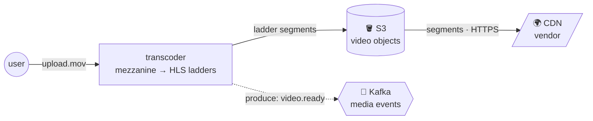
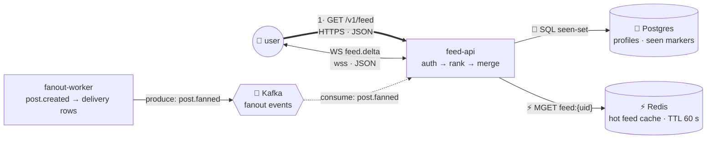

# Diagram Standard

How every Mermaid diagram in this repo is drawn. Goal: any two cases drawn by different
sessions/readers look the same, and a reader can decode an edge or a node without reading
the prose. New diagrams always follow this; existing ones are brought to it on edit.

GitHub renders Mermaid's default theme and adapts it to light/dark mode. Hard-coded
`classDef` colors break in dark mode, so **component type is encoded by shape + label +
emoji, never by color.**

## 1. Node shapes = component types

| Syntax | Shape | Meaning | Examples |
|---|---|---|---|
| `N[label]` | rectangle | a deployed unit you named (service, worker, job) | `feed-api`, `fanout-worker` |
| `N((label))` | circle | a human/actor or an unnamed client population | `user`, `moderators` |
| `N[(label)]` | cylinder | a keyed store you query by key (durable or cache) | Postgres, Redis, S3, Cassandra |
| `N{{label}}` | hexagon | an append-only topic/log you consume from | Kafka topic, Kinesis, CDC log |
| `N[[label]]` | subroutine | a stage inside one component (compile step, sandbox executor), not a deployed unit | — |
| `N[/label/]` | parallelogram | external third-party vendor you call out to | payment PSP, OAuth IdP, CDN |

Rectangle is the default. If you're unsure whether something is a store or a service, a
store answers queries by key; a service does work. Kafka is drawn as a hexagon because the
diagram sees it as a topic you produce/consume on, even though it is durable underneath. If
consumers read it as a log (consume:), draw hexagon — Kafka rule generalized; cylinder only
if every access is keyed read/put. A parallelogram is the whole external system viewed from
this diagram; its internals are never drawn. An external user calling us is a circle, not a
parallelogram.

Group things with `subgraph` only for a real boundary: region, tier, trust boundary, or a
cluster acting as one logical unit. Never group just to tidy the layout.

## 2. Icons

Icons are emoji, at the start of the label. Emoji is decoration on top of the name — the
sized label text (`Postgres`, `Kafka`) must also be present, because emoji never carries
meaning on its own.

| Component | Emoji |
|---|---|
| user / client | 🧑 |
| generic service | — |
| Postgres | 🐘 |
| MySQL | 🐬 |
| Redis | ⚡ |
| Kafka | 📨 |
| queue / bus other than Kafka | 📨 |
| wide-row store (Cassandra, Bigtable) | 🗄️ |

| Component | Emoji |
|---|---|
| Elasticsearch / search index | 🔍 |
| object storage (S3/GCS) | 🪣 |
| CDN / edge | 🌍 |
| vector database | 🧲 |
| TSDB / metrics | 📈 |
| ML model / LLM | 🧠 |
| auth / identity | 🔑 |
| coordination (ZK, etcd) | 🗝️ |
| notifications / push | 🔔 |

Infra services (LB, DNS, gateway, rate limiter) stay bare on purpose.

No emoji exists for a plain service — leave it bare. Don't invent a new one per diagram;
if a component type is missing from this table, add it here so the next case reuses it.

## 3. Labels

Format: `emoji Name<br/>what it does<br/>notes`, max two `<br/>` lines, components inside
a label separated by `·`.

```
A[feed-api<br/>auth → rank → merge]
P[(🐘 Postgres<br/>profiles · seen markers<br/>1 primary + 2 replicas)]
```

Quote any label containing `&`, `<`, `>`, or `:` — unquoted `&` can parse as a chain operator.

Transformations that happen inside a component are a `→` chain in the label body, never an
arrow in the diagram (see §5).

Node IDs: 1–4 lowercase letters, meaningful, unique within the diagram (`a` = api, `pg` =
Postgres, `k` = Kafka). IDs are scaffolding; the label is the truth.

## 4. Arrows

Flowcharts:

| Syntax | Meaning | Use for |
|---|---|---|
| `-->` | synchronous call — the caller waits | API calls, cache/store reads, RPC |
| `==>` | primary path | the one data path the case is about |
| `-.->` | asynchronous — the caller does not wait | events, queue consumption, replication, log shipping |
| `<-->` | bidirectional | long-lived connections (WebSocket, gRPC stream), mutual handshake |

- Do not use `---` (no-arrowhead) and do not use plain `A -- B -- C` chains; the only
  bidirectional arrow is `<-->`, for sessions only.
- Draw the request direction only. Don't draw the response as a second edge; a sequence
  diagram is the place for request/response pairs.
- When order matters, number the labels: `-->|"1· GET /v1/feed"|`. Number labels as `1·`
  (digit + `·`, no space), restarting per diagram, and only when a reader could misorder
  the edges.
- `<-->` marks a connection/session, never a pull/push API pair — if both directions are
  requests, draw two labeled edges or use a sequence diagram; one-way push (SSE) is `-->`.
- A `-->` edge into a store is the operation named in its label; a read-modify-write is one
  edge labeled e.g. `read+write seen-set`, response still not drawn. Cache lookups are
  `-->`, never `-.->`.
- `==>` is reserved for the primary *sync* path; a primary async path stays `-.->` (Mermaid
  has no thick-dotted arrow) and carries produce:/consume: plus, if needed, the word
  `primary` in the target node's label.

Sequence diagrams:

| Syntax | Meaning |
|---|---|
| `->>` | synchronous call |
| `-->>` | response (dashed, back) |
| `-)` | asynchronous message |

## 5. Transfer vs transformation

The diagram distinguishes the two mechanically:

- **An edge only moves data.** Its label states *what crosses*: payload, event name, or
  query. `-->|"produce: view.events"|` — not `-->|"aggregates popularity"|`.
- **A node does work.** Transformations are `in → out` chains inside the owning component's
  label: `[transcoder<br/>mezzanine → HLS ladders]`.
- An outcome or trigger is not a payload: `miss`, `hit 95%`, `push config` get rewritten as
  the data that crosses (`key lookup`, `purge list`).
- If a transformation is independently deployed, it becomes a rectangle with an
  `input → output` label, and its edges still only say what moved in and what moved out:



## 6. API edges

Every edge crossing a deploy boundary carries the contract in this order, one or two lines:

```
-->|"METHOD /path<br/>transport · format"|
-->|"gRPC GetDegree()"|
-->|"produce: event.name"|        (or consume:)
```

`-->|"MGET feed:{uid}"|` (stores: the operation + argument, e.g. `OP arg` or
`SQL <table/purpose>`; no transport line, the node shape already says it's a store).

- HTTP: `|"GET /v1/feed<br/>HTTPS · JSON"|` — method + path, then transport and body format.
- RPC: method name; each cross-boundary HTTP/RPC edge names its transport (`HTTPS · JSON`,
  `gRPC · proto`) so every edge decodes alone.
- Events: `produce:` / `consume:` + event name — the event name is the API.

Function calls inside one deploy unit are not diagrammed. An edge without a label is
allowed only between components inside one deploy boundary.

## 7. Reference example



Read it without the prose: thick arrow = the primary path; solid = sync reads; dotted =
async events; both-heads = the WS session; hexagon = the topic; cylinders = Postgres and
Redis.

## 8. One diagram, one question

- 03-architecture gets one `flowchart LR` of the request path. If a second question needs
  a second diagram (e.g. write path vs read path), draw a second diagram — don't overload
  one with numbered spaghetti.
- Sequence diagrams for interactions with failure modes or ordering questions.
- Keep diagrams under ~15 nodes; push detail into the prose instead.
- State the diagram's question as a one-line `Q:` caption directly above each mermaid
  block — if you can't write it, split the diagram.
- Sequence diagrams: humans are `actor`, failure modes go in `alt`/`opt` blocks; `->>`
  sync call, `-->>` response, `-)` async.

Component tables (`Component | Job | Key data`) are prose, not diagrams — the standard
doesn't govern them.
